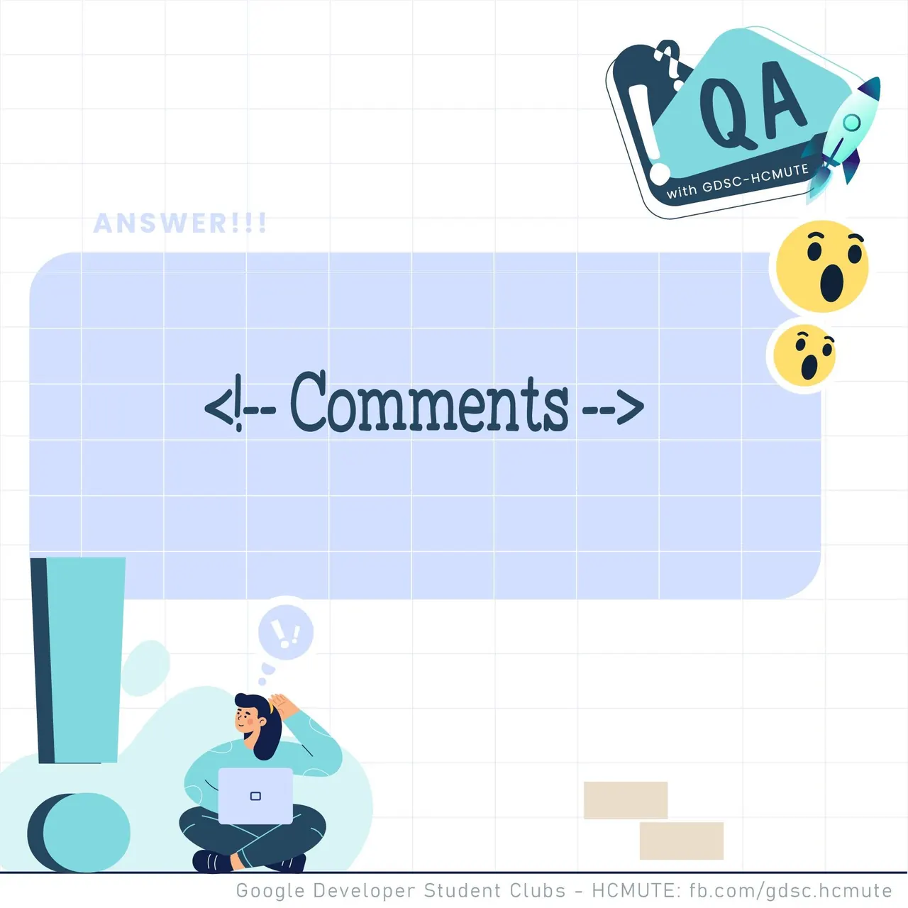

\[QA GDSC - Answer\]  
❤️ Phần Question hôm qua cũng khiến các bạn suy nghĩ nhiều rồi đúng không nè. Vậy thì không để các bạn chờ lâu nữa tụi mình sẽ đưa ra đáp án cho các bạn ngay sau đây.🙆 🏅️ Để Add một Comment trong HTML thì sẽ dùng lệnh : &lt;!--Comments--&gt; ️ 🤘 Các bạn có suy nghĩ thế nào với đáp án lần này Để lại bình luận bên dưới để Ad cũng như các bạn có thể tham khảo nha.🤘

<!--truncate-->

---------------------------  
👉QA with GDSC - HCMUTE là chuyên mục do GDSC - HCMUTE thực hiện với mong muốn cung cấp các kiến thức và thông tin hữu ích, giúp các bạn có thêm các tips thú vị trong lĩnh vực Công nghệ Thông tin thông qua Question và Answer được lên sóng hàng tuần!  
👉Mọi ý kiến đóng góp, các bạn có thể liên hệ trực tiếp thông qua fanpage Google Developer Student Clubs - HCM UTE: [https://www.facebook.com/gdsc.hcmute](https://www.facebook.com/gdsc.hcmute)
  
\#GDSC #GoogleDeveloperStudentClubs #GDSC\_HCMUTE #GDSC\_QA

---

_Bài viết được lưu trữ từ [fanpage HCMUTE Developer Student Club](https://www.facebook.com/hcmute.dsc)._
