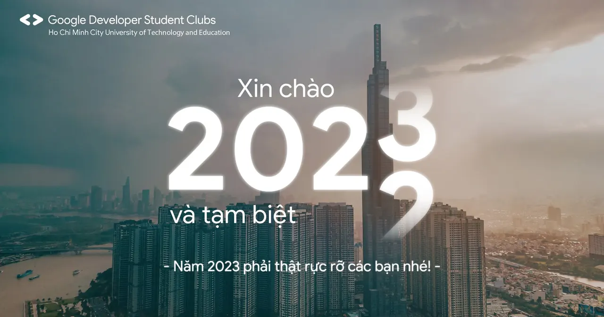

\[Xin chào 2023 và tạm biệt 2022\]  
🍃 Trang lịch cuối cùng của năm 2022 đã lật qua, lúc này, chắc hẳn ai trong chúng ta cũng đều sẽ nhìn lại những điều mình đã trải nghiệm được trong một năm.

<!--truncate-->

🌼 Các bạn còn nhớ những mục tiêu mình đề ra ở đầu năm và quyết tâm thực hiện ở năm nay không. Như là năm nay phải cùng một người đón Countdown 2023 hay trở thành một full-stack developer. Không biết các bạn đã hoàn thành chưa hay còn đang dang dở….  
🍀 Dù kết quả thế nào thì bước sang năm 2023, chúng mình mong các bạn vẫn giữ cho mình mục tiêu và kiên trì thực hiện, học thêm nhiều điều mới và phát triển những mối quan hệ xung quanh để chuẩn bị cho một năm 2023 thật rực rỡ các bạn nhé!  
🌻 Cảm ơn các bạn đã cùng đồng hành với GDSC - HCMUTE trong một năm vừa qua và chúng mình hy vọng sẽ tiếp tục nhận được sự ủng hộ và tham gia của các bạn trong những hoạt động sắp tới! Nguồn ảnh: Tron Lê  
-----------------------  
Mọi ý kiến đóng góp, các bạn có thể liên hệ trực tiếp thông qua fanpage Google Developer Student Clubs - HCM UTE: [https://www.facebook.com/gdsc.hcmute](https://www.facebook.com/gdsc.hcmute)
  
\#GDSC #GoogleDeveloperStudentClubs #GDSC\_HCMUTE

---

_Bài viết được lưu trữ từ [fanpage HCMUTE Developer Student Club](https://www.facebook.com/hcmute.dsc)._
