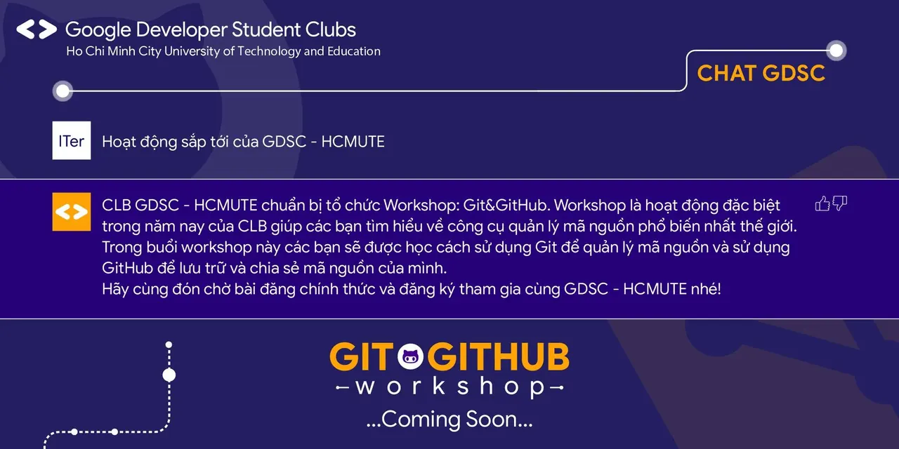

\[WORKSHOP: GIT&GITHUB | KICKOFF\]  
🤘Bổ quả dừa ChatGDSC thấy vẫn còn nhiều bạn chưa biết Git và GitHub. Đúng nhận sai cãi giúp Chat 👉 Chat thấy các bạn có thể tham gia Workshop: Git&GitHub do CLB GDSC - HCMUTE sắp tới tổ chức để có thể học hỏi cách quản lý mã nguồn của mình ✌️Hãy cùng đón chờ bài đăng ký chính thức từ GDSC - HCMUTE nhaa #WorkshopGit\_GitHub #Comingsoon

<!--truncate-->

-----------------------  
Mọi ý kiến đóng góp, các bạn có thể liên hệ trực tiếp thông qua fanpage Google Developer Student Clubs - HCM UTE: [https://www.facebook.com/gdsc.hcmute](https://www.facebook.com/gdsc.hcmute)
  
\#GDSC #GoogleDeveloperStudentClubs #GDSC\_HCMUTE

---

_Bài viết được lưu trữ từ [fanpage HCMUTE Developer Student Club](https://www.facebook.com/hcmute.dsc)._
