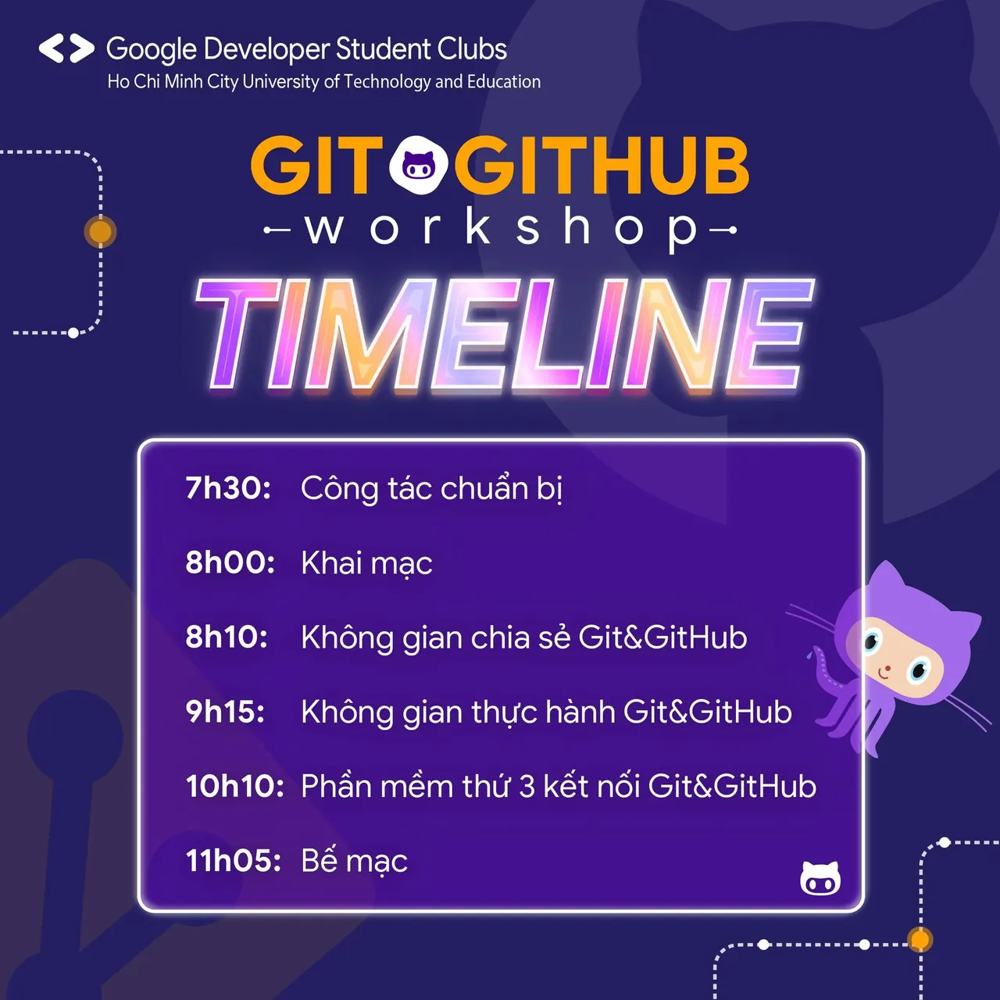

\[WORKSHOP: GIT&GITHUB | TIMELINE\]  
📣 Cốc cốc 📣 👉👉 Vậy là chỉ còn vài ngày nữa là Workshop: Git&GitHub chính thức diễn ra hứa hẹn sẽ đem đến cho các bạn những kiến thức bổ ích về cách quản lý mã nguồn. Và không để các bạn chờ đợi lâu, chúng mình xin thông báo về lịch trình của buổi Workshop với không gian chia sẻ và không gian thực hành vô cùng hấp dẫn. Hãy cùng chúng mình cập nhật lịch trình ngay nhé:

<!--truncate-->

✅ 7g30: Công tác chuẩn bị ✅ 8g00: Khai mạc ✅ 8g10: Không gian chia sẻ Git&GitHub ✅ 9g15: Không gian thực hành Git&GitHub ✅ 10g10: Phần mềm thứ 3 kết nối Git&GitHub ✅ 11g05: Bế Mạc 😊😊 Các bạn có cảm thấy háo hức không nào Hẹn gặp các bạn ở buổi Workshop chính thức nhaa!  
\_\_\_\_\_\_\_\_\_\_\_\_\_\_\_\_\_\_\_\_\_\_\_\_\_\_\_\_\_\_\_\_\_\_\_\_\_\_\_\_\_\_\_\_\_\_\_\_\_\_\_\_\_\_\_\_\_\_  
📅📅 Thời gian: 8g00 ngày 18/02/2023 🏢🏢 Địa điểm: Phòng A4.302 - Đại học Sư phạm Kỹ thuật TP.HCM ❤️❤️ Quyền lợi: Sau khi kết thúc chương trình, sinh viên tham gia hoàn thành bài thu hoạch sẽ được cộng điểm rèn luyện theo quy định của nhà trường. #WorkshopGit\_GitHub  
---------------------------  
Mọi ý kiến đóng góp, các bạn có thể liên hệ trực tiếp thông qua fanpage Google Developer Student Clubs - HCM UTE: [https://www.facebook.com/gdsc.hcmute](https://www.facebook.com/gdsc.hcmute)
  
\#GDSC #GoogleDeveloperStudentClubs #GDSC\_HCMUTE

---

_Bài viết được lưu trữ từ [fanpage HCMUTE Developer Student Club](https://www.facebook.com/hcmute.dsc)._
