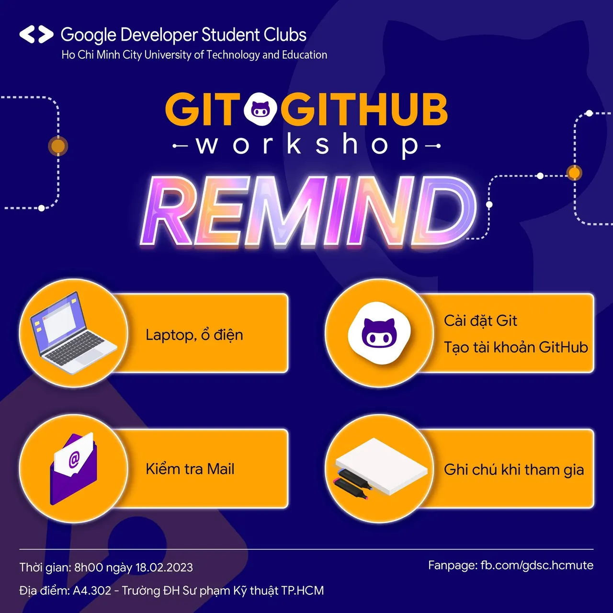

\[WORKSHOP: GIT&GITHUB | REMIND\] ⁉️ LÀM THẾ NÀO ĐỂ THAM GIA WORKSHOP HIỆU QUẢ ⁉️ 🕗🕗 Vậy là Workshop: Git&GitHub sẽ chính thức diễn ra vào ngày mai. Chương trình dự kiến bắt đầu từ lúc 7g30 đến 11g05 nên các bạn hãy ăn sáng đầy đủ để bổ sung cho mình một năng lượng thật tốt khi tham gia nhé. Các bạn đã chuẩn bị sẵn tinh thần và những thắc mắc cần được các diễn giả giải đáp chưa nào  
📧📧 Các bạn đăng ký thành công đừng quên kiểm tra Email để nắm được thông tin của buổi Workshop nhé! Nếu không thấy, các bạn có thể tìm trong mục thư Spam và nếu vẫn chưa nhận được thư mời thì hãy liên hệ ngay Fanpage để chúng mình có thể hỗ trợ kịp thời nhaa 🔴🔴 Thêm một vài lưu ý nhỏ, các bạn đừng quên chuẩn bị trước khi tham gia buổi Workshop là đem theo laptop cùng ổ điện, cài đặt Git ([https://git-scm.com/](https://git-scm.com/)) và tạo tài khoản GitHub ([https://github.com/](https://github.com/)) để cùng thực hành với diễn giả luôn nha. Và cũng đừng quên ghi chú những từ khóa hay những ý quan trọng mà diễn giả sẽ đề cập tới vì chúng có thể sẽ giúp ích cho các bạn đấy nhé!

<!--truncate-->

🙆🙆 Tham dự đúng giờ và hy vọng các bạn sẽ có những trải nghiệm thú vị nhaa!  
\_\_\_\_\_\_\_\_\_\_\_\_\_\_\_\_\_\_\_\_\_\_\_\_\_\_\_\_\_\_\_\_\_\_\_\_\_\_\_\_\_\_\_\_\_\_\_\_\_\_\_\_\_\_\_\_\_\_  
📅📅 Thời gian: 8g00 ngày 18/02/2023 🏢🏢 Địa điểm: Phòng A4.302 - Đại học Sư phạm Kỹ thuật TP.HCM ❤️❤️ Quyền lợi: Sau khi kết thúc chương trình, sinh viên tham gia hoàn thành bài thu hoạch sẽ được cộng điểm rèn luyện theo quy định của nhà trường. #WorkshopGit\_GitHub  
---------------------------  
Mọi ý kiến đóng góp, các bạn có thể liên hệ trực tiếp thông qua fanpage Google Developer Student Clubs - HCM UTE: [https://www.facebook.com/gdsc.hcmute](https://www.facebook.com/gdsc.hcmute)
  
\#GDSC #GoogleDeveloperStudentClubs #GDSC\_HCMUTE

---

_Bài viết được lưu trữ từ [fanpage HCMUTE Developer Student Club](https://www.facebook.com/hcmute.dsc)._
