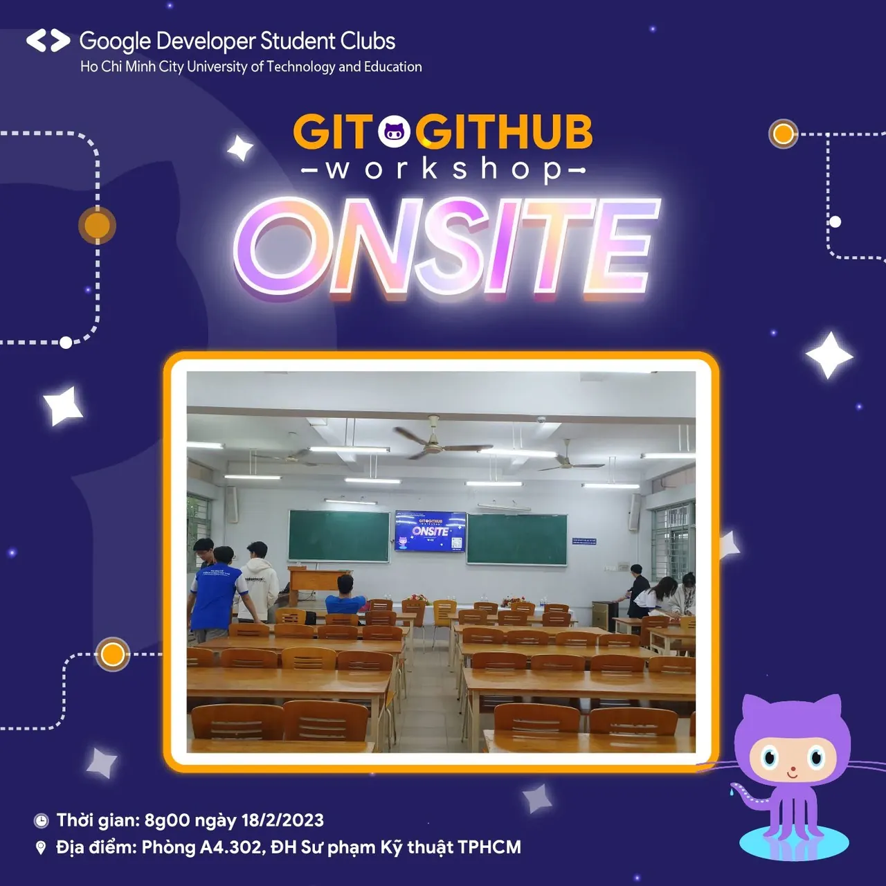

\[WORKSHOP: GIT&GITHUB | ONSITE\]
  
3️⃣ 2️⃣ 1️⃣

<!--truncate-->

❤️❤️ Sau bao ngày chuẩn bị và chờ đợi, Workshop: Git&GitHub đang chính thức diễn ra. Chúng mình đang rất háo hức chờ đợi các bạn để đến với buổi Workshop hôm nay.
  
👉👉 Còn chần chờ gì nữa mà không đến check-in ngay thôi nào??  
\_\_\_\_\_\_\_\_\_\_\_\_\_\_\_\_\_\_\_\_\_\_\_\_\_\_\_\_\_\_\_\_\_\_\_\_\_\_\_\_\_\_\_\_\_\_\_\_\_\_\_\_\_\_\_\_\_\_  
📅📅 Thời gian: 8g00 ngày 18/02/2023  
🏢🏢 Địa điểm: Phòng A4.302 - Đại học Sư phạm Kỹ thuật TP.HCM  
❤️❤️ Quyền lợi: Sau khi kết thúc chương trình, sinh viên tham gia hoàn thành bài thu hoạch sẽ được cộng điểm rèn luyện theo quy định của nhà trường.  
\#WorkshopGit\_GitHub  
---------------------------  
Mọi ý kiến đóng góp, các bạn có thể liên hệ trực tiếp thông qua fanpage Google Developer Student Clubs - HCM UTE: [https://www.facebook.com/gdsc.hcmute](https://www.facebook.com/gdsc.hcmute)  
\#GDSC #GoogleDeveloperStudentClubs #GDSC\_HCMUTE

---

_Bài viết được lưu trữ từ [fanpage HCMUTE Developer Student Club](https://www.facebook.com/hcmute.dsc)._
