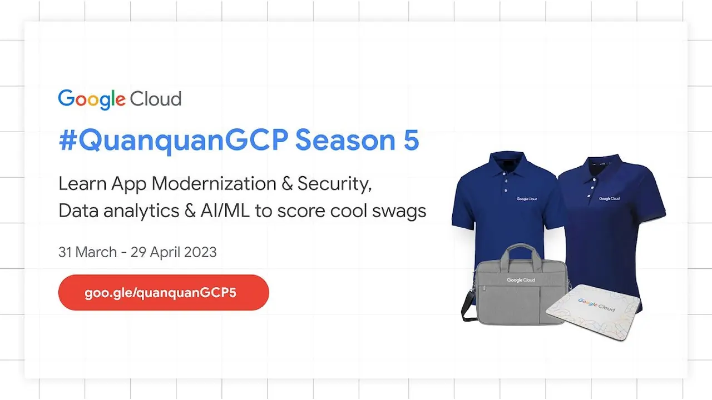

Chương trình học miễn phí #QuanquanGCP mùa 5 đã trở lại!  
Sau 4 mùa thành công cùng sự tham gia của hơn 6000 lập trình viên trên toàn quốc, #QuanQuanGCP mùa 5 đã quay trở lại với 30 ngày học tập, nâng cấp sự nghiệp với cơ hội sở hữu chứng chỉ Google Cloud.

<!--truncate-->

Chi tiết xem tại website: [http://goo.gle/quanquanGCP5](http://goo.gle/quanquanGCP5)  
—-----------------------------------------------------------------------------------  
QuanQuanGCP là một chương trình tự học trực tuyến của Google nhằm cung cấp cho các lập trình viên ở Việt Nam cơ hội tiếp cận và khuyến khích học tập với các Google Cloud labs thực tế cùng với cộng đồng lập trình viên đầy nhiệt huyết. Tham gia Quán Quân GCP Mùa 5, bạn có:  
✅ 30 ngày học tập miễn phí trên nền tảng Google Cloud Skills Boost  
✅ 30+ quests và khóa học chuyên môn hóa về App Modernization & Security và Data Analytics & AI/ML App Modernization  
✅ 7 quests trong tay, nhận ngay quà khủng  
✅ 10+ Mentors và Facilitators hỗ trợ trực tiếp trong quá trình tham gia học  
✅ Kết nối và chia sẻ với Cộng đồng hỗ trợ Cloud tại Việt Nam  
✅ Quà tặng hấp dẫn nhất từ trước đến nay gồm: 1 Áo Polo Shirt, Balo Laptop, Lót chuột.  
⏰ Thời gian tham gia: 31/03 - 29/04  
👉 Còn chờ gì nữa, tham gia học và rinh quà khủng tại: goo.gle/quanquanGCP5-reg  
Đừng quên chia sẻ chương trình và sử dụng hastag #QuanQuanGCP5 để giới thiệu đến bạn bè cùng tham gia!  
—----------------------------------------  
Theo dõi ngay Slack của GDG Cloud Vietnam để được hỗ trợ: [https://gdgcloudvietnam-slack.herokuapp.com/](https://gdgcloudvietnam-slack.herokuapp.com/)

---

_Bài viết được lưu trữ từ [fanpage HCMUTE Developer Student Club](https://www.facebook.com/hcmute.dsc)._
