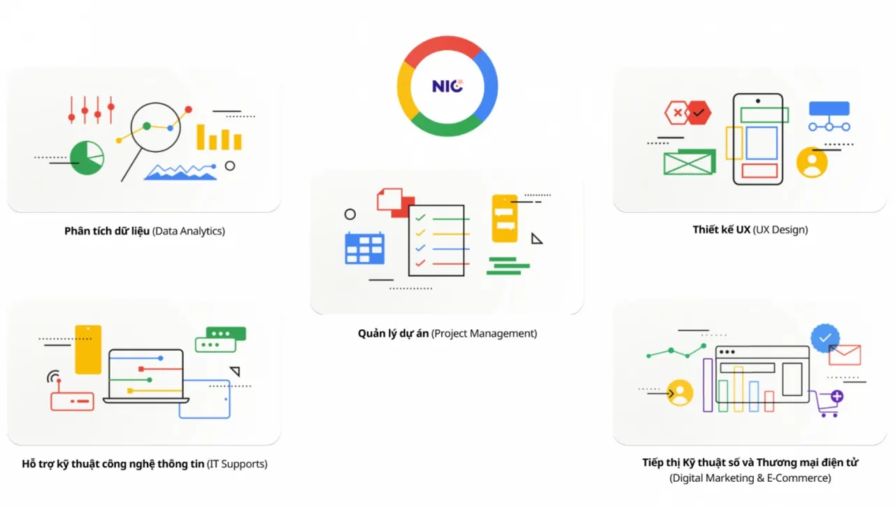

\[HỌC BỔNG PHÁT TRIỂN NHÂN TÀI SỐ\]  
6000 học bổng khóa học của Google trên Coursera cho sinh viên năm 3,4.

<!--truncate-->

Với sự bảo trợ của Trung tâm Đổi mới sáng tạo Quốc gia (NIC) - Bộ Kế hoạch và Đầu tư, Google cam kết tài trợ miễn phí chương trình học bổng trị giá 168 USD/suất cho tổng số 6.000 học viên trên toàn quốc tham gia học tập trực tuyến một số khóa học do Google thiết kế, đào tạo trên hệ thống Coursera. Học viên hoàn thành khoá học sẽ nhận được chứng nhận của Google và một số ưu đãi khác đến từ Google.  
6 khóa học của Chương trình bao gồm: Phân tích dữ liệu (Data Analytics), Hỗ trợ kỹ thuật công nghệ thông tin (IT Supports), Quản lý dự án (Project Management), Thiết kế trải nghiệm người dùng (UX Design), Tiếp thị kỹ thuật số và Thương mại điện tử (Digital marketing and E-commerce). Các khoá học được học bằng Tiếng Anh, riêng khoá Hỗ trợ Công nghệ thông tin và khoá Phân tích dữ liệu sẽ có tài liệu bổ trợ bằng tiếng Việt. Thông tin chi tiết xin xem tại trang chủ của Chương trình: Nhân tài số  
Link đăng ký: [https://link.gdsc.app/GCC-2023](https://link.gdsc.app/GCC-2023)  
Đối tượng: Sinh viên năm cuối và năm thứ 3 tại các Trường Đại học, Cao đẳng trên toàn quốc  
Hạn đăng ký nhận học bổng: 15/4/2023  
Lưu ý:  
\- Hạn kết thúc tất cả các khoá học: 31/12/2023  
\- Các học viên sau khi nhận được thư mời/bắt đầu học, nếu ngừng học/không học trên 30 ngày sẽ bị thu hồi học bổng  
\- Trong vòng 30 ngày kể từ lúc đăng ký, nếu học viên thoả mãn các yêu cầu của chương trình và còn đủ số lượng học bổng, học viên sẽ nhận được thư mời học (gửi từ hệ thống của Coursera) đến học viên.

---

_Bài viết được lưu trữ từ [fanpage HCMUTE Developer Student Club](https://www.facebook.com/hcmute.dsc)._
