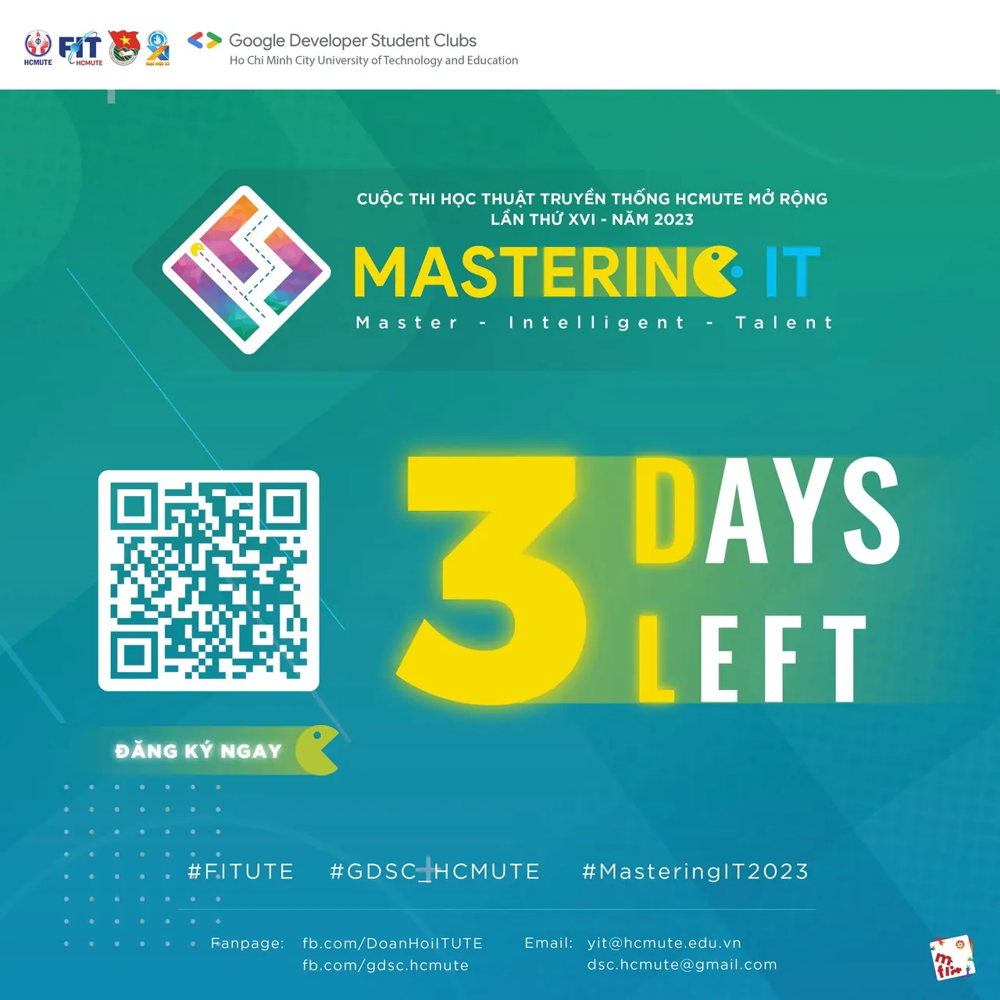

🌟 CHỈ CÒN 3 NGÀY ĐĂNG KÝ CUỘC THI HỌC THUẬT “MASTERING IT 2023”  
🌟 🔥 “Nóng như cái lò, nóng nóng nóng như cái lò”

<!--truncate-->

🔥 🥲🥲 Sài Gòn dạo này quá là nóng luôn á 😉😉 Những mà sao nóng như cuộc thi học thuật truyền thống Mastering IT 2023 được 👉👉 Thế bạn có muốn cùng tụi mình bùng cháy không?  
💫 Chỉ còn 3 ngày nữa, cuộc thi học thuật truyền thống MASTERING IT 2023 sẽ đóng cổng đăng ký. Nếu bạn đã sẵn sàng đánh bại mọi thử thách, vậy còn chần chờ gì nữa mà không tìm kiếm đồng đội và giành ngay giải thưởng nào.  
💫  
\_\_\_\_\_\_\_\_\_\_\_\_\_\_\_\_\_\_\_\_\_\_\_\_\_\_\_\_\_\_\_\_\_\_\_\_\_\_\_\_\_\_\_\_  
🤖 ĐỐI TƯỢNG THAM GIA: Sinh viên đang theo học các khối ngành Công nghệ Thông tin hoặc sinh viên đam mê lĩnh vực tin học, lập trình, công nghệ,... thuộc các trường Đại học, Cao đẳng trên địa bàn TP.HCM.  
📌CÁCH THỨC ĐĂNG KÝ: Mỗi đội thi gồm 05 thành viên (trong đó bắt buộc phải có ít nhất 01 thành viên biết lập trình C/C++ cơ bản) đến từ cùng một trường hoặc có thể liên kết nhiều trường tham gia.  
🚨Lưu ý: Những thành viên trong Ban tổ chức và các bạn làm công tác liên quan đến đề thi không được tham gia cuộc thi.  
⏰ THỜI GIAN ĐĂNG KÝ: Từ ngày 28/04/2023 – 12/05/2023. Link đăng ký: [https://itute.tiny.us/DKMIT-2023](https://itute.tiny.us/DKMIT-2023) Thể lệ cuộc thi: [https://itute.tiny.us/THELEMIT-2023](https://itute.tiny.us/THELEMIT-2023)  
\_\_\_\_\_\_\_\_\_\_\_\_\_\_\_\_\_\_\_\_\_\_\_\_\_\_\_\_\_\_\_\_\_\_\_\_\_\_\_\_\_\_\_\_  
💻HÌNH THỨC THI:  
📌Vòng sơ loại: 13h00, ngày 14/5/2023 (Chủ nhật). - Địa điểm: Phòng máy Tòa nhà Trung tâm - Trường Đại học Sư phạm Kỹ thuật TP.HCM. - Nội dung: Các đội thi phải có mặt đầy đủ 05 thành viên và đúng giờ theo quy định của Ban tổ chức. Mỗi thành viên sẽ phải trả lời trực tiếp trên máy tính 25 câu hỏi dạng trắc nghiệm với 04 phương án (A, B, C, D) trong vòng 30 phút. - Sau vòng sơ loại, tổng điểm của 05 thành viên sẽ là điểm của đội thi. Ban tổ chức sẽ chọn ra 05 đội thi xuất sắc nhất ở mỗi trường sẽ lọt vào vòng chung kết xếp hạng.  
📌Vòng chung kết: 08h00, ngày 16/6/2023 (Thứ 6). - Địa điểm: Hội trường lớn Khu A - Trường Đại học Sư phạm Kỹ thuật TP.HCM. - Nội dung: 05 đội thi được chọn ở vòng sơ loại sẽ tiếp tục tranh tài với 05 phần thi lần lượt là Khởi động, Kết nối, Tăng tốc, Lập trình tiếp sức và Về đích. - Trải qua 04 phần thi: Khởi động, Kết nối, Tăng tốc và Lập trình tiếp sức, Top 03 đội thi có tổng điểm cao nhất sẽ tiếp tục đi đến phần thi cuối cùng - Về đích - để chọn ra quán quân của cuộc thi.  
\_\_\_\_\_\_\_\_\_\_\_\_\_\_\_\_\_\_\_\_\_\_\_\_\_\_\_\_\_\_\_\_\_\_\_\_\_\_\_\_\_\_\_\_  
🎀CƠ CẤU GIẢI THƯỞNG:  
🥇 01 Giải Nhất: 5.000.000 đồng, cúp lưu niệm và hoa tươi 🥈 01 Giải Nhì: 3.000.000 đồng, cúp lưu niệm và hoa tươi 🥉 01 Giải Ba: 2.000.000 đồng, cúp lưu niệm và hoa tươi 🏅 02 Giải Khuyến khích: mỗi giải 1.000.000 đồng, cúp lưu niệm và hoa tươi 🎖️ 01 Giải Video giới thiệu đội ấn tượng nhất: 1.000.000 đồng, cúp lưu niệm và hoa tươi 🎁QUYỀN LỢI: - Được cộng điểm rèn luyện theo quy định của nhà trường. (Đối với sinh viên tham gia là sinh viên của Trường Đại học Sư phạm Kỹ Thuật TP.HCM). - Được BTC cấp giấy chứng nhận tham gia cuộc thi học thuật cấp trường khi thí sinh yêu cầu.  
🥰 Đừng quên Like + Follow fanpage và kênh Tik Tok chính thức của Đoàn - Hội Khoa Công nghệ Thông tin - Trường ĐH Sư phạm Kỹ thuật TP.HCM để cập nhật những thông tin mới nhất về cuộc thi nhé!  
✅ Fanpage Đoàn – Hội Khoa Công Nghệ Thông Tin – ĐH Sư Phạm Kỹ Thuật TP.HCM (Đoàn - Hội Khoa Công Nghệ Thông Tin - ĐH Sư phạm Kỹ thuật TP.HCM)  
✅ Fanpage Google Developer Student Clubs – HCM UTE (Google Developer Student Clubs - HCM UTE)  
✅ Kênh TikTok chính thức (tiktok.com/@yit\_hcmute)  
\_\_\_\_\_\_\_\_\_\_\_\_\_\_\_\_\_\_\_\_\_\_\_\_\_\_\_\_\_\_\_\_\_\_\_\_\_\_\_\_\_\_\_\_  
💫 Cuộc thi học thuật “Mastering IT” được biết đến là cuộc thi học thuật truyền thống của Khoa Công nghệ Thông tin - Trường ĐH Sư phạm Kỹ thuật TP.HCM, các câu hỏi được xây dựng xoay quanh các kiến thức về lập trình, mạng, internet, thuật toán, máy tính, tin học văn phòng, xu hướng công nghệ, an toàn thông tin, chuyển đổi số, ứng dụng trí tuệ nhân tạo và các kiến thức xã hội liên quan đến lĩnh vực Công nghệ Thông tin, Kỹ thuật dữ liệu, Kỹ thuật máy tính.  
💫 Cuộc thi học thuật “Mastering IT” lần thứ XVI, Năm 2023 được tổ chức với quy mô cấp trường mở rộng là nơi để sinh viên tham gia, thể hiện và phát huy kiến thức về các lĩnh vực Công nghệ Thông tin.  
\_\_\_\_\_\_\_\_\_\_\_\_\_\_\_\_\_\_\_\_\_\_\_\_\_\_\_\_\_\_\_\_\_\_\_\_\_\_\_\_\_\_\_\_  
📬Mọi thắc mắc, xin vui lòng liên hệ:  
👦 Đ/c Phạm Đăng Khoa - Phó Bí thư Đoàn khoa CNTT - Phó BTC 🔖SĐT 🔖Fb: [https://www.facebook.com/phamPha01100](https://www.facebook.com/phamPha01100) 👦 Đ/c Vi Quốc Thuận - UV.BCH LCH khoa CNTT- Phó BTC 🔖SĐT 🔖Fb: [https://www.facebook.com/viquoc.thuan](https://www.facebook.com/viquoc.thuan)
  
\#FITUTE #GDSC\_HCMUTE #ITUTE\_MasteringIT2023

---

_Bài viết được lưu trữ từ [fanpage HCMUTE Developer Student Club](https://www.facebook.com/hcmute.dsc)._
