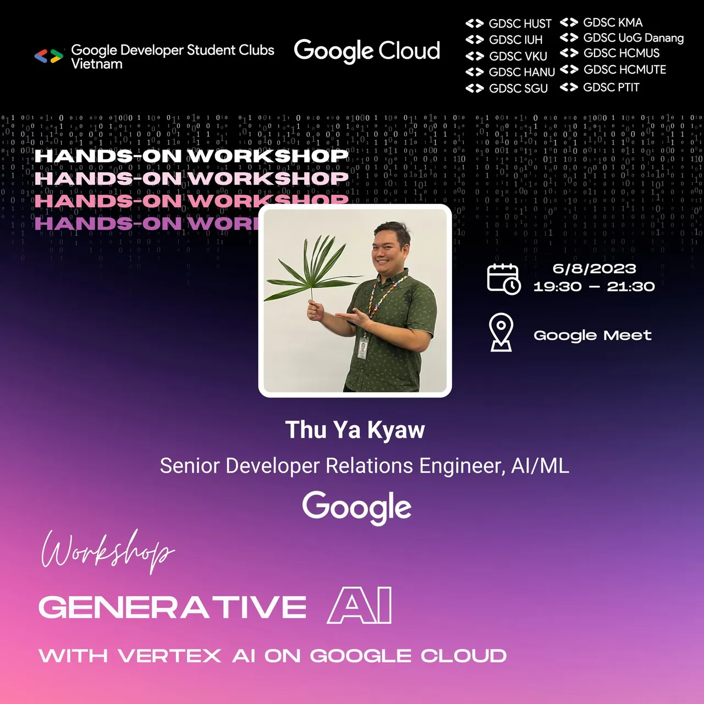

Workshop: Generative AI with Vertex AI on Google Cloud \[English Content below\]  
☁️ Trong workshop này, chúng ta sẽ cùng nhau tìm hiểu về những kiến thức cơ bản của Generative AI, bao gồm cách thức hoạt động, ứng dụng và tương lai của công nghệ này. Bạn cũng sẽ được thực hành với API PaLM 2 trên Vertex AI của Google Cloud. Diễn giả Thu Ya Kyaw đến từ Google sẽ chia sẻ các khái niệm như kỹ thuật prompt engineering, zero-shot prompting….

<!--truncate-->

👉 Workshop này phù hợp cho tất cả mọi người, những ai quan tâm đến việc tìm hiểu thêm về Generative AI, không yêu cầu kinh nghiệm hay bạn phải có kiến thức về AI để tham dự. Tất cả đều có thể tham gia bằng cách đăng ký (miễn phí) tại đây: [https://forms.gle/LgHFe5cX6QtWBhyL9](https://forms.gle/LgHFe5cX6QtWBhyL9) Thời gian: 6/8/2023 - 19:30 to 21:30 (GMT+7), Google Meet sẽ được gửi đến email của bạn. Workshop: Generative AI with Vertex AI on Google Cloud ☁️ In this workshop, you will learn about the basics of generative AI, including how it works, its applications, and its future. You will also have the opportunity to get hands-on experience with PaLM 2 API through Vertex AI from Google Cloud. Speaker Thu Ya Kyaw from Google will also cover concepts like prompt engineering, zero-shot prompting, and so on. This workshop is perfect for anyone who is interested in learning more about generative AI, regardless of their level of experience.  
👉 Although it’s helpful, you do not need to be a machine learning expert to attend this workshop. Register (totally free): [https://forms.gle/LgHFe5cX6QtWBhyL9](https://forms.gle/LgHFe5cX6QtWBhyL9) Time: 6/8/2023 - 19:30 to 21:30 (GMT+7), Google Meet will be sent to your email. Organizers: Google Developer Student Clubs Vietnam  Google Cloud Speaker: Thu Ya Kyaw - Senior Developer Relations Engineer, AI/ML @Google
  
\#GDSC #GoogleDeveloperStudentClubs #GDSC\_HCMUTE

---

_Bài viết được lưu trữ từ [fanpage HCMUTE Developer Student Club](https://www.facebook.com/hcmute.dsc)._
