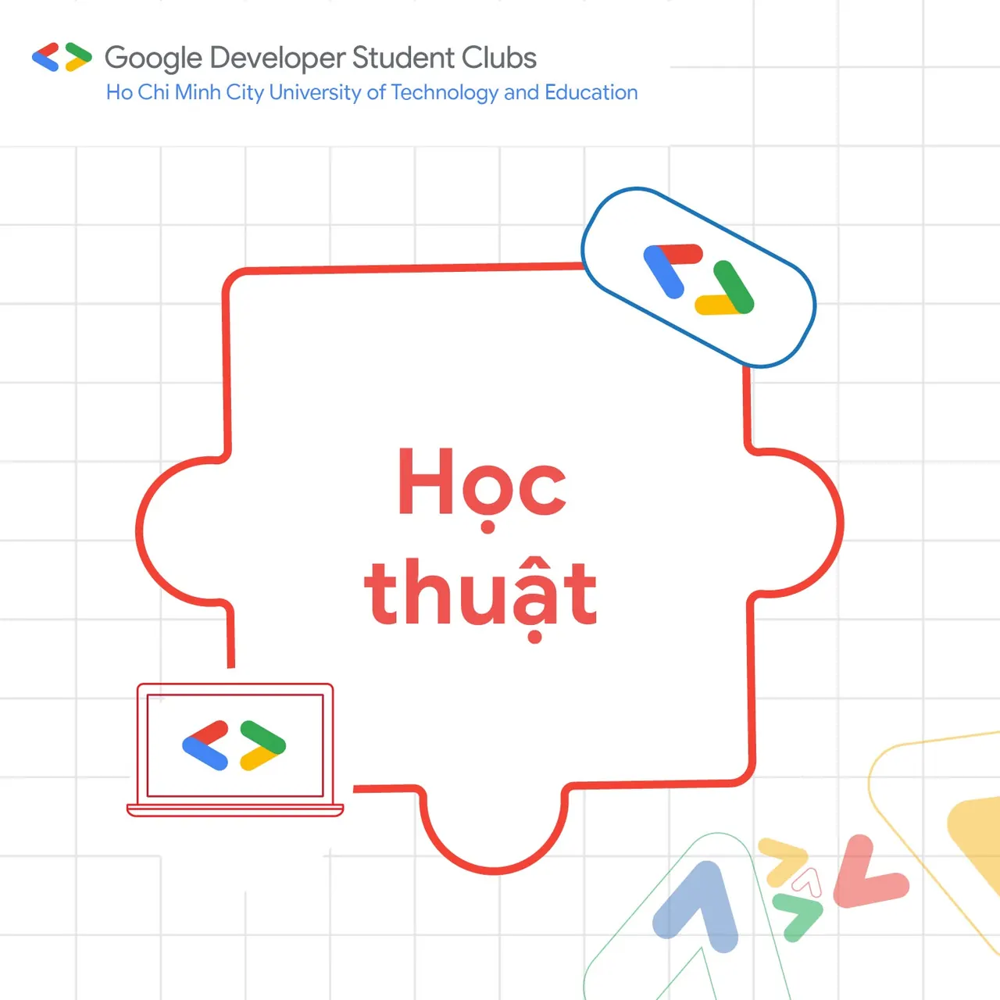
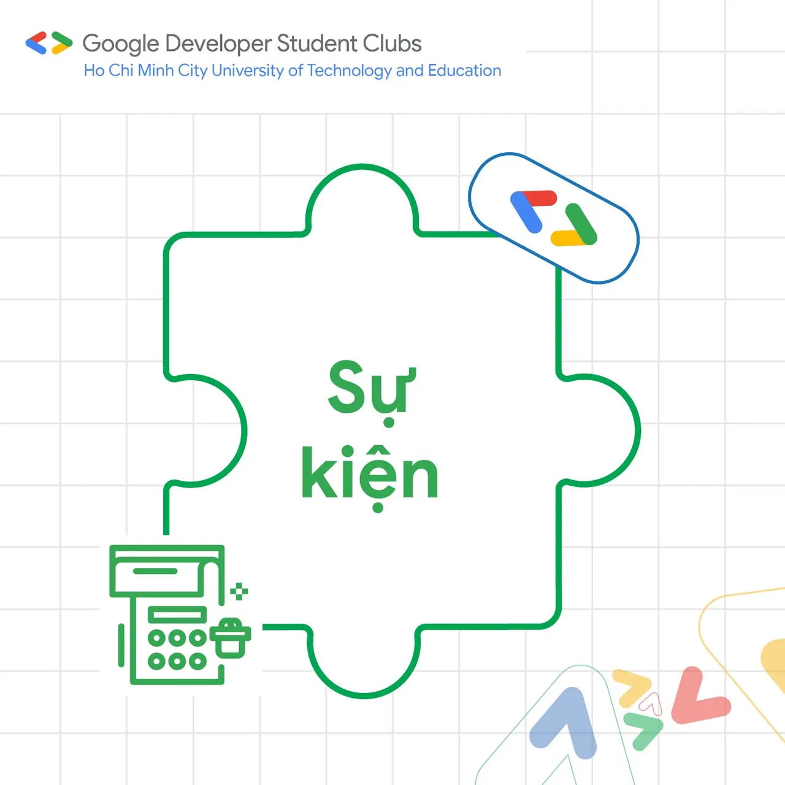
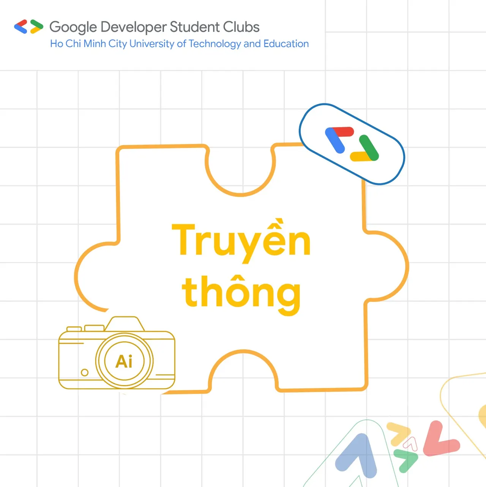
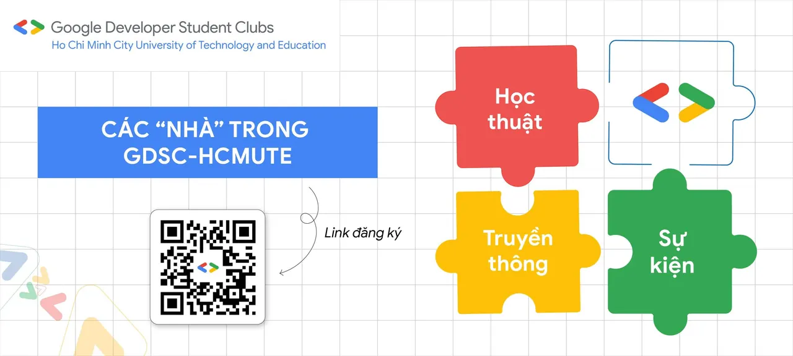

\[GIỚI THIỆU CÁC BAN | TUYỂN THÀNH VIÊN ĐỢT 4 GDSC-HCMUTE\]  
📍 Link đăng ký: [https://forms.gle/iajZEMcm5py67GbR6](https://forms.gle/iajZEMcm5py67GbR6) 📅 Thời gian:

<!--truncate-->

️từ ngày 0️⃣9️⃣. 1️⃣0️⃣ đến hết ngày 1️⃣5️⃣.1️⃣0️⃣ 🙆 Đối tượng: Sinh viên thuộc các trường Đại học, Cao đẳng trên thành phố Hồ Chí Minh  
—---------------------------------------------------------------  
🤔🤔 “Liệu rằng GDSC-HCMUTE sẽ hoạt động như thế nào nhỉ Không biết liệu mình có thể phù hợp với ban nào trong CLB hong ta?”  
🤙 Có bạn nào có cùng câu hỏi này hong nhỉ, hãy cùng chúng mình khám phá từng “nhà” trong GDSC-HCMUTE thông qua những tấm hình bên dưới nhé!!  
👐 Hy vọng rằng qua bài này, các bạn sẽ có thể hiểu thêm về GDSC-HCMUTE và tự tin đăng ký ứng tuyển nhé!!!!  
⌛ Và chỉ còn 4 ngày nữa là đơn đăng ký sẽ đóng nên hãy nhanh tay đăng ký ngay thôi!!!  
-----------------------  
Mọi ý kiến đóng góp, các bạn có thể liên hệ trực tiếp thông qua fanpage Google Developer Student Clubs - HCM UTE: [https://www.facebook.com/gdsc.hcmute](https://www.facebook.com/gdsc.hcmute)
  
\#GDSC #GoogleDeveloperStudentClubs #GDSC\_HCMUTE #gdschcmute\_mems\_gen4 #gdschcmute\_recruitment

---

_Bài viết được lưu trữ từ [fanpage HCMUTE Developer Student Club](https://www.facebook.com/hcmute.dsc)._
