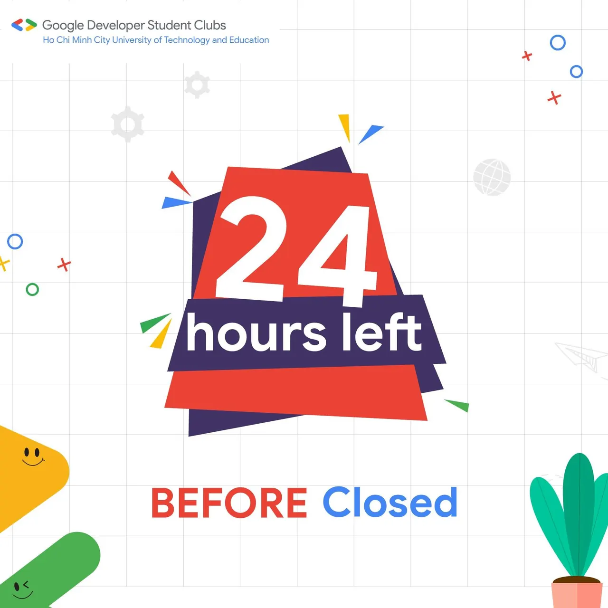

📢📢\[CHỈ CÒN 24H ĐỂ ĐĂNG KÝ ỨNG TUYỂN THÀNH VIÊN GDSC-HCMUTE ĐỢT 4\]
  
⏳⏳Tíc tắc tíc tắc…

<!--truncate-->

Vậy là gần 1 tuần mở cổng đăng ký, ngôi nhà GDSC-HCMUTE đã nhận được rất nhiều tín hiệu từ các bạn trẻ nhiệt huyết. Trong suốt thời gian qua, chúng mình rất vui và muốn gửi lời cảm ơn những bạn đã chọn CLB là sân chơi để thể hiện ngọn lửa đam mê bùng cháy của mình. Đến nay, CLB xin thông báo:
  
🔔Link đăng ký ứng tuyển tham gia Google Developer Student Clubs - HCMUTE đợt 4 này SẼ CHÍNH THỨC ĐÓNG LẠI SAU 1 NGÀY NỮA.
  
Thế nên đừng phân vân, do dự, chần chừ nữa… Mà hãy nhanh tay đăng ký ứng tuyển đi nào các bạn ơi!!!
  
📌Bấm vào link dưới đây, điền thông tin và tham gia Tuyển thành viên đợt 4 để trở thành thành viên của gia đình GDSC-HCMUTE chúng mình nào.
  
👉Link đăng ký: [https://forms.gle/iajZEMcm5py67GbR6](https://forms.gle/iajZEMcm5py67GbR6)  
🗓️Thời gian: ️từ ngày 9/10/2023 đến hết ngày 15/10/2023
  
🙆🙆‍♀️Đối tượng: Sinh viên thuộc các trường Đại học, Cao đẳng trên thành phố Hồ Chí Minh  
===========================  
🤘Bạn đã sẵn sàng nắm bắt những cơ hội mới 🤘  
👉 Và cơ hội nằm ngay tại đây, đăng ký trở thành Thành viên của Google Developer Student Clubs - HCMUTE các bạn sẽ:  
 ️🏅 Truy cập vào tài nguyên của nhà phát triển Google  
 ️🏅 Học hỏi và chia sẻ những kiến thức về công nghệ  
 ️🏅 Kết nối với các bạn đến từ các ngành và các trường đại học khác nhau  
 ️🏅 Áp dụng kiến thức thông qua việc xây dựng những sản phẩm giải quyết những vấn đề trong cuộc sống.  
👉Các vị trí ứng tuyển:  
 💻 Ban học thuật: Phát triển ứng dụng, chia sẻ kiến thức, đảm bảo nội dung về công nghệ cho các chương trình và sự kiện.  
 🖱 Ban truyền thông: Quản lý fanpage, thiết kế ấn phẩm, chỉnh sửa video, nhiếp ảnh và tạo nội dung cho các bài đăng.  
 ⌨ Ban sự kiện: Tham gia tổ chức sự kiện, MC, viết kịch bản chương trình.  
👉 Để tìm hiểu thêm về GDSC và GDSC - HCMUTE, các bạn có thể tham khảo tại: [https://furl.one/gdschcmute23](https://furl.one/gdschcmute23)  
💌 Hãy nhanh tay ứng tuyển để cùng GDSC-HCMUTE tham gia các hoạt động thú vị sắp tới các bạn nhớ!!!!  💌  
===============================  
Mọi ý kiến đóng góp, các bạn có thể liên hệ trực tiếp thông qua fanpage Google Developer Student Clubs - HCM UTE: [https://www.facebook.com/gdsc.hcmute](https://www.facebook.com/gdsc.hcmute)  
\#GDSC #GoogleDeveloperStudentClubs #GDSC\_HCMUTE #gdschcmute\_mems\_gen4  #gdschcmute\_recruitment

---

_Bài viết được lưu trữ từ [fanpage HCMUTE Developer Student Club](https://www.facebook.com/hcmute.dsc)._
