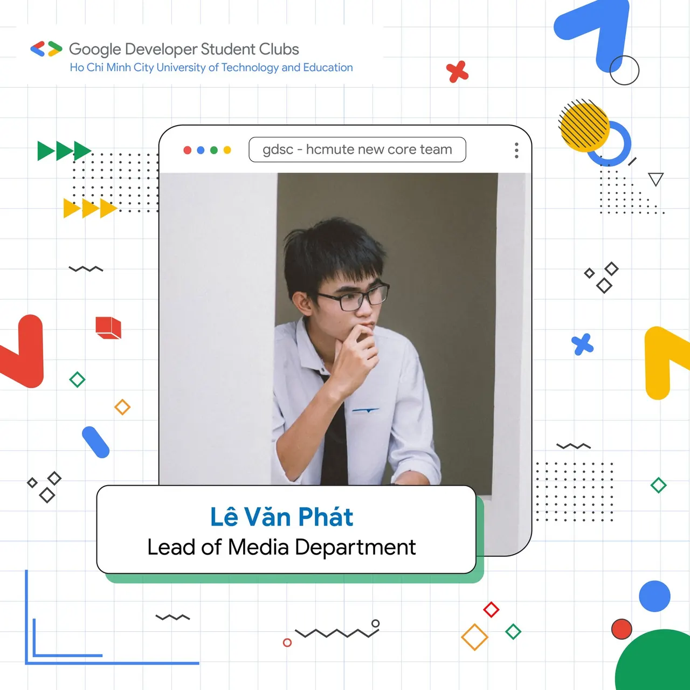
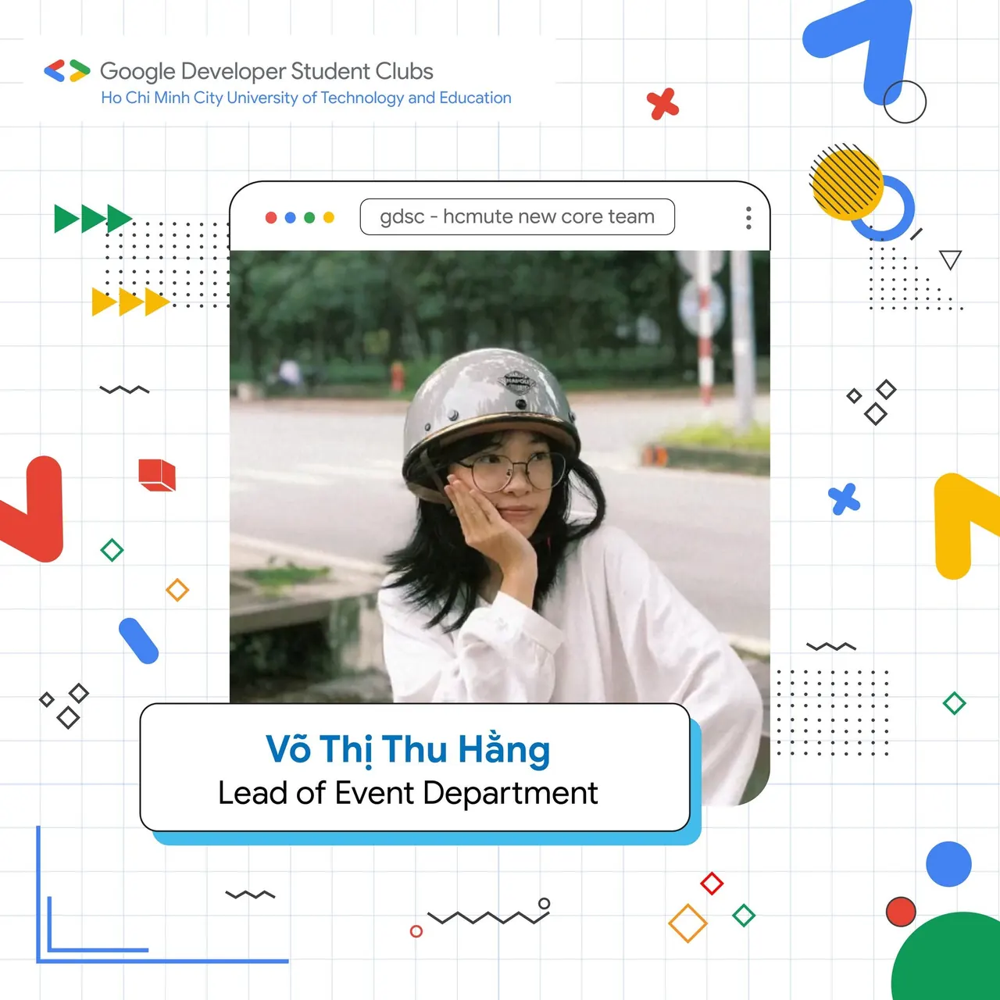
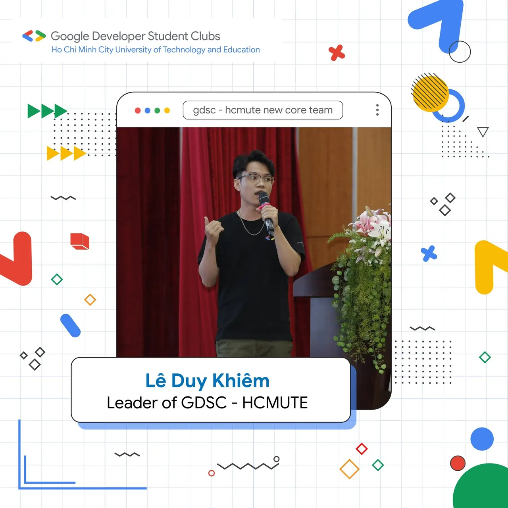
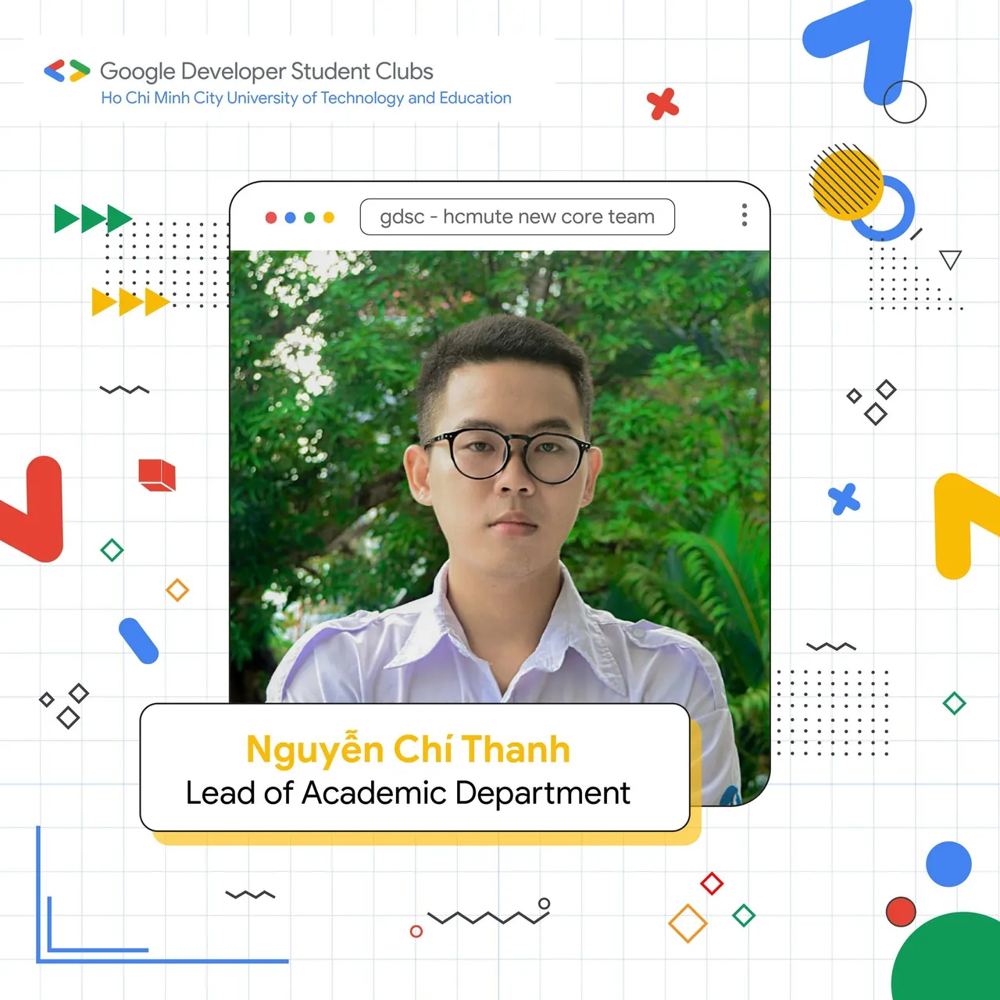
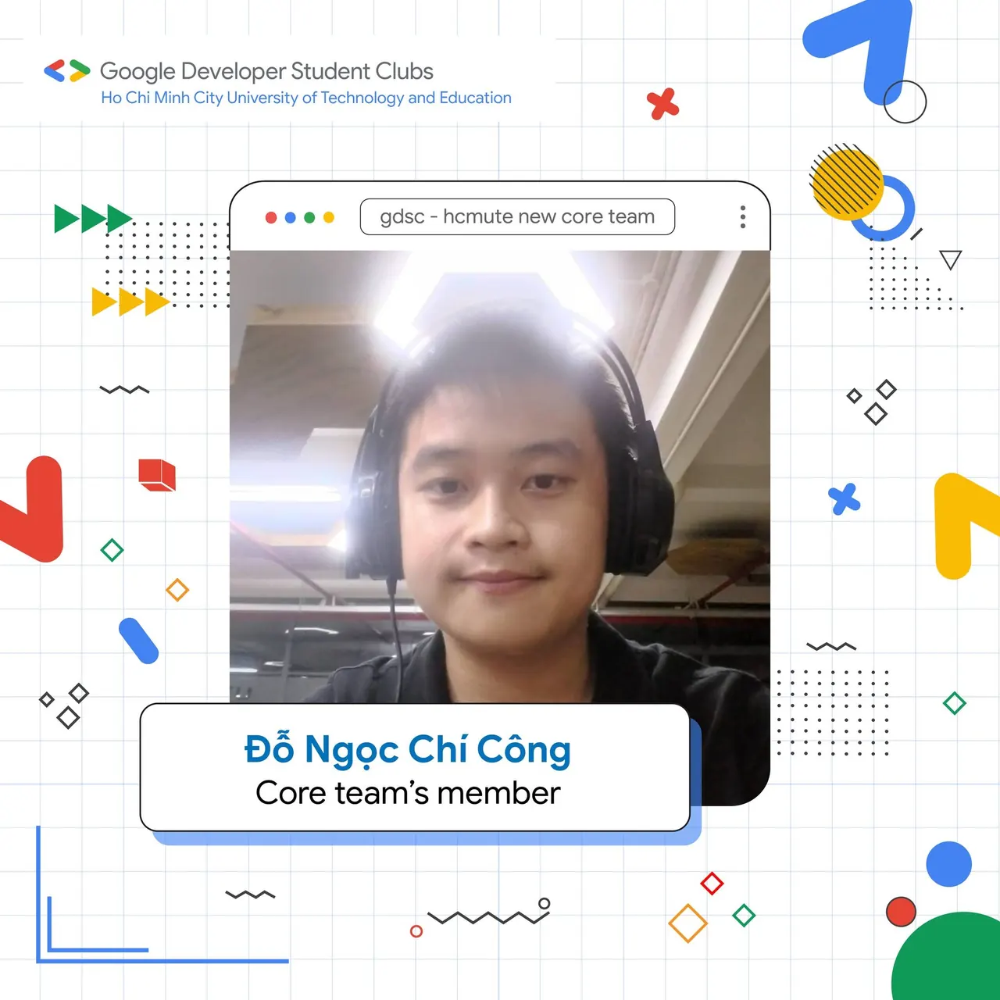
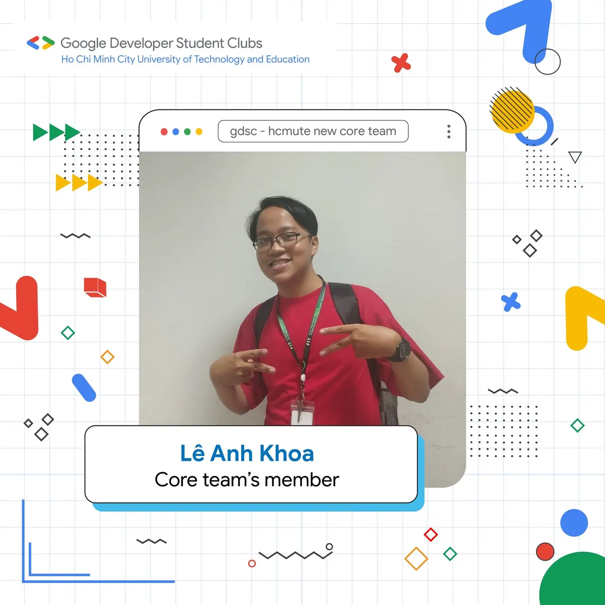

📢📢 \[BAN CHỦ NHIỆM MỚI 2023 - 2024\] “Nhìn em, anh bối rối Anh thua rồi, tim em lắm lối, Anh chưa từng dám nói anh yêu một ai thế này. Cứ coi là chúng ta chưa từng quen thì em cứ đi nhưng không được quên, Hôm nay GDSC - HCMUTE chính thức thông báo Ban chủ nhiệm mới!”  
⏱️⏱️ Thời gian thấm thoát thoi đưa, vậy là một nhiệm kỳ mới đã bắt đầu. Hãy cùng CLB chào đón Ban chủ nhiệm mới 2023 - 2024 nhé!

<!--truncate-->

🔥🔥 Những chàng trai, cô gái năng động mang trong mình những màu sắc riêng hứa hẹn sẽ dẫn dắt CLB và đồng hành cùng các bạn trong những hoạt động sắp tới của GDSC - HCMUTE.  
🎉🎉 GDSC - HCMUTE xin tự hào ra mắt Team leader nhiệm kỳ 2023 - 2024:  
🎯🎯 Chủ nhiệm: Lê Duy Khiêm, sinh viên khóa 2020, khoa Công nghệ thông tin, chuyên ngành Công nghệ phần mềm.  
🎓🎓 Trưởng ban Học thuật: Nguyễn Chí Thanh, sinh viên khóa 2021, khoa Công nghệ thông tin 📸📸 Trưởng ban Truyền thông: Lê Văn Phát, sinh viên khóa 2022, khoa Công nghệ thông tin.  
🎩🎩 Trưởng ban Sự kiện: Võ Thị Thu Hằng, sinh viên khóa 2022, khoa Công nghệ thông tin.  
🌟🌟 Thành viên ban chủ nhiệm: Lê Anh Khoa, sinh viên khóa 2022, khoa Công nghệ thông tin.  
🌟🌟 Thành viên ban chủ nhiệm: Đỗ Ngọc Chí Công, sinh viên khóa 2021, khoa Công nghệ thông tin.  
🍀🍀 GDSC - HCMUTE xin chúc Ban chủ nhiệm mới sẽ có một nhiệm kỳ thành công rực rỡ, sẽ đưa CLB ngày càng thành công, ngày càng phát triển. Cùng nhau đồng hành, hỗ trợ lẫn nhau và đem đến nhiều hoạt động giá trị cho các bạn sinh viên có niềm yêu thích và đam mê với Công nghệ.  
🥰🥰 Và hơn hết, chúng mình rất mong sẽ tiếp tục nhận được sự quan tâm, theo dõi, phản hồi và đóng góp ý kiến từ các bạn trong những hoạt động sắp tới để chúng mình có thể hoàn thiện và phát triển hơn nữa trong tương lai.  
--------------------------------------  
🌻🌻 Mọi ý kiến đóng góp, các bạn đừng ngần ngại liên hệ trực tiếp với tụi mình thông qua fanpage Google Developer Student Clubs - HCMUTE: [https://www.facebook.com/gdsc.hcmute/](https://www.facebook.com/gdsc.hcmute/)
  
\#GDSC #GDSC\_HCMUTE #New\_coreteam\_GDSC\_HCMUTE

---

_Bài viết được lưu trữ từ [fanpage HCMUTE Developer Student Club](https://www.facebook.com/hcmute.dsc)._
