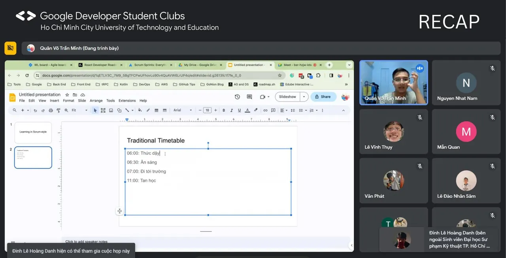
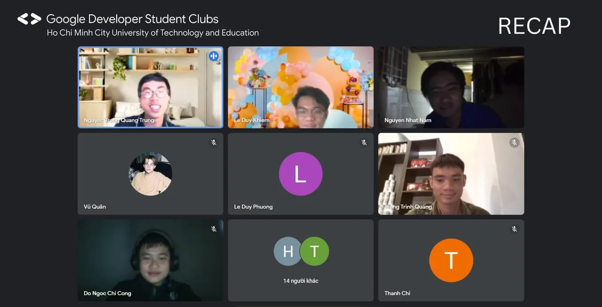
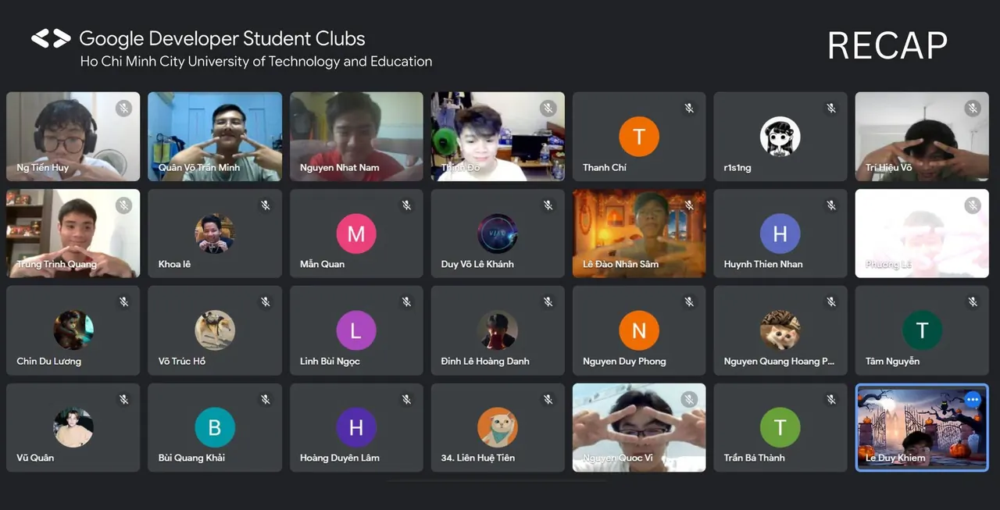
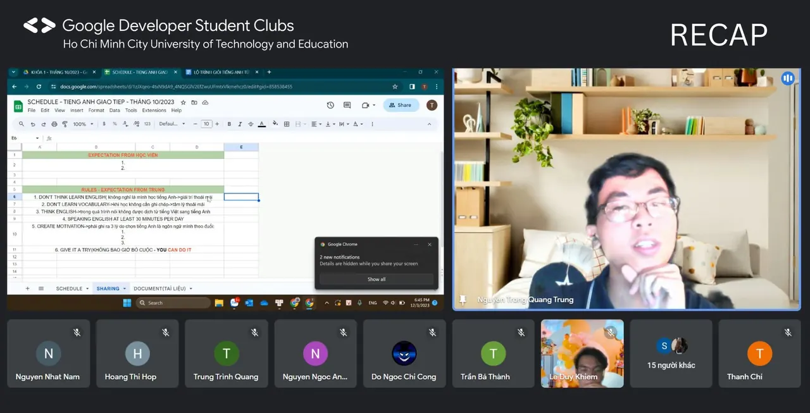

\[SINH HOẠT TUẦN GDSC - HCMUTE | RECAP\]  
🙋‍♂️ It’s been a long time! GDSC - HCMUTE đã quay trở lại với cả nhà rồi đây tadaa. Hình như là chúng ta sắp hết một học kỳ rồi nhỉ Vậy các bạn đã hoàn thành mục tiêu của bản thân mình chưa. Suỵt🤫, để mình kể nhỏ với các bạn điều này nhé, đó là GDSC - HCMUTE đã tổ chức thành công hai buổi sinh hoạt CLB cuối cùng trong kỳ này.

<!--truncate-->

👉 Buổi sinh hoạt đầu tiên của CLB là “Learning in Scrum-style ”. Deadline không còn điều là quá xa lạ với giới trẻ chúng ta, đặc biệt hơn là sinh viên Công nghệ thông tin chúng ta phải chạy đồ án rất nhiều đúng không nhỉ Hàng loạt câu hỏi được đặt ra làm thế nào để quản lý tốt những project ấy. Hiểu được khó khăn mà các bạn sinh viên đang gặp, anh Võ Trần Minh Quân (nguyên Chủ nhiệm CLB) đã có một buổi chia sẻ kinh nghiệm thực tế vô cùng bổ ích khi vận dụng Scrum-style trong việc quản lý đồ án, quản lý học tập.  
👉 Buổi thứ hai là buổi chia sẻ thân mật về nội dung sử dụng và xào trộn Tiếng Anh trong thực tế “Try to Practice”. Việc vận dụng tiếng Anh trong đời sống, trong việc học tập là vô cùng thiết thực vì việc này đang dần trở thành xu hướng. Thông qua buổi chia sẻ của anh Nguyễn Trọng Quang Trung (diễn giả đặc biệt) và anh Lê Duy Khiêm (Chủ nhiệm CLB), hai anh đã mang đến những trải nghiệm quý báu của bản thân qua quá trình hoàn thiện khả năng ngoại ngữ của bản thân và cách vận dụng ngôn ngữ trong học tập và cuộc sống.  
💥 Một tín hiệu vô cùng đáng mừng rằng ở cả hai buổi sinh hoạt đều nhận được nhiều đóng góp tích cực và câu hỏi đến từ các thành viên trong CLB. Điều đó thúc đẩy thành công cho buổi sinh hoạt, làm buổi sinh hoạt của chúng ta sôi động, thú vị và ý nghĩa hơn.💞 🙆‍♀️🙆 Có thể có những buổi sinh hoạt vui nhộn và thành công như vậy không thể không cảm ơn những chia sẻ chân thành cũng như sự góp mặt, đóng góp của các thành viên trong CLB.  
🥰🥰 Cuối cùng, CLB rất vui khi có sự tham gia của các anh/chị và các bạn. Cảm ơn và hẹn gặp lại mọi người ở buổi sinh hoạt tiếp theo!! . Xin chúc tất cả mọi người đã và đang theo dõi những hoạt động của GDSC - HCMUTE sẽ hoàn thành một học kỳ thật tốt đẹp với những con điểm thật tròn trĩnh và hơn hết hãy giữ gìn sức khỏe, tinh thần tốt để khởi động cho một học kỳ mới thật rực rỡ nhé.  
💓💓💓💓💓💓💓  
————————————————————————————————  
Muốn biết thêm thông tin về GDSC toàn cầu, các bạn hãy vào trang web: \[[https://developers.google.com/community/dsc\](https://developers.google.com/community/dsc\)] Mọi ý kiến đóng góp, các bạn có thể liên hệ trực tiếp thông qua fanpage Google Developer Student Clubs - HCM UTE: \[[https://www.facebook.com/gdsc.hcmute\](https://www.facebook.com/gdsc.hcmute\)]
  
\#GDSC #GoogleDeveloperStudentClubs #GDSC\_HCMUTE #gdschcmute\_weeklymeeting

---

_Bài viết được lưu trữ từ [fanpage HCMUTE Developer Student Club](https://www.facebook.com/hcmute.dsc)._
