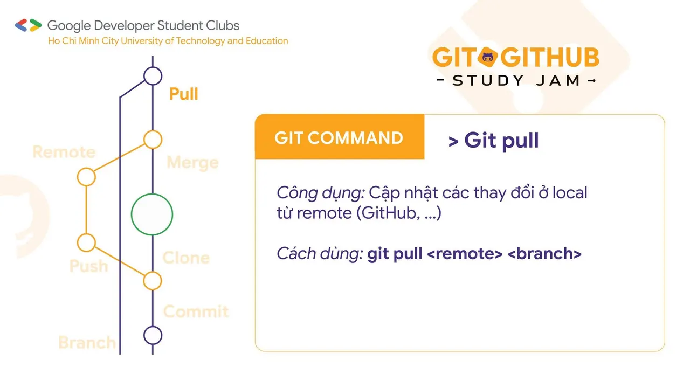
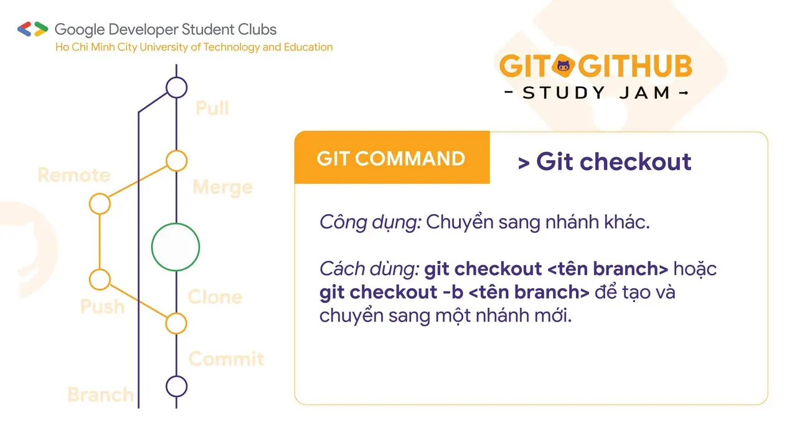
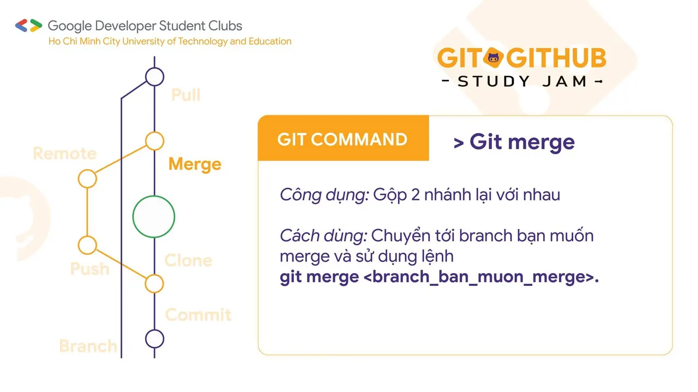
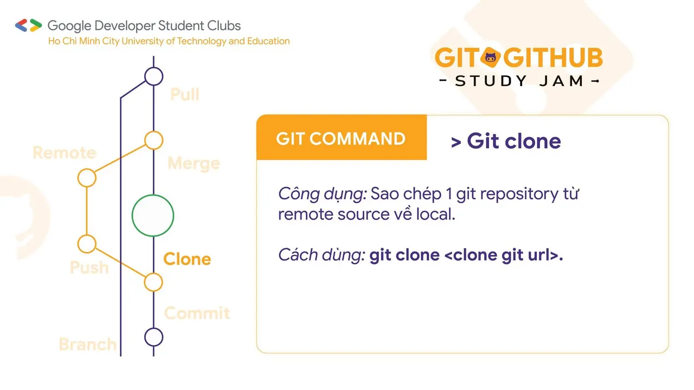
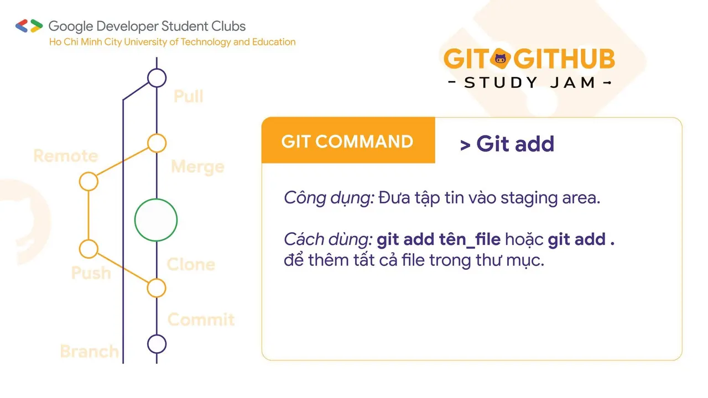
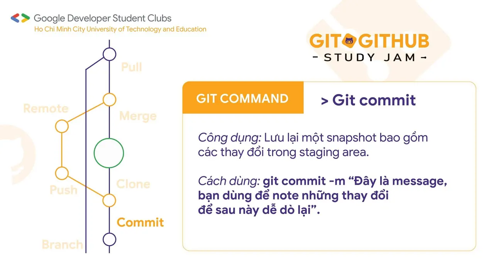
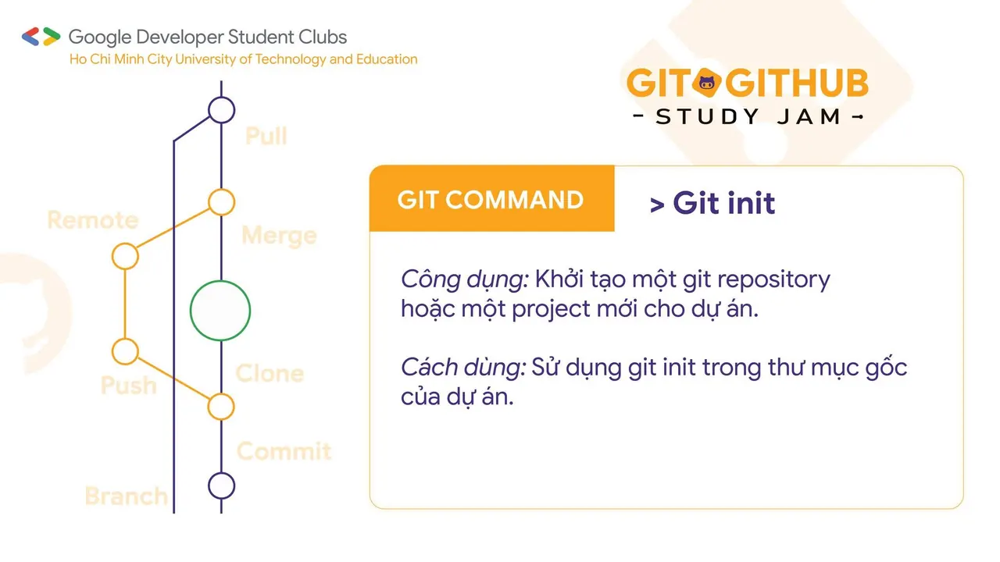
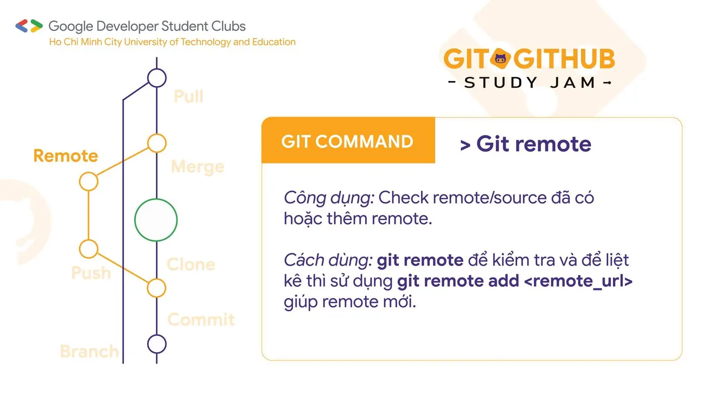
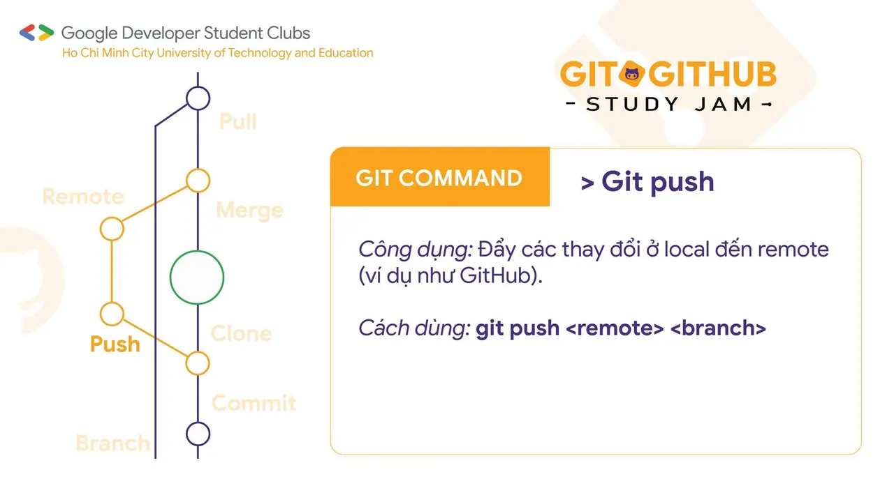
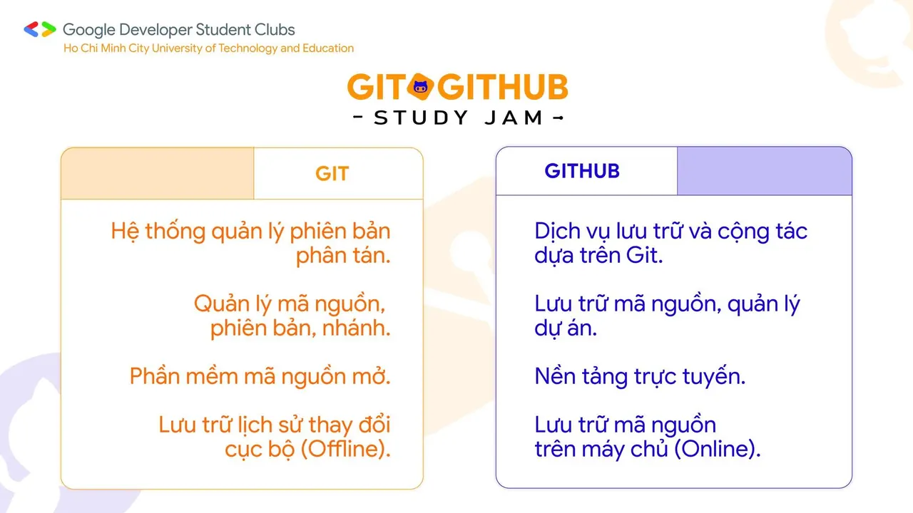

\[TOP NHỮNG ĐIỀU CẦN BIẾT VỀ GIT  GITHUB\]  
🐲🐲 Rồng rắn lên mây ✨✨ GDSC - HCMUTE có event lớn 🥰🥰 Hỏi thăm các bạn đã đăng ký chưa

<!--truncate-->

😉 Sự kiện đầu tiên trong năm mới của CLB đã chính thức mở link đăng ký, các bạn đã đăng ký hết chưa nè Hay các bạn còn điều gì băn khoăn nên vẫn chưa tự tin ấn vào link đăng ký Vậy thì hãy cùng mình tìm hiểu sơ lược để có cái nhìn tổng quan hơn qua bài viết này nhé!  
😉 ❤❤ Hy vọng bài viết sẽ giúp các bạn hiểu rõ hơn về Git  GitHub cũng như tự tin đăng ký tham gia chương trình của bọn mình. Nếu còn gì thắc mắc các bạn cứ mạnh dạn comment trên bài viết này nhé!  
❤❤ 🥳 Nhanh tay đăng ký tham gia đi vì số lượng có hạn đó nha!  
🥳  
\_\_\_\_\_\_\_\_\_\_\_\_\_\_\_\_\_\_\_\_\_\_\_\_\_\_\_\_\_\_\_\_\_\_\_\_\_\_\_\_\_\_\_\_\_\_\_\_\_\_\_\_\_\_\_\_  
📌📌 Cách thức tham gia:  
🔑 Đăng ký tại link: tinyurl.com/gitgithub-registration ⏳ Thời hạn đăng ký: 13/02/2024 - 18/02/2024.  
🙆 Đối tượng: Sinh viên Đại học Sư phạm Kỹ thuật TP.HCM 👤 Số lượng thành viên: Tham gia theo nhóm (3 - 5 người), tối đa 10 nhóm. ‼️ Yêu cầu: Sử dụng Git  GitHub, xây dựng ứng dụng (web/ desktop app/ mobile app) giới thiệu nhóm theo yêu cầu.  
👌👌 Thể lệ chương trình: [http://tinyurl.com/gdsc-hcmute-studyjam2024](http://tinyurl.com/gdsc-hcmute-studyjam2024) 👉👉 Quyền lợi:  
✅ Được cộng điểm rèn luyện theo quy định.  
✅ Được thực hành sử dụng Git và GitHub.  
✅ Tiếp cận quy trình phát triển phần mềm theo hướng chuyên nghiệp.  
✅ Nâng cao các kỹ năng: quản lý dự án, quản lý thời gian, quản lý nhóm.  
✅ Được cấp giấy chứng nhận khi hoàn thành chương trình.  
👉👉 Cam kết ❎ Sinh viên đăng ký nhưng không tham gia sẽ bị trừ điểm rèn luyện theo quy định.  
🎁🎁 Cơ cấu giải thưởng: Tất cả các thành viên hoàn thành chương trình đều được giấy chứng nhận từ ban tổ chức. Căn cứ theo thứ hạng tổng kết sau các tuần thực hiện nhiệm vụ:  
🥇🥇 Nhóm hạng 1: 1,000,000 VND.  
🥈🥈 Nhóm hạng 2: 700,000 VND.  
🥉🥉 Nhóm hạng 3: 500,000 VND.  
🏅🏅 Các nhóm còn lại: những nhóm đạt được ít nhất 1 điểm mỗi tuần, mỗi nhóm 200,000 VND.  
\_\_\_\_\_\_\_\_\_\_\_\_\_\_\_\_\_\_\_\_\_\_\_\_\_\_\_\_\_\_\_\_\_\_\_\_\_\_\_\_\_\_\_\_\_\_\_\_\_\_\_\_\_\_\_\_  
🍀🍀 Mọi ý kiến đóng góp, các bạn có thể liên hệ trực tiếp thông qua fanpage Google Developer Student Clubs - HCM UTE: [https://www.facebook.com/gdsc.hcmute🌻🌻](https://www.facebook.com/gdsc.hcmute🌻🌻)
  
\#GDSC #GoogleDeveloperStudentClubs #GDSC\_HCMUTE #STUDY\_JAM #GIT\_GITHUB

---

_Bài viết được lưu trữ từ [fanpage HCMUTE Developer Student Club](https://www.facebook.com/hcmute.dsc)._
