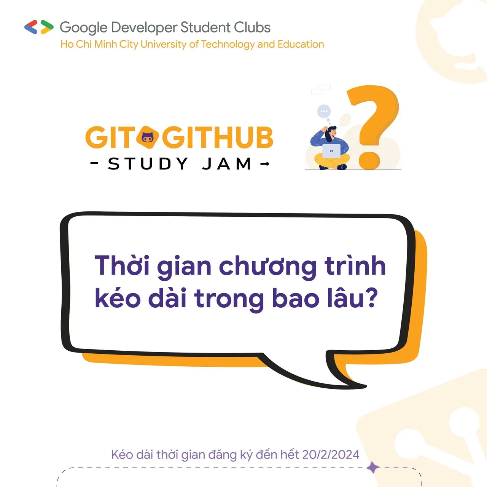
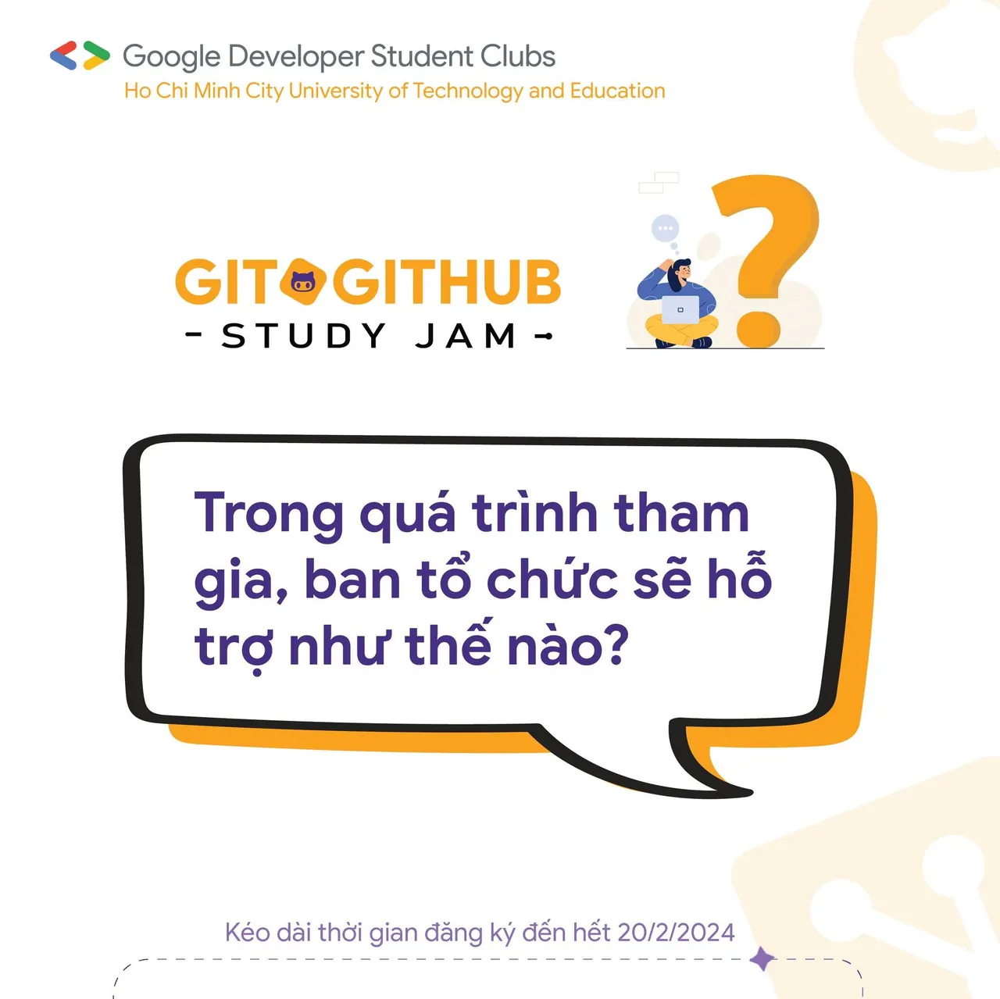
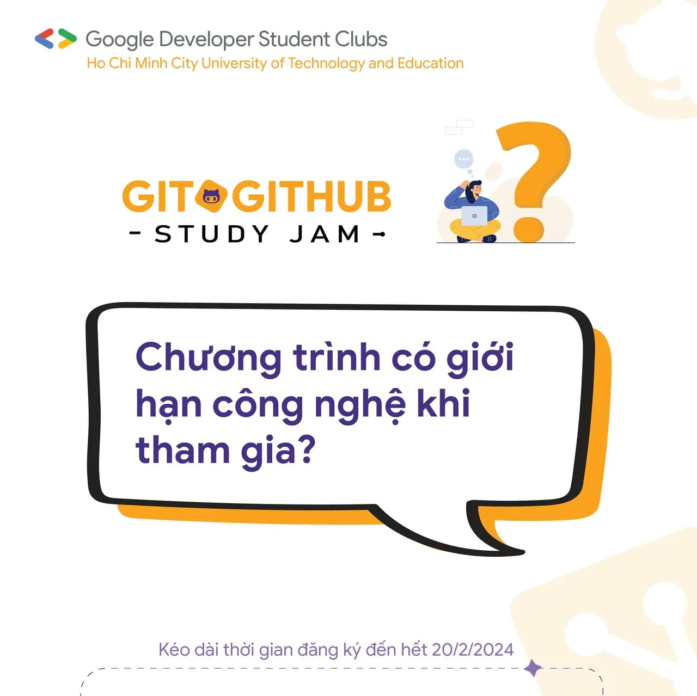

\[Q/A WITH “GIT  GITHUB STUDY JAM”  MỞ RỘNG THỜI GIAN ĐĂNG KÝ\] “Nếu đăng ký thất bại, bạn sẽ là quá khứ mới của ad, Còn nếu thành công, chúng ta sẽ là tương lai của nhau”  
👉👉 Những ngày mở đơn đăng ký vừa qua, chúng mình nhận được rất nhiều thắc mắc của các bạn, nên ở bài viết này GDSC - HCMUTE sẽ giải đáp những thắc mắc mà các bạn gửi về cho chúng mình nhé!!!!

<!--truncate-->

📣📣 Và để chúng ta có thể đồng hành cùng nhau trong chương trình này, GDSC - HCMUTE sẽ kéo dài thời gian đăng ký đến hết ngày 20/02.  
🍀🍀 Nếu các bạn còn thắc mắc đừng ngần ngại bình luận dưới bài viết hoặc có thể nhắn tin qua fanpage nha, chúng mình sẽ hỗ trợ các bạn. Hẹn gặp lại các bạn ở những hoạt động mới nhất trong chương trình 🍀🍀  
\_\_\_\_\_\_\_\_\_\_\_\_\_\_\_\_\_\_\_\_\_\_\_\_\_\_\_\_\_\_\_\_\_\_\_\_\_\_\_\_\_\_\_\_\_\_\_\_\_\_\_\_\_\_\_\_  
📌📌 Cách thức tham gia:  
🔑 Đăng ký tại link: tinyurl.com/gitgithub-registration ⏳ Thời hạn đăng ký: 13/02/2024 - 20/02/2024.  
🙆 Đối tượng: Sinh viên Đại học Sư phạm Kỹ thuật TP.HCM 👤 Số lượng thành viên: Tham gia theo nhóm (3 - 5 người), tối đa 10 nhóm. ‼️ Yêu cầu: Sử dụng Git  GitHub, xây dựng ứng dụng (web/ desktop app/ mobile app) giới thiệu nhóm theo yêu cầu.  
👌👌 Thể lệ chương trình: [http://tinyurl.com/gdsc-hcmute-studyjam2024](http://tinyurl.com/gdsc-hcmute-studyjam2024) 👉👉 Quyền lợi:  
✅ Được cộng điểm rèn luyện theo quy định.  
✅ Được thực hành sử dụng Git và GitHub.  
✅ Tiếp cận quy trình phát triển phần mềm theo hướng chuyên nghiệp.  
✅ Nâng cao các kỹ năng: quản lý dự án, quản lý thời gian, quản lý nhóm.  
✅ Được cấp giấy chứng nhận khi hoàn thành chương trình.  
👉👉 Cam kết ❎ Sinh viên đăng ký nhưng không tham gia sẽ bị trừ điểm rèn luyện theo quy định.  
🎁🎁 Cơ cấu giải thưởng: Tất cả các thành viên hoàn thành chương trình đều được giấy chứng nhận từ ban tổ chức. Căn cứ theo thứ hạng tổng kết sau các tuần thực hiện nhiệm vụ:  
🥇🥇 Nhóm hạng 1: 1,000,000 VND.  
🥈🥈 Nhóm hạng 2: 700,000 VND.  
🥉🥉 Nhóm hạng 3: 500,000 VND.  
🏅🏅 Các nhóm còn lại: những nhóm đạt được ít nhất 1 điểm mỗi tuần, mỗi nhóm 200,000 VND.  
\_\_\_\_\_\_\_\_\_\_\_\_\_\_\_\_\_\_\_\_\_\_\_\_\_\_\_\_\_\_\_\_\_\_\_\_\_\_\_\_\_\_\_\_\_\_\_\_\_\_\_\_\_\_\_\_  
🍀🍀 Mọi ý kiến đóng góp, các bạn có thể liên hệ trực tiếp thông qua fanpage Google Developer Student Clubs - HCM UTE: [https://www.facebook.com/gdsc.hcmute🌻🌻](https://www.facebook.com/gdsc.hcmute🌻🌻)
  
\#GDSC #GoogleDeveloperStudentClubs #GDSC\_HCMUTE #STUDY\_JAM #GIT\_GITHUB

---

_Bài viết được lưu trữ từ [fanpage HCMUTE Developer Student Club](https://www.facebook.com/hcmute.dsc)._
