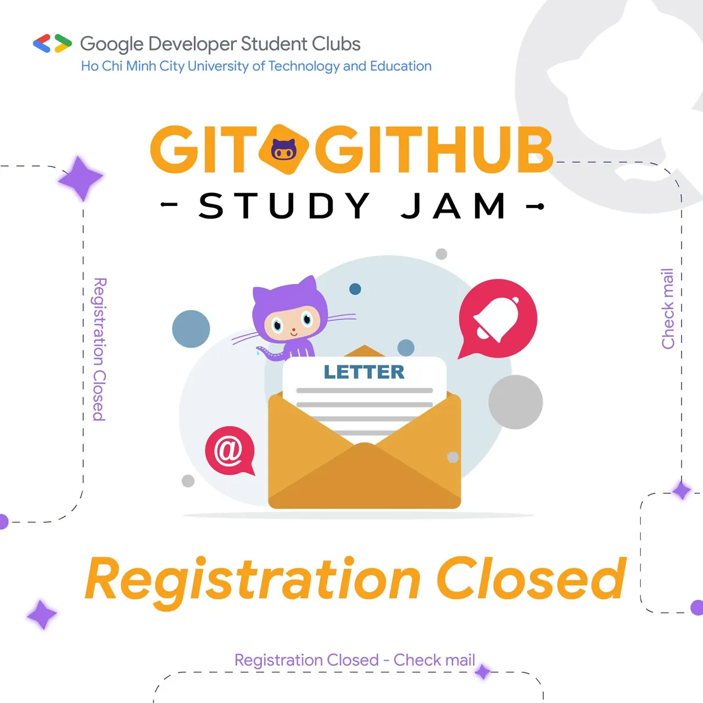

\[ GIT & GITHUB STUDY JAM  | THÔNG BÁO ĐÓNG LINK ĐĂNG KÝ \]
  
💥BÙMMM

<!--truncate-->

Vậy là link đăng ký sự kiện Git & GitHub Study Jam đã chính thức đóng lại. GDSC-HCMUTE xin cảm ơn tất cả các bạn sinh viên đã đăng ký tham gia chương trình !!! Chúng mình sẽ gửi thông tin xác nhận tham gia qua email cho những bạn đăng ký thành công. Các bạn hãy theo dõi và đừng quên kiểm tra cả hộp thư spam nữa nhé.❤️
  
🥰Chúng mình đã nhận được những đơn đăng ký tham gia của các bạn, hy vọng rằng các bạn sẽ hết mình với phần dự thi của mình. Sự nhiệt huyết và hăng hái của mỗi các bạn sẽ góp phần tạo nên thành công của sự kiện Git & GitHub Study Jam năm nay.  🎉🌟
  
🔶Còn nếu bạn nào chưa kịp đăng ký thì cũng đừng buồn nhé, sẽ còn rất nhiều sự kiện thú vị nữa đang đón chờ trong thời gian sắp tới đó. Hãy theo dõi Fanpage của chúng mình để không bị bỏ lỡ thông tin nhaa.😍
  
----------------------------------------  
🍀🍀 Mọi ý kiến đóng góp, các bạn có thể liên hệ trực tiếp thông qua fanpage Google Developer Student Clubs - HCM UTE: [https://www.facebook.com/gdsc.hcmute🌻🌻](https://www.facebook.com/gdsc.hcmute🌻🌻)  
\#GDSC #GoogleDeveloperStudentClubs #GDSC\_HCMUTE  
\#STUDY\_JAM #GIT\_GITHUB

---

_Bài viết được lưu trữ từ [fanpage HCMUTE Developer Student Club](https://www.facebook.com/hcmute.dsc)._
