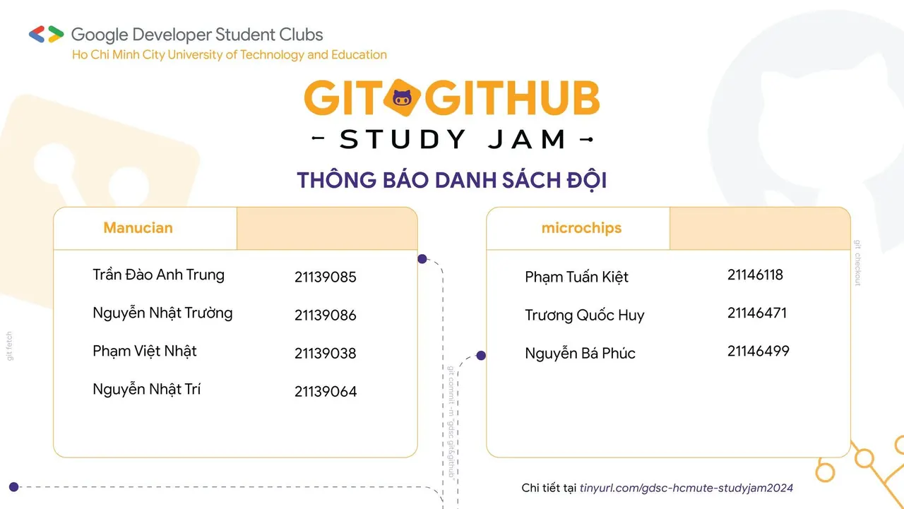
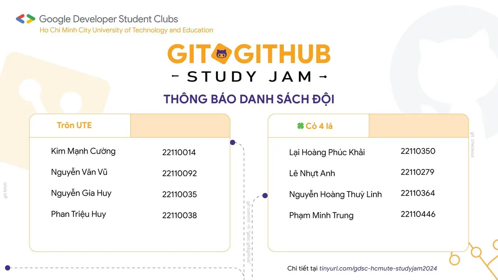
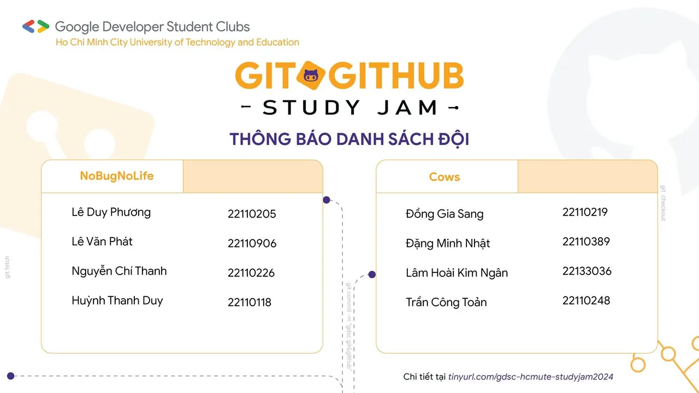
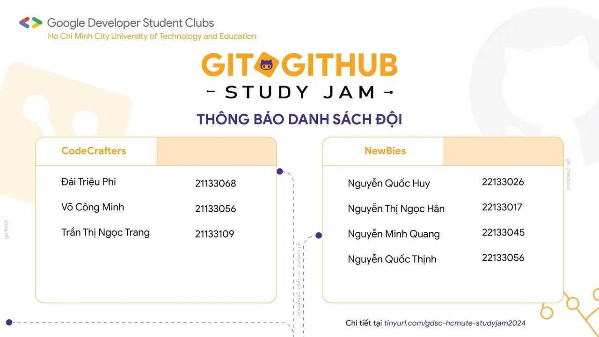
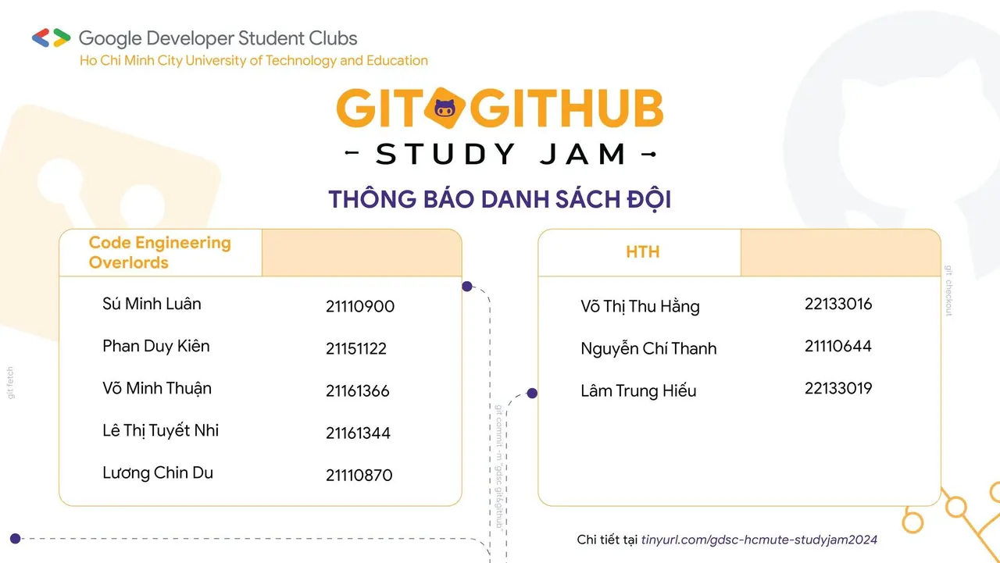

\[GIT  GITHUB STUDY JAM | DANH SÁCH THÀNH VIÊN CÁC ĐỘI\]  
😍😍 Ngoan xinh yêu của GDSC - HCMUTE đâu zồi 😲 "GIT  GITHUB STUDY JAM", đây zồi. Một cơ hội tuyệt vời để học hỏi và thực hành sử dụng Git và GitHub, hai công cụ không thể thiếu trong quản lý mã nguồn và dự án phần mềm.

<!--truncate-->

🤓 Trong sự kiện này, các bạn sẽ được hướng dẫn cách sử dụng Git để quản lý phiên bản code của mình, thực hiện các thao tác như commit, push, pull và merge. Đồng thời, chúng ta cũng sẽ tìm hiểu cách sử dụng GitHub để lưu trữ mã nguồn và quản lý dự án một cách hiệu quả.  
👉 Sau khoảng thời gian đăng ký, Google Developer Student Clubs - HCMUTE xin thông báo danh sách 10 đội với tổng 38 bạn tham gia 💌 Kết quả đã được gửi qua email của các bạn, các bạn vui lòng check mail để nhận thông báo, nhớ check luôn cả hộp thư spam nữa nha.  
🙆 Một lần nữa, đại Gia Đình GDSC - HCMUTE muốn gửi lời cảm ơn chân thành đến tất cả mọi người! Chúc mọi người có một năm mới tràn đầy sức khỏe và đạt được nhiều thành công. Hãy đón chờ những hoạt động vô cùng hấp dẫn tiếp theo trong chương trình nhé!  
=====================================  
Mọi ý kiến đóng góp, các bạn có thể liên hệ trực tiếp thông qua fanpage Google Developer Student Clubs - HCM UTE: [https://www.facebook.com/gdsc.hcmute](https://www.facebook.com/gdsc.hcmute)
  
\#GDSC #GoogleDeveloperStudentClubs #GDSC\_HCMUTE #STUDY\_JAM #GIT\_GITHUB

---

_Bài viết được lưu trữ từ [fanpage HCMUTE Developer Student Club](https://www.facebook.com/hcmute.dsc)._
