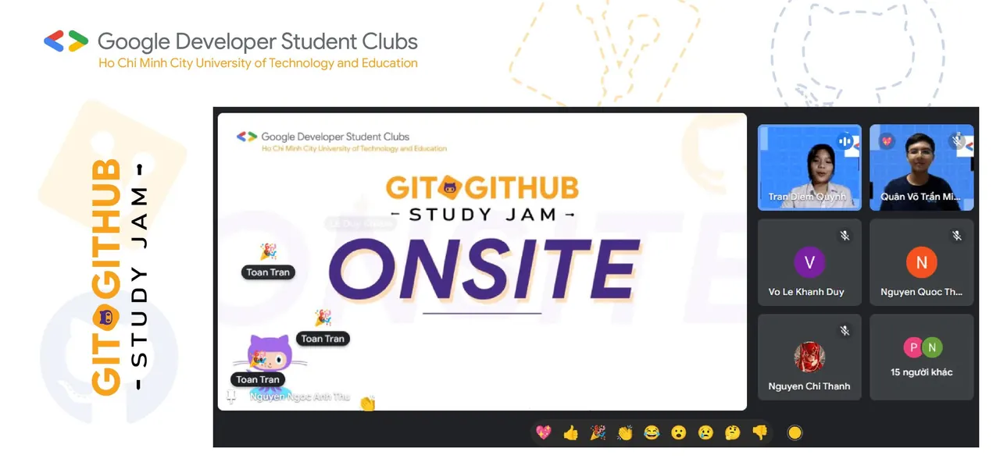
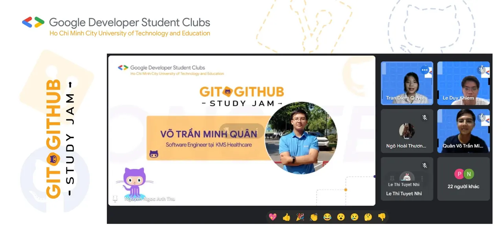
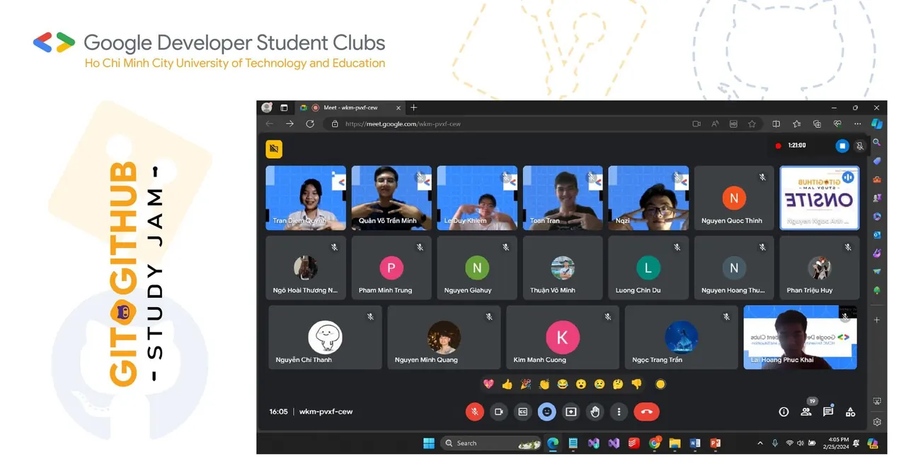

\[  GIT & GITHUB STUDY JAM  | RECAP \]
  
🥳 Gần xa nô nức yến anh

<!--truncate-->

Chị em sắm sửa bộ hành tham gia Git & GitHub Study Jam😍
  
🥰 Một tuần nữa lại đến rồi. Tuần qua của các bạn thế nào? Còn chúng mình thì rất vui khi được chào đón các bạn sinh viên đến với sự kiện Git & GitHub Study Jam. Có lẽ các đội thi đã và đang chuẩn bị tinh thần thật tốt để tham gia sự kiện bổ ích này. 💐❤️
  
📌 Và cuối tuần qua, ngày 25/2/2024 BTC cũng đã tổ chức buổi Kick off để phổ biến chương trình cũng như chia sẻ các kiến thức về Git & GitHub đến các bạn sinh viên. Chúng mình xin cảm ơn các bạn đã quan tâm và dành thời gian để tham dự buổi kick off. Hy vọng rằng các bạn sẽ cháy hết mình trong những tuần tới của sự kiện này nhé. ❤️
  
🌸 Chúng ta hãy đón chờ những hoạt động tiếp theo của chương trình nha. Giờ thì cùng nhìn lại những khoảnh khắc tuyệt vời được ghi lại tại buổi kick off hôm đó nào. 👇👇  
----------------------------------------  
Mọi ý kiến đóng góp, các bạn có thể liên hệ trực tiếp thông qua fanpage Google Developer Student Clubs - HCM UTE: [https://www.facebook.com/gdsc.hcmute](https://www.facebook.com/gdsc.hcmute)  
\#GDSC #GoogleDeveloperStudentClubs #GDSC\_HCMUTE  
\#STUDY\_JAM #GIT\_GITHUB

---

_Bài viết được lưu trữ từ [fanpage HCMUTE Developer Student Club](https://www.facebook.com/hcmute.dsc)._
