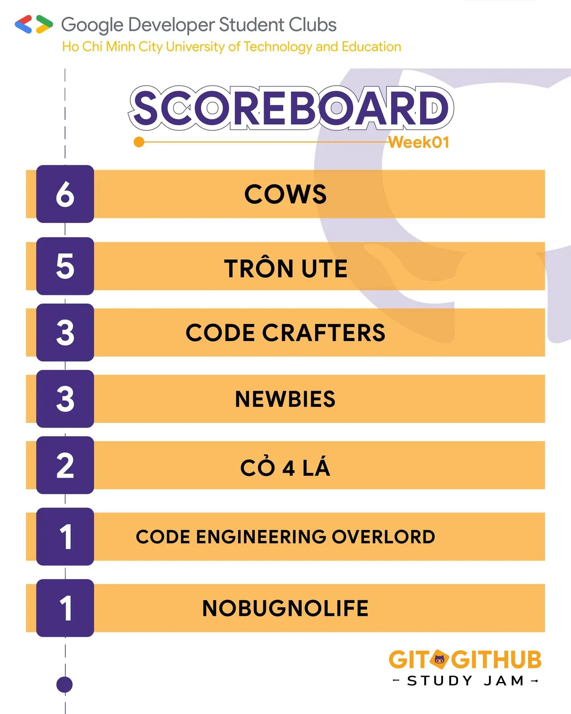

\[TỔNG KẾT TUẦN 1 | GIT  GITHUB STUDY JAM\]  
📣📣: Ngoan xinh yêu của GDSC HCMUTE đâu rồi nhỉ

<!--truncate-->

🤔🤔: Đầu tuần của các bạn thế nào rồi …  
🌻🌻 Lại thêm một tuần nữa lại qua đi, các bạn hãy cùng CLB nhìn lại chặng đường một tuần qua của các đội thi tham gia chương trình Git  GitHub Study Jam nha. Cùng nhau chiêm ngưỡng những thành quả mà các đội đã làm được trong tuần qua.  
🔥🔥 🌟🌟 Tuần đầu cũng là tuần khởi động, các đội thi cũng đã bắt đầu hòa mình vào không khí của chương trình, mở đầu cho một hành trình học tập đầy thú vị và bổ ích. Các thành viên của các đội thi đã tích cực tham gia các hoạt động học tập như hướng dẫn, thảo luận nhóm và thực hành thêm trên nền tảng Git và GitHub. Không chỉ giúp họ nắm vững kiến thức cơ bản về Git, mà còn phát triển kỹ năng làm việc nhóm và quản lý dự án một cách hiệu quả.🎉🎉 🏅🏅 Và sau khi kết thúc tuần đầu tiên của sự kiện thì BXH các đội cũng đã có những thay đổi nhất định, GDSC - HCMUTE xin được phép công bố bảng xếp hạng của tuần đầu tiên. Tuần rồi thì đội “Cows” đang chiếm lĩnh vị trí đầu bảng với 6 điểm.  
💐💐 🥰🥰 Chúng ta hãy cùng chờ đợi những phát triển tiếp theo từ các đội thi trong những tuần tiếp theo của sự kiện Git  GitHub Study Jam. Hãy tiếp tục đồng hành và cổ vũ cho các thành viên trong hành trình học tập của họ nhé!🍀🍀  
\_\_\_\_\_\_\_\_\_\_\_\_\_\_\_\_\_\_\_\_\_\_\_\_\_\_\_\_\_\_\_\_\_\_\_\_\_\_\_\_\_\_\_\_\_\_\_\_\_  
🍀🍀 Mọi ý kiến đóng góp, các bạn có thể liên hệ trực tiếp thông qua fanpage Google Developer Student Clubs - HCM UTE: [https://www.facebook.com/gdsc.hcmute🌻🌻](https://www.facebook.com/gdsc.hcmute🌻🌻)
  
\#GDSC #GoogleDeveloperStudentClubs #GDSC\_HCMUTE #STUDY\_JAM #GIT\_GITHUB

---

_Bài viết được lưu trữ từ [fanpage HCMUTE Developer Student Club](https://www.facebook.com/hcmute.dsc)._
