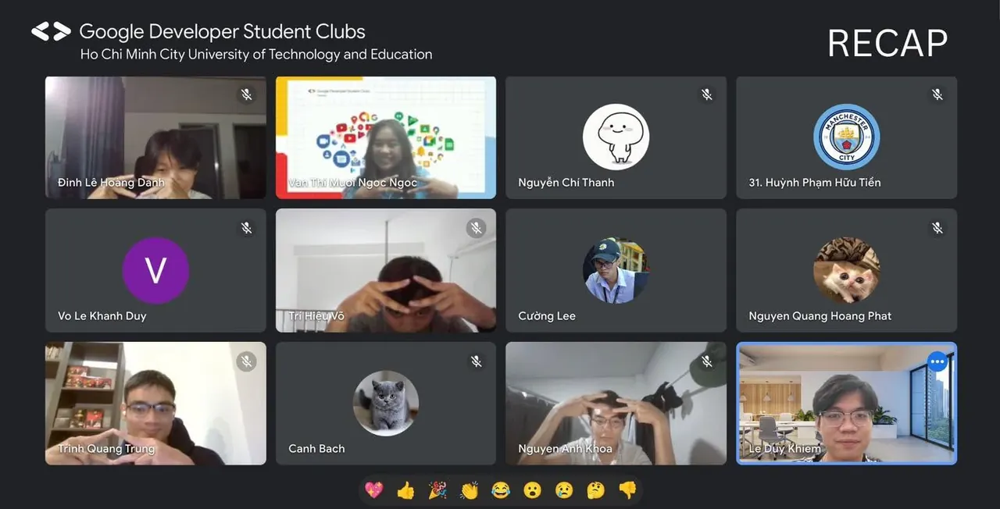

\[SINH HOẠT TUẦN GDSC – HCMUTE | RECAP\]
  
✌😉 Hello mọi người 😉🤞

<!--truncate-->

🧐 Vậy là một tuần đã trôi qua, anh chị em trong GDSC – HCMUTE lại hội ngộ với đề tài Software Development Life Cycle với các mô hình Agile và Waterfall phục vụ cho quản lý dự án. Qua buổi sinh hoạt này, chúng ta đã nhận thức sâu hơn về cách thức tổ chức và điều phối các dự án công nghệ một cách hiệu quả.
  
👏👏 Buổi sinh hoạt đã diễn ra vô cùng sôi động với sự chia sẻ nhiệt tình của các anh/chị cũng như sự tương tác tích cực của các thành viên trong CLB. CLB xin gửi lời cảm ơn chân thành sự góp mặt của mọi người.
  
🍀 Và cuối cùng mình xin chúc mọi người sẽ có buổi cuối tuần vui vẻ và một tuần mới đầy năng lượng ạ! 🍀
  
👋😉 Hẹn gặp lại mọi người trong những buổi sinh hoạt tiếp theo nha.
  
—-----------------------------------  
Mọi ý kiến đóng góp, các bạn có thể liên hệ trực tiếp thông qua fanpage Google Developer Student Clubs - HCM UTE: [https://www.facebook.com/gdsc.hcmute](https://www.facebook.com/gdsc.hcmute)  
\#GDSC #GoogleDeveloperStudentClubs #GDSC\_HCMUTE

---

_Bài viết được lưu trữ từ [fanpage HCMUTE Developer Student Club](https://www.facebook.com/hcmute.dsc)._
