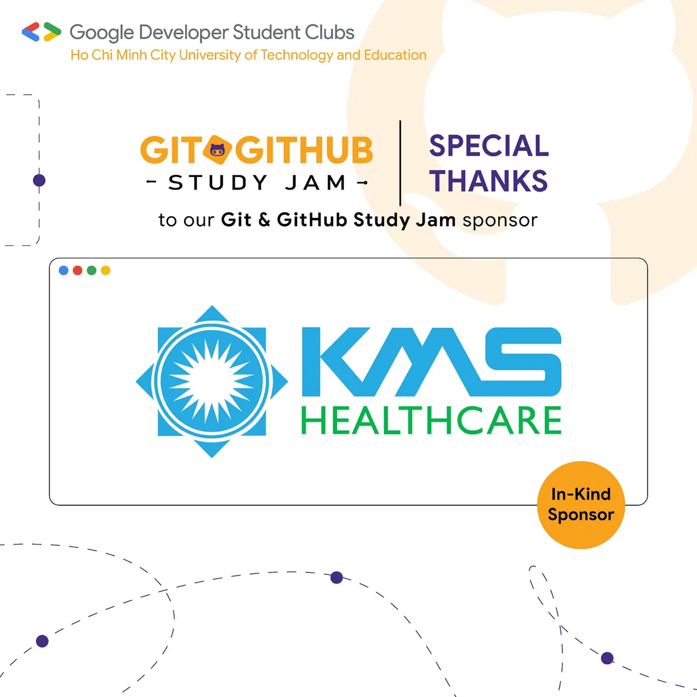

\[GIT  GITHUB STUDY JAM | THANKS TO OUR AMAZING SPONSOR\]  
✨ THANKS A MILLION TO KMS HEALTHCARE Chương trình Git  Github Study Jam cũng đã chính thức khép lại sau 3 tuần thi căng thẳng của 10 đội thi với những thành tích xuất sắc. Bên cạnh đó chúng ta cũng không quên nhắc đến những tổ chức đứng sau góp phần làm nên thành công của chương trình này.

<!--truncate-->

💕 GDSC – HCMUTE xin được gửi lời cảm ơn chân thành nhất đến KMS Healthcare, nhà tài trợ đã đồng hành xuyên suốt chương trình Git  Github Study Jam vừa qua. KMS Healthcare là đơn vị kinh doanh chuyên cung cấp các dịch vụ tư vấn, giải pháp phần mềm trong lĩnh vực y tế và chăm sóc sức khỏe thuộc Công ty KMS Technology. Được đồng hành cùng KMS Healthcare là niềm vinh hạnh của CLB. GDSC – HCMUTE xin chúc cho KMS Healthcare luôn thành công trong sứ mệnh của mình, mang lại những giải pháp y tế tiên tiến đáng tin cậy cho cộng đồng. Hy vọng GDSC – HCMUTE sẽ có thật nhiều cơ hội hợp tác cùng KMS Healthcare trong những chương trình sắp tới.  
💚  
-----------------------  
Mọi ý kiến đóng góp, các bạn có thể liên hệ trực tiếp thông qua fanpage Google Developer Student Clubs - HCM UTE: [https://www.facebook.com/gdsc.hcmute](https://www.facebook.com/gdsc.hcmute)
  
\#GDSC #GoogleDeveloperStudentClubs #GDSC\_HCMUTE

---

_Bài viết được lưu trữ từ [fanpage HCMUTE Developer Student Club](https://www.facebook.com/hcmute.dsc)._
