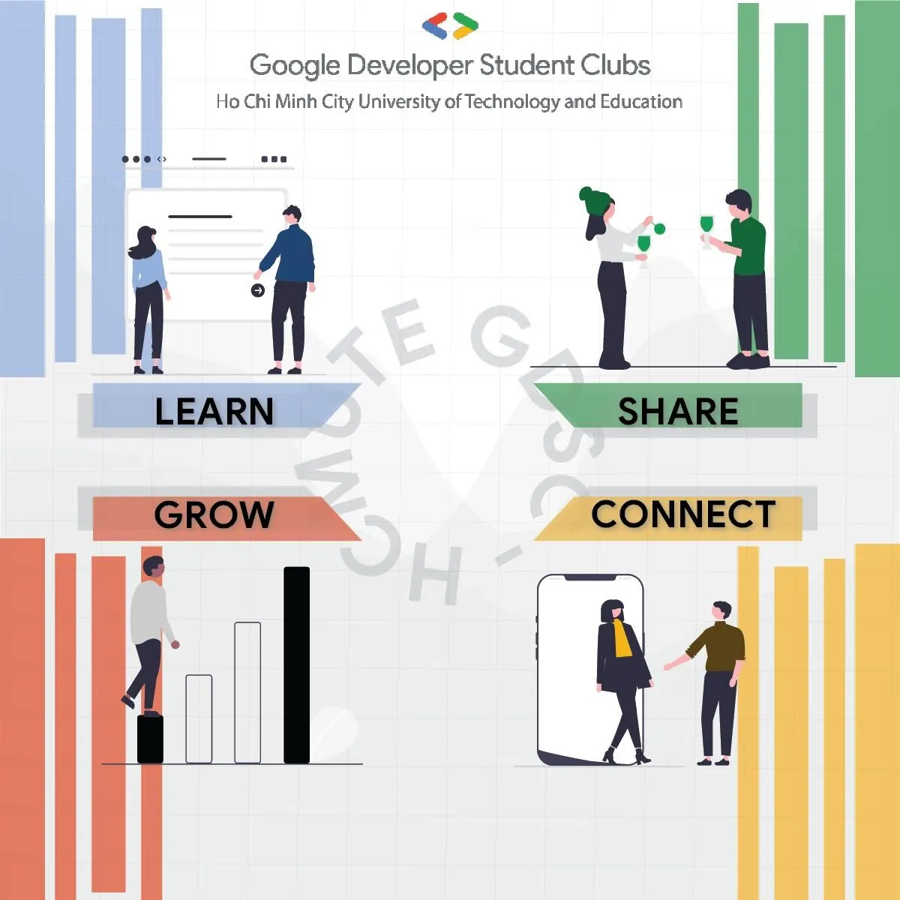

💥💥HÀNH TRÌNH MỚI LẠI BẮT ĐẦU💥💥
  
🔔Bing Boonggg!!! Nhà GDSC-HCMUTE mở cửa rồi nàyy, khám phá ngayyyy !!!!🔔

<!--truncate-->

Cái gì cơ?! Câu lạc bộ Học thuật chán quá à?? 😮😮  
🔥Thế thì phải ngồi xuống đây, nhìn mà xem, có đủ thứ để ta “vui” !!👇👇
  
🎀 GDSC là câu lạc bộ gì thế? 🎀  
📍GDSC HCMUTE là câu lạc bộ Google Developer Student Clubs tại trường Đại học Sư phạm Kỹ Thuật TP.HCM được thành lập với mục tiêu kết nối các bạn sinh viên yêu thích công nghệ, đặc biệt là những người muốn khám phá và phát triển các kỹ năng lập trình và công nghệ thông tin.  
📍CLB hoạt động dưới sự bảo trợ của Google Developers, là nơi cung cấp các cơ hội học tập, chia sẻ và sáng tạo dành riêng cho cộng đồng sinh viên. Qua các hoạt động đào tạo, workshop và dự án, CLB đã trở thành một điểm đến lý tưởng dành cho các bạn yêu thích lĩnh vực công nghệ lập trình, kỹ năng phần mềm và truyền thông sự kiện.
  
🎀 GDSC có những ban nào ta? 🎀  
📍Ban Học thuật là linh hồn của GDSC - HCMUTE, tập trung vào việc phát triển và cung cấp kiến thức cho các thành viên, bao gồm tổ chức các workshop, seminar về lập trình, trí tuệ nhân tạo (AI), phát triển ứng dụng di động, web, và các công nghệ tiên tiến khác.  
📍Ban Truyền thông chịu trách nhiệm quảng bá hình ảnh của GDSC - HCMUTE đến với cộng đồng sinh viên và những người quan tâm đến công nghệ, duy trì sự kết nối và tương tác với công chúng thông qua các kênh truyền thông xã hội và thiết kế nội dung sáng tạo.  
📍Ban Sự kiện và Đối ngoại đóng vai trò chủ đạo trong việc tổ chức các hoạt động của CLB, bao gồm các buổi workshop, seminar, hackathon, và các sự kiện giao lưu với cộng đồng công nghệ.
  
🎀 Tham gia GDSC, ta được gì? 🎀  
📍Kết nối (Connect): GDSC - HCMUTE là cầu nối với các chuyên gia trong ngành, giảng viên, và cộng đồng lập trình viên tại địa phương cũng như trên toàn thế giới. Ghê chưa!!  
📍Chia sẻ (Share): Thông qua các buổi thảo luận, hội thảo và chia sẻ kinh nghiệm, sinh viên có thể trao đổi kiến thức và kỹ năng với nhau, solo 1-1 luon!!💢  
📍Học hỏi (Learn): Những khóa học, tài liệu và sự kiện học thuật, giúp sinh viên tiếp cận với các công nghệ mới như trí tuệ nhân tạo (AI), phát triển ứng dụng di động, web, và nhiều lĩnh vực khác nah 😘  
📍Phát triển (Grow): Cơ hội bao la để ta phát triển các dự án cá nhân và tham gia vào các cuộc thi lập trình quốc tế nữa nhe
  
⏰⏰ Hãy sẵn sàng gia nhập nhà GDSC!! Luôn theo dõi chúng mình để biết lịch tuyển thành viên nhá 💖  
----------------------------------------------------------------------------  
Mọi ý kiến đóng góp, các bạn đừng ngần ngại liên hệ trực tiếp với tụi mình thông qua fanpage Google Developer Student Clubs - HCMUTE: [https://www.facebook.com/gdsc.hcmute/](https://www.facebook.com/gdsc.hcmute/)  
hoặc email:  
dsc.hcmute@gmail.com  
\#GDSC #GDSC\_HCMUTE  
\#New\_coreteam\_GDSC\_HCMUTE

---

_Bài viết được lưu trữ từ [fanpage HCMUTE Developer Student Club](https://www.facebook.com/hcmute.dsc)._
