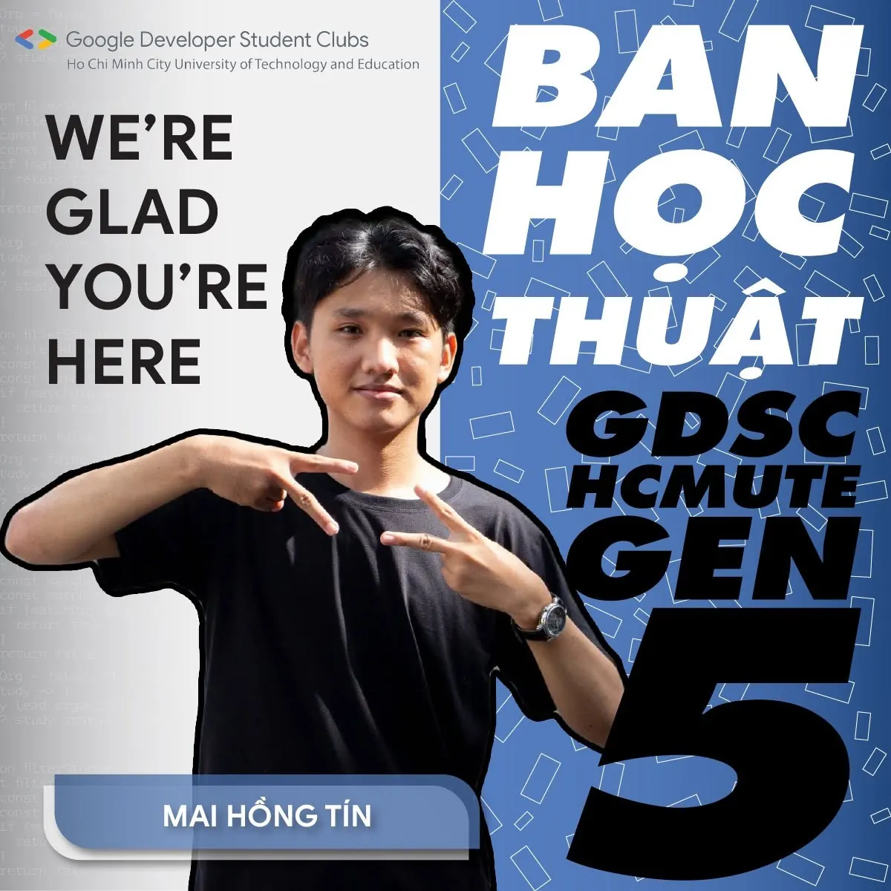
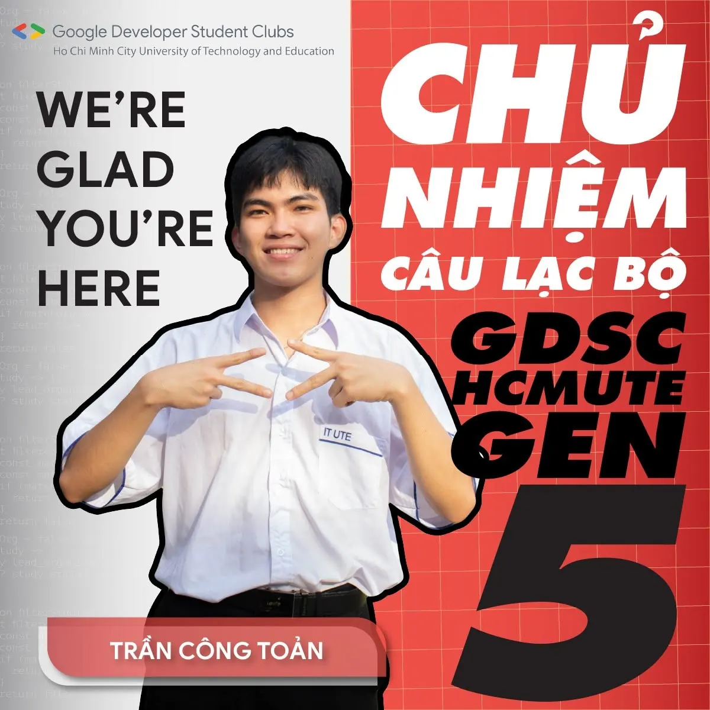
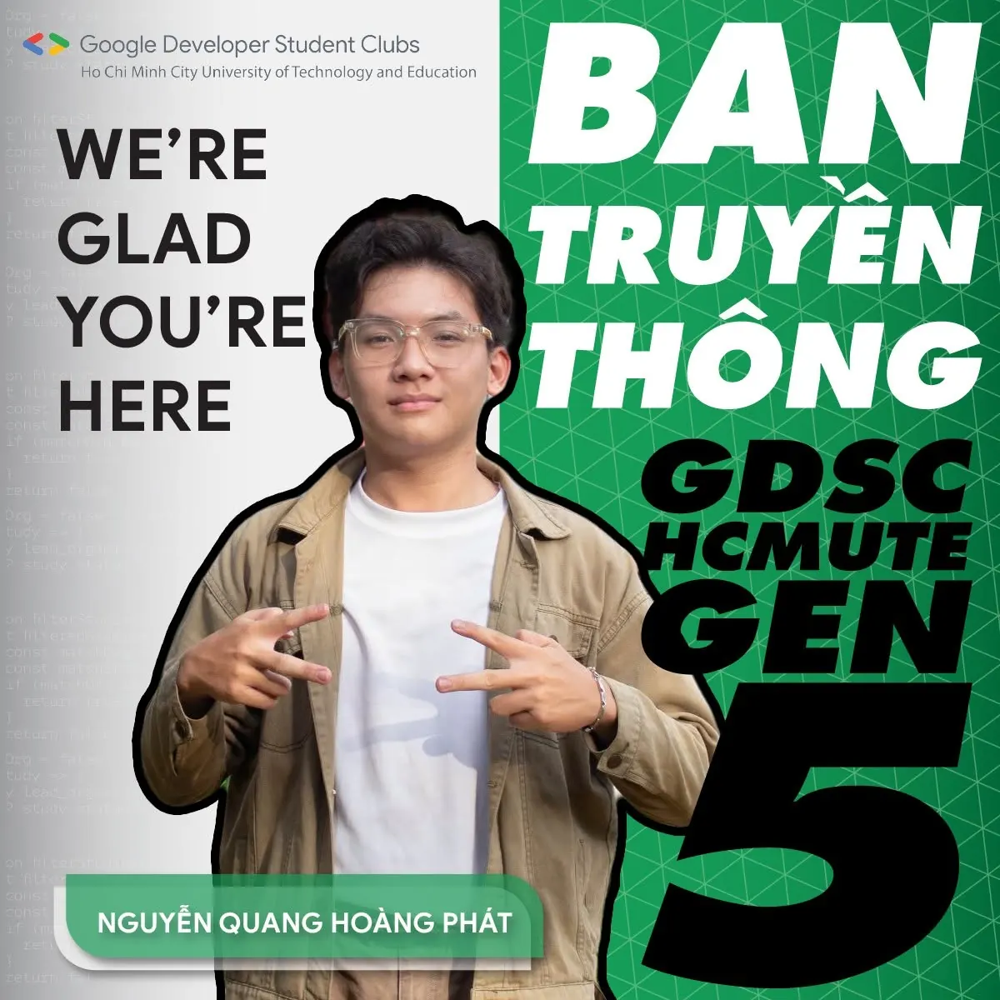
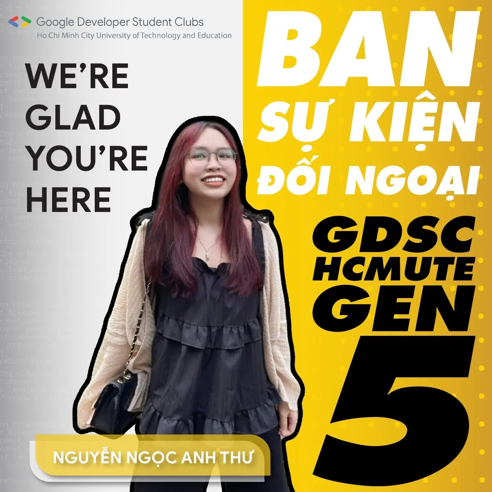

📢📢\[GIỚI THIỆU BAN CHỦ NHIỆM NĂM 2024-2025 | GDSC - HCMUTE\] You’re thinking about me?!  
😎😜 🥰Xin chào mọi người, Team leader đến rồi đây!! Cuối cùng, nhiệm kì 2023 - 2024 của CLB Google Developer Student Clubs - HCMUTE đã chính thức khép lại. Chúng mình xin gửi lời cảm ơn đến tất cả mọi người đã luôn ủng hộ và đã góp phần tạo nên những thành công, để lại nhiều giá trị sâu sắc và vô cùng ý nghĩa cho CLB của chúng mình trong năm học vừa qua.

<!--truncate-->

🌟Sang một năm hoạt động mới, GDSC- HCMUTE xin được giới thiệu Ban Chủ nhiệm Nhiệm kì 2024 - 2025 bao gồm những gương mặt tài năng và vô cùng nhiệt huyết, hứa hẹn sẽ đem lại một kỳ vọng mới cho chặng đường tiếp theo.  
🔥🔥GDSC - HCMUTE xin tự hào và vinh dự ra mắt Team leader nhiệm kỳ 2024 - 2025:  
👑👨‍💻Chủ nhiệm - Trần Công Toản Sinh viên khóa 2022, khoa Công nghệ thông tin, chuyên ngành Công nghệ phần mềm 🎓💁‍♂️Trưởng ban Học thuật - Mai Hồng Tín Sinh viên khóa 2023, khoa Công nghệ thông tin, chuyên ngành Công nghệ phần mềm 📷💁Trưởng ban Truyền thông - Nguyễn Quang Hoàng Phát Sinh viên khóa khóa 2022, khoa Công nghệ thông tin, chuyên ngành Kỹ Thuật Dữ Liệu.  
️️🎉🙆‍♀️Trưởng ban Sự kiện và Đối ngoại - Nguyễn Ngọc Anh Thư Sinh viên khóa 2022, khoa Công nghệ thông tin, chuyên ngành Kỹ Thuật Dữ Liệu.  
🌻GDSC - HCMUTE xin chúc Ban chủ nhiệm mới sẽ có một nhiệm kỳ thành công rực rỡ, sẽ đưa CLB ngày càng thành công, ngày càng phát triển. Cùng nhau đồng hành, hỗ trợ lẫn nhau và đem đến nhiều hoạt động giá trị cho các bạn sinh viên có niềm yêu thích và đam mê với Công nghệ.  
🥰Và hơn hết, chúng mình rất mong sẽ tiếp tục nhận được sự quan tâm, theo dõi, phản hồi và đóng góp ý kiến từ các bạn trong những hoạt động sắp tới để chúng mình có thể hoàn thiện và phát triển hơn nữa trong tương lai.  
----------------------------------------------------------------------------  
Mọi ý kiến đóng góp, các bạn đừng ngần ngại liên hệ trực tiếp với tụi mình thông qua fanpage Google Developer Student Clubs - HCMUTE: [https://www.facebook.com/gdsc.hcmute/](https://www.facebook.com/gdsc.hcmute/)
  
\#GDSC #GDSC\_HCMUTE #New\_coreteam\_GDSC\_HCMUTE

---

_Bài viết được lưu trữ từ [fanpage HCMUTE Developer Student Club](https://www.facebook.com/hcmute.dsc)._
