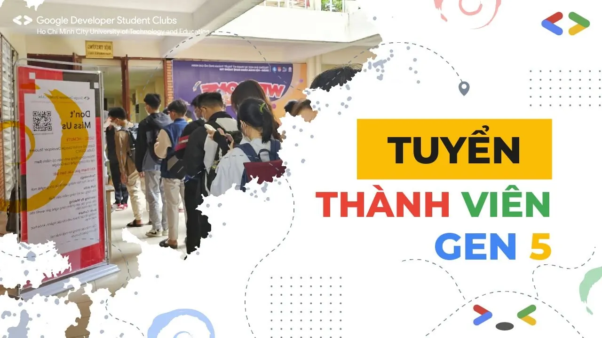

📣📣 \[MỞ ĐĂNG KÝ PHỎNG VẤN – THE NEXT GDSC-HCMUTE GENERATION – GEN 5\]
  
🌟 Bạn có niềm đam mê với công nghệ?

<!--truncate-->

🌟 Bạn muốn tìm kiếm một sân chơi để phát triển kỹ năng lập trình và làm việc nhóm?  
🌟 Bạn đã sẵn sàng trở thành một phần của cộng đồng sinh viên công nghệ đầy nhiệt huyết?
  
🎉🎉GDSC-HCMUTE Generation 5 chính thức mở đơn đăng ký phỏng vấn để tìm kiếm những gương mặt sáng giá gia nhập thế hệ mới. Đây là thời điểm vàng để bạn thể hiện tài năng, học hỏi và cùng nhau chinh phục các thử thách công nghệ!
  
—-----------------------  
💡 TẠI SAO BẠN NÊN THAM GIA GDSC?  
Môi trường năng động: Làm việc cùng các sinh viên và chuyên gia công nghệ từ khắp nơi trên thế giới.  
Cơ hội thực tế: Tham gia phát triển các dự án, sự kiện và workshop thú vị.  
Phát triển toàn diện: Rèn luyện kỹ năng lập trình, giải quyết vấn đề, giao tiếp và làm việc nhóm.  
Kết nối sâu rộng: Xây dựng mạng lưới kết nối với các nhà phát triển, doanh nghiệp và cộng đồng công nghệ toàn cầu.
  
—-----------------------  
🔑 AI CÓ THỂ THAM GIA?  
Sinh viên có đam mê về lập trình, công nghệ và phát triển phần mềm.  
Không yêu cầu kinh nghiệm trước – chỉ cần bạn có tinh thần ham học hỏi và sẵn sàng đương đầu với thử thách!
  
—-----------------------  
Các vị trí ứng tuyển:  
 Ban học thuật: Phát triển ứng dụng, chia sẻ kiến thức, đảm bảo nội dung về công nghệ cho các chương trình và sự kiện.  
 Ban truyền thông: Quản lý fanpage, thiết kế ấn phẩm, chỉnh sửa video, nhiếp ảnh và tạo nội dung cho các bài đăng.  
 Ban sự kiện và đối ngoại: Tham gia tổ chức sự kiện, MC, viết kịch bản chương trình, viết mail và kêu gọi tài trợ.
  
—-----------------------  
📋 QUY TRÌNH ĐĂNG KÝ:  
Điền đơn đăng ký: [https://docs.google.com/forms/d/e/1FAIpQLSdWcRf-aSeCikFjPSU-emhffuPN3lXXN7Hew6am8VMhWBKjSw/viewform](https://docs.google.com/forms/d/e/1FAIpQLSdWcRf-aSeCikFjPSU-emhffuPN3lXXN7Hew6am8VMhWBKjSw/viewform)  
Chờ thông báo phỏng vấn: Chúng mình sẽ liên hệ với bạn qua email.  
Phỏng vấn: Hãy sẵn sàng thể hiện niềm đam mê và năng lực của mình!  
⏰ Hạn chót đăng ký: 8:00 - 22/09/2024
  
🥰 Đừng bỏ lỡ cơ hội để trở thành một phần của đại gia đình GDSC chúng mình nhé! 😉
  
—-----------------------  
Mọi ý kiến đóng góp, các bạn đừng ngần ngại liên hệ trực tiếp với tụi mình thông qua fanpage Google Developer Student Clubs - HCMUTE: [https://www.facebook.com/gdsc.hcmute/](https://www.facebook.com/gdsc.hcmute/)  
hoặc email:  
dsc.hcmute@gmail.com  
\#GDSC #GDSC\_HCMUTE  
\#GDSC\_HCMUTE\_GEN\_5

---

_Bài viết được lưu trữ từ [fanpage HCMUTE Developer Student Club](https://www.facebook.com/hcmute.dsc)._
