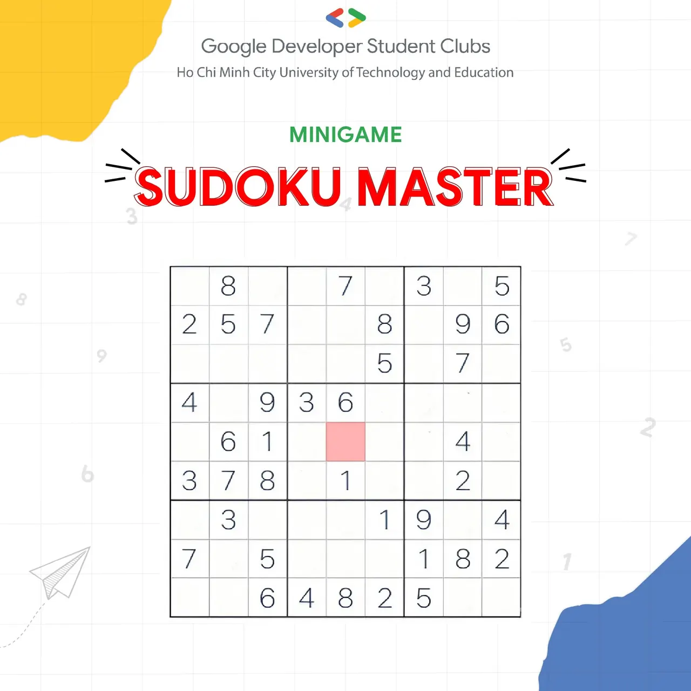

🔥🔥 \[GDSC - HCMUTE MINI GAME\] SUDOKU MASTER 🔥🔥  
✨ ✨ Tín hiệu này đã phát ra, một nhịp đập mới giữa chúng ta...

<!--truncate-->

Nếu bạn còn chưa nhận ra, thì hãy lắng nghe lời thì thầm của GDSC - HCMUTE: Một thế hệ GEN 5 đang chuẩn bị lên ngôi, và chúng mình cùng khởi đầu bằng một minigame thú vị! 🌟🌟  
🎉🎉 Và để tạo bầu không khí sôi động, lan tỏa năng lượng đến tất cả các bạn sinh viên, chúng mình mang đến một thử thách đầy mê hoặc: Minigame Sudoku!  
Bước vào thế giới của con số, nơi trí tuệ và sự sáng tạo giao hòa, và cảm nhận mỗi bước đi là một phần của câu chuyện lớn hơn.  
\_\_\_\_\_\_\_\_\_\_\_\_\_\_\_\_\_\_\_\_\_\_\_\_\_\_\_\_\_\_\_\_\_\_\_\_\_\_\_\_\_\_\_\_\_\_\_\_\_\_\_  
👉👉 THÔNG TIN CHI TIẾT VỀ MINIGAME  
👥👥 Đối tượng tham gia: Toàn thể sinh viên thuộc trường Đại học Sư phạm Kỹ thuật TP. Hồ Chí Minh.  
⏳⏳ Thời gian: từ 20h00 - 16/09/2024 đến 23h59- 21/09/2024  
📋📋 Nội dung: Minigame “Sudoku Master” hãy điền vào ô được tô đỏ trong bảng sudoku sau một số từ 1 đến 9 theo quy tắc:  
👉Mỗi hàng ngang có đủ các số từ 1 đến 9, không lặp lại.  
👉Mỗi cột dọc có đủ các số từ 1 đến 9, không lặp lại.  
👉Mỗi ô nhỏ 3x3 cũng có đủ các số từ 1 đến 9, không lặp lại.  
💌💌 THỂ LỆ THAM GIA  
📍 Bước 1: Nhấn Like và theo dõi Fanpage Google Developer Student Clubs - HCM UTE  
📍 Bước 2: Nhấn Like, chia sẻ bài viết về trang cá nhân ở chế độ công khai kèm hashtag #MINIGAME #GDSC\_HCMUTE #GEN5 và bình luận tag 3 người bạn  
📍 Bước 3: Điền câu trả lời của bạn vào link google form sau: [https://docs.google.com/forms/d/e/1FAIpQLSe0b7k1g-T1-38sVQY2a1zU3a4Zh_VKD7X75nZwpeY0zT6dpQ/viewform](https://docs.google.com/forms/d/e/1FAIpQLSe0b7k1g-T1-38sVQY2a1zU3a4Zh_VKD7X75nZwpeY0zT6dpQ/viewform)  
\* Lưu ý: Sinh viên phải thực hiện đầy đủ các bước mà BTC yêu cầu thì mới được tính là hợp lệ.  
📒📒 QUYỀN LỢI THAM GIA  
🔥🔥 Sinh viên thực hiện hợp lệ đầy đủ các bước, gửi đáp án đúng về BTC sẽ được cộng 3 điểm rèn luyện.  
\_\_\_\_\_\_\_\_\_\_\_\_\_\_\_\_\_\_\_\_\_\_\_\_\_\_\_\_\_\_\_\_\_\_\_\_\_\_\_\_\_\_\_\_\_\_\_\_\_\_\_\_\_\_\_\_\_\_\_\_\_\_\_\_\_\_\_\_\_  
🎮🎮 Và nếu bạn đã lắng nghe tín hiệu giữa chúng ta, đừng quên điền form đăng ký để trở thành thành viên gen 5 của CLB nhé!  
Cùng GDSC - HCMUTE mở ra chương mới, tạo ra những khoảng hồi ức thanh xuân tươi đẹp trong hành trình của hoàn thiện bản thân nào!  
👉👉 Trở thành một phần của GDSC-HCMUTE: [https://docs.google.com/forms/d/e/1FAIpQLSdWcRf-aSeCikFjPSU-emhffuPN3lXXN7Hew6am8VMhWBKjSw/viewform](https://docs.google.com/forms/d/e/1FAIpQLSdWcRf-aSeCikFjPSU-emhffuPN3lXXN7Hew6am8VMhWBKjSw/viewform)  
🌻🌻 Đừng quên like và follow Fanpage Google Developer Student Clubs - HCMUTE  để được cập nhật những tin tức mới nhất nhé!🍀🍀

---

_Bài viết được lưu trữ từ [fanpage HCMUTE Developer Student Club](https://www.facebook.com/hcmute.dsc)._
