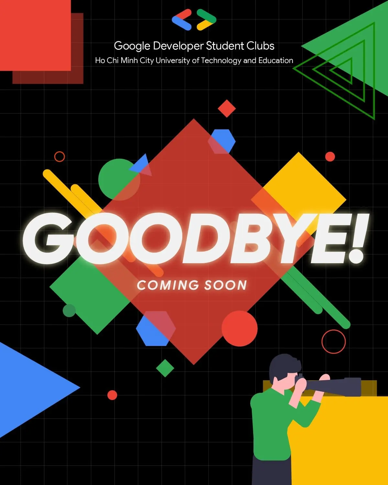

🔥 THÔNG BÁO QUAN TRỌNG TỪ CLB GDSC - HCMUTE 🔥  
\_\_\_\_\_\_\_\_\_\_\_\_\_\_\_\_\_\_\_\_\_\_\_\_\_\_\_\_\_\_\_\_\_\_\_\_\_\_\_\_\_\_\_\_\_\_\_\_\_\_\_\_\_\_\_\_\_\_\_\_\_\_\_\_\_\_\_\_\_\_\_\_\_

<!--truncate-->

Thân gửi quý đơn vị tài trợ, quý đơn vị bạn và toàn thể các bạn sinh viên gần xa đã luôn đồng hành cùng CLB trong suốt 3 năm qua!  
🙌💖 🎯 Mục tiêu mới, sứ mệnh mới: CLB Sinh viên Lập trình Google - HCMUTE (Google Developer Student Clubs - HCMUTE) sẽ chính thức thay đổi định hướng hoạt động từ tháng 10 năm 2024. Với sự đồng ý của Ban Chủ nhiệm khoa Công nghệ Thông tin, chúng mình sẽ hướng đến một mục tiêu mang giá trị lâu dài và thiết thực hơn cho cộng đồng sinh viên khoa CNTT và những bạn đam mê công nghệ tại trường ĐH Sư phạm Kỹ thuật TP. HCM.  
🚀 🔧 Các tiêu chí hoạt động mới của CLB: 1️⃣ Khuyến khích, hỗ trợ thành viên nghiên cứu và ứng dụng các công nghệ tiên tiến (KHÔNG chỉ của Google) để giải quyết các vấn đề thực tế trong cộng đồng. 2️⃣ Xây dựng các hoạt động hỗ trợ học tập bám sát chương trình đào tạo của khoa CNTT.  
🖥️📚 3️⃣ Kết nối với các công ty công nghệ tại TP. HCM, mở ra cơ hội trải nghiệm doanh nghiệp cho các bạn ngay khi còn đang học tập.  
💼👨‍💻👩‍💻 💡 Thay đổi về tên và bộ nhận diện thương hiệu: Do định hướng mới tập trung sâu hơn vào cộng đồng sinh viên khoa CNTT, chúng mình quyết định rời khỏi chương trình Google Developer Student Clubs. Kể từ hôm nay, CLB sẽ mang tên mới:  
👉 CLB Sinh viên Lập trình HCMUTE (HCMUTE Developer Student Club) với bộ nhận diện thương hiệu hoàn toàn mới!  
🎉 💬 Chúng mình xin chân thành cảm ơn các anh chị quản lý chương trình Google Developer Student Clubs Việt Nam và các chapter bạn đã đồng hành cùng CLB trong thời gian vừa qua. Sự hỗ trợ của mọi người là động lực để CLB phát triển đến ngày hôm nay.  
💪💙 🌟CLB sẽ vẫn tiếp tục tạo ra một môi trường học thuật lành mạnh, bền vững, mang lại giá trị thực tế cho sinh viên khoa CNTT và các bạn đam mê công nghệ tại HCMUTE. Đồng thời, chúng mình sẽ phát triển thêm các dự án, giải pháp hữu ích cho cộng đồng. CLB mong rằng sẽ tiếp tục nhận được sự tin tưởng và ủng hộ từ các bạn!  
💖 Hãy đón chờ các chương trình sắp tới của CLB Sinh viên Lập trình HCMUTE nhé!  
🤩✨ Hẹn gặp lại mọi người!  
🙏🎊  
\_\_\_\_\_\_\_\_\_\_\_\_\_\_\_\_\_\_\_\_\_\_\_\_\_\_\_\_\_\_\_\_\_\_\_\_\_\_\_\_\_\_\_\_\_\_\_\_\_\_\_\_\_\_\_\_\_\_\_\_\_\_\_\_\_\_\_\_\_\_\_\_\_  
🎉 Theo dõi chúng mình để không bỏ lỡ bất kỳ thông tin nào!  
🎉
  
\#HCMUTE\_DSC #SinhVienLapTrinh #DeveloperStudentClub #KetNoi #HoTro #PhatTrien

---

_Bài viết được lưu trữ từ [fanpage HCMUTE Developer Student Club](https://www.facebook.com/hcmute.dsc)._
