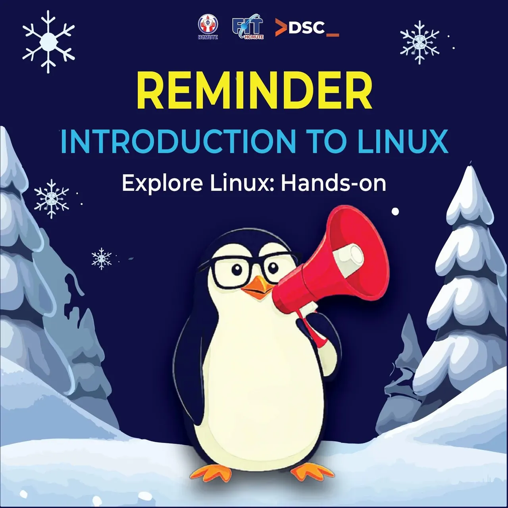

📢 \[NHẮC NHỞ THAM GIA | WORKSHOP “INTRODUCTION TO LINUX” - Explore Linux: Hands-on\] 📢  
\_\_\_\_\_\_\_\_\_\_\_\_\_\_\_\_\_\_\_\_\_\_\_\_\_\_\_\_\_\_\_\_\_\_\_\_\_\_\_\_\_\_\_\_\_\_\_\_\_\_\_\_\_\_\_\_\_\_\_\_\_\_\_\_\_\_\_\_\_\_\_\_\_\_\_

<!--truncate-->

🔔 Thời gian: Chủ Nhật, ngày 17/11/2024.  
Địa điểm: A5-203, Tòa Nhà Trung Tâm
  
👉 Topic: "Explore Linux: Hands-on"  
(Nội dung: Khám phá sâu hơn về hệ điều hành, thực hành trực tiếp và chia sẻ kinh nghiệm cùng cộng đồng)  
🕣 8h30: Bắt đầu buổi workshop, giới thiệu sơ lược về nội dung và mục tiêu của buổi online.  
🕙 8h45: Check-in  
🕘 9h00: Cùng xem lại những gì mọi người đã tìm hiểu về Linux trong 1 tuần qua (chia sẻ trải nghiệm, khó khăn, thắc mắc).  
🕙 9h30: Đặt câu hỏi và giải đáp thắc mắc từ người tham gia  
🎁 10h00: Trao quà cho những người tham gia tích cực.  
🖥️ 10h15: Cập nhật và giới thiệu thêm kiến thức về User và Group trong Linux (trình bày ngắn gọn, kèm ví dụ thực tế).  
🌐 10h45: Kết nối cộng đồng: Chia sẻ thông tin liên lạc, tạo nhóm chat/diễn đàn để tiếp tục thảo luận sau buổi workshop.  
📝 11h00: Thu thập phản hồi từ người tham gia về hai buổi workshop (gửi link form feedback).  
⏰ 11h30: Kết thúc buổi workshop.  
Hẹn gặp mọi người vào buổi cuối để cùng khám phá và làm chủ Linux! ✨  
👉 Đừng quên tham gia đúng giờ nha!  
\_\_\_\_\_\_\_\_\_\_\_\_\_\_\_\_\_\_\_\_\_\_\_\_\_\_\_\_\_\_\_\_\_\_\_\_\_\_\_\_\_\_\_\_\_\_\_\_\_\_\_\_\_\_\_\_\_\_\_\_\_\_\_\_\_\_\_\_\_\_\_\_\_\_\_  
Mọi ý kiến đóng góp, các bạn đừng ngần ngại liên hệ trực tiếp với tụi mình thông qua fanpage HCMUTE Developer Student Club [https://www.facebook.com/hcmute.dsc/](https://www.facebook.com/hcmute.dsc/)  
hoặc email: dsc.hcmute@gmail.com #HCMUTE\_DSC #DeveloperStudentClub  
\#HCMUTE\_DSC #DeveloperStudentClub  
\#DSCWorkshop #LinuxWorkshop #ConnectAndExplore #OpenSource #LinuxCommunity #IntroductionToLinux

---

_Bài viết được lưu trữ từ [fanpage HCMUTE Developer Student Club](https://www.facebook.com/hcmute.dsc)._
