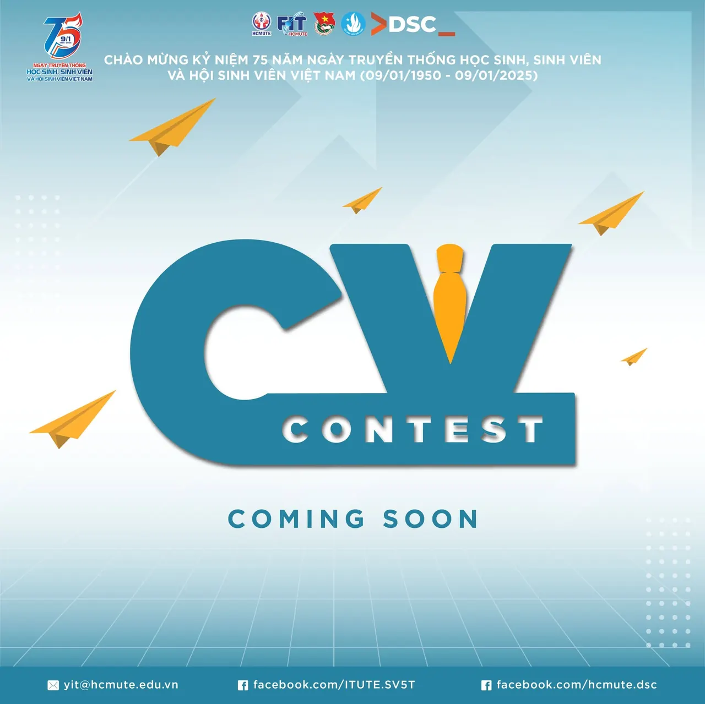

COMING SOON CV CONTEST 2025 🕊️🕊️ 🕊️ Chào mừng kỷ niệm 75 năm Ngày truyền thống học sinh, sinh viên và Hội Sinh viên Việt Nam (09/01/1950 - 09/01/2025)  
\_\_\_\_\_\_\_\_\_\_\_\_\_\_\_\_\_

<!--truncate-->

🎓 Bạn muốn khởi động cho năm 2025 bằng việc tìm kiếm việc làm nhưng chưa biết viết CV từ đâu  
✨ Đừng lo lắng! CV CONTEST 2025 đã trở lại mang đến sân chơi bổ ích giúp sinh viên học cách thiết kế hồ sơ xin việc chuyên nghiệp, tạo dấu ấn cá nhân và tự tin gây ấn tượng với nhà tuyển dụng.  
✨ Đây là cơ hội vàng để bạn nâng cấp kỹ năng và sẵn sàng cho hành trình sự nghiệp của mình.  
✨ Hãy cùng chúng mình chờ đón siêu phẩm này vào đầu năm 2025 bạn nhé!  
\_\_\_\_\_\_\_\_\_\_\_\_\_\_\_\_\_  
🔴 Mọi thắc mắc vui lòng liên hệ:  
🚩 Đ/c Đồng Gia Sang, UV BCH LCH khoa CNTT ()  
🚩 Đ/c Trần Công Toản, Chủ nhiệm CLB HCMUTE DSC () #FITUTE,
  
\#ITUTE\_CVCONTEST #HCMUTE\_DSC #DeveloperStudentClub

---

_Bài viết được lưu trữ từ [fanpage HCMUTE Developer Student Club](https://www.facebook.com/hcmute.dsc)._
