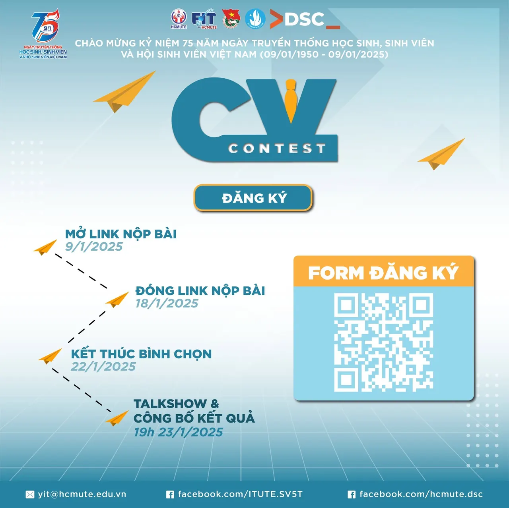
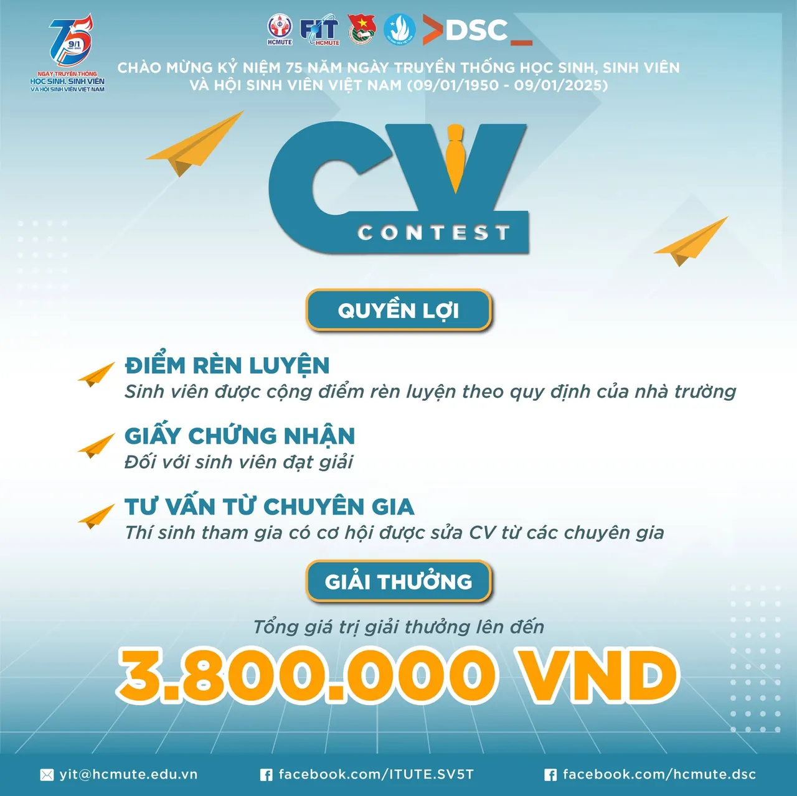
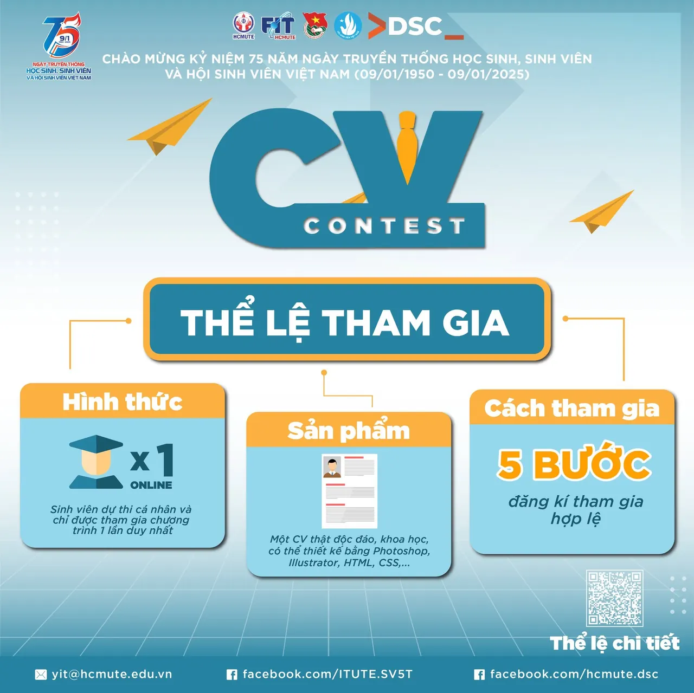
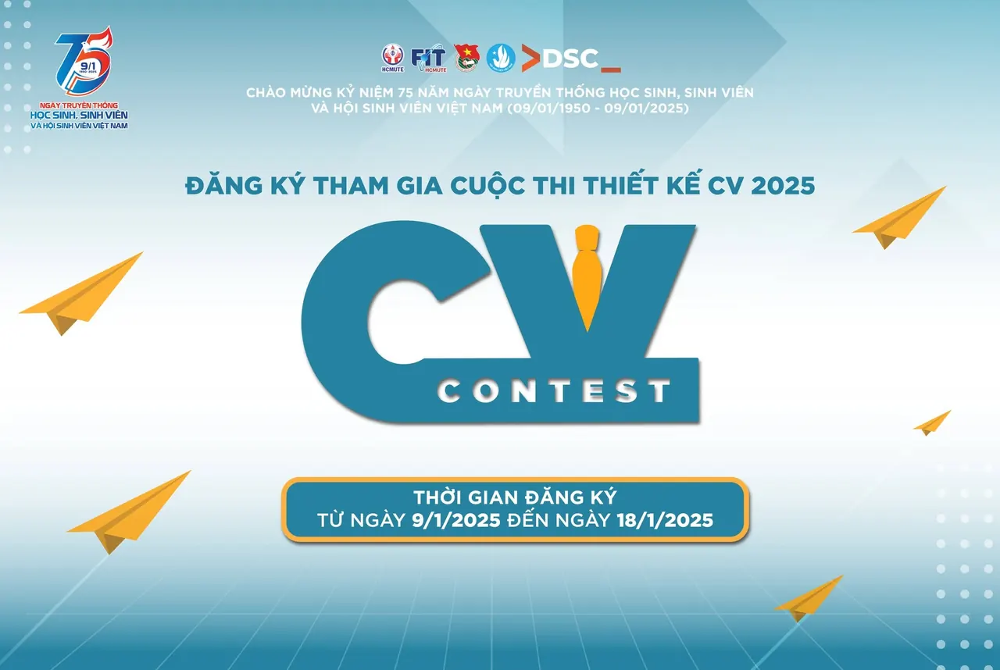

🌟CUỘC THI THIẾT KẾ CV “CV CONTEST 2025”: KHAI PHÁ TIỀM NĂNG - CHINH PHỤC TƯƠNG LAI  
------------------

<!--truncate-->

Bạn đã bao giờ nghĩ làm thế nào để "đốn tim" nhà tuyển dụng ngay từ ánh nhìn đầu tiên Bạn muốn chinh phục sự nghiệp với hành trang vững chắc cùng với sự tự tin không giới hạn, sẵn sàng khám phá, phát triển bản thân cho tương lai Vậy thì hãy đến với CV CONTEST 2025 - nơi bạn có thể tỏa sáng và thể hiện tài năng của mình! Nhằm khuyến khích tinh thần học hỏi, nâng cao kỹ năng viết CV và chuẩn bị hành trang cho con đường sự nghiệp tương lai, Đoàn - Hội Khoa Công nghệ Thông tin phối hợp với câu lạc bộ Developer Students Club chính thức phát động Cuộc thi thiết kế CV "CV CONTEST 2025" dành cho tất cả các bạn sinh viên. Đây là cơ hội để bạn thể hiện khả năng và nhận những phản hồi quý báu từ các chuyên gia và đạt được những phần thưởng hấp dẫn. Hãy cùng nhau tạo nên những bản CV ấn tượng và xây dựng hành trang vững chắc cho sự nghiệp tương lai nhé!  
🚀💼  
-----------------  
🗓️🗓️Thời gian đăng ký: Từ ngày 09/01/2025 đến ngày 18/01/2025 🙋🙋Đối tượng tham gia: Sinh viên đang theo học tại trường Đại học Sư phạm Kỹ thuật TP.HCM 🎁🎁Quyền lợi:  
📍Sinh viên được cộng điểm rèn luyện theo quy định của nhà trường 📍Đối với sinh viên đạt giải, được nhận giấy chứng nhận từ chương trình 📦📦Giải thưởng:  
🥇 01 giải nhất: 500.000 VND/Giải + Giấy chứng nhận; 🥈 01 giải nhì: 400.000 VND/Giải + Giấy chứng nhận; 🥉 02 giải ba: 300.000 VND/Giải + Giấy chứng nhận; 🏅 03 giải khuyến khích: 200.000 VND/Giải + Giấy chứng nhận; 🏅 01 giải tương tác cao nhất: 300.000VND/Giải + Giấy chứng nhận.  
📝Thể lệ chi tiết: [https://itute.tiny.us/THE-LE](https://itute.tiny.us/THE-LE) Các bước tham gia Bước 1️⃣ : Nhấn theo dõi fanpage “Sinh Viên 5 Tốt Khoa Công Nghệ Thông Tin Trường ĐH Sư Phạm Kỹ Thuật TP.HCM” Bước 2️⃣ : Tag tên 03 người bạn và chia sẻ bài viết của chương trình được đăng tải trên fanpage “Sinh Viên 5 Tốt Khoa Công Nghệ Thông Tin Trường ĐH Sư Phạm Kỹ Thuật TP.HCM” ở chế độ công khai kèm hashtag: #FITUTE, #ITUTE\_CVCONTEST #HCMUTE\_DSC #DeveloperStudentClub Bước 3️⃣ : Sinh viên tiến hành thiết kế cho mình 01 hồ sơ xin việc độc đáo, khoa học, đáp ứng đặc trưng ngành nghề nhưng vẫn thể hiện được điểm mạnh cá nhân, cá tính giúp nhà tuyển dụng đánh giá chính xác năng lực của bản thân. Hồ sơ xin việc có thể được thiết kế dưới dạng hình ảnh, file văn bản, web bằng các công cụ photoshop, các trình soạn thảo văn bản, hoặc bằng các ngôn ngữ lập trình như HTML, CSS,… Bước 4️⃣ : Gửi bài dự thi về biểu mẫu đăng ký do Ban Tổ chức đăng tải Bước 5️⃣: Sau khi gửi bài dự thi về cho Ban Tổ chức, những bài dự thi hợp lệ sẽ được Ban Tổ chức đăng tải trên Fanpage “Sinh Viên 5 Tốt Khoa Công Nghệ Thông Tin Trường ĐH Sư Phạm Kỹ Thuật TP.HCM”, sau đó sinh viên có thể kêu gọi bình chọn cho bài dự thi của mình.  
🔥🔥Đăng ký ngay tại: [https://itute.tiny.us/CV-CONTEST2025](https://itute.tiny.us/CV-CONTEST2025) Sau khi đăng tải thí sinh có thể kêu gọi bình chọn cho sản phẩm của mình với lượt tính điểm như sau: 1 lượt chia sẻ/1 lần duy nhất/1 tài khoản = 5 điểm (cú pháp:#FITUTE, #ITUTE\_CVCONTEST #HCMUTE\_DSC #DeveloperStudentClub) Tổng điểm của hồ sơ xin việc dự thi sẽ được tính bằng 80% điểm từ Ban Giám khảo và 20% điểm tương tác trên Fanpage “Sinh Viên 5 Tốt Khoa Công Nghệ Thông Tin Trường ĐH Sư Phạm Kỹ Thuật TP.HCM”  
❗❗❗Lưu ý: Hồ sơ xin việc phải do chính sinh viên sáng tạo ra, chưa từng tham gia bất kỳ cuộc thi thiết kế hồ sơ xin việc nào, chưa từng được đăng tải trên các phương tiện thông tin truyền thông đại chúng, mạng xã hội... Sinh viên phải chịu hoàn toàn trách nhiệm với bài dự thi của mình về các vấn đề liên quan đến bản quyền, chuẩn mực đạo đức, vi phạm thuần phong mỹ tục và pháp luật Việt Nam. Nếu các tác phẩm dự thi có dấu hiệu vi phạm bản quyền hoặc không đúng theo quy định đã được thông báo thì Ban Tổ chức có quyền từ chối đăng tải, trao giải và cộng điểm; đồng thời Ban Tổ chức không chịu trách nhiệm về bất cứ vấn đề pháp lý nào liên quan đến quyền tác giả của các tác phẩm tham gia dự thi.  
❤️ Còn chần chừ gì mà không tham gia nữa các bạn ơiii Mọi thắc mắc vui lòng liên hệ: Đ/c Đồng Gia Sang, UV BCH LCH khoa CNTT () Đ/c Trần Công Toản, Chủ nhiệm CLB HCMUTE DSC () Fanpage: Sinh Viên 5 Tốt Khoa Công Nghệ Thông Tin Trường ĐH Sư Phạm Kỹ Thuật TP.HCM #FITUTE,
  
\#ITUTE\_CVCONTEST #HCMUTE\_DSC #DeveloperStudentClub

---

_Bài viết được lưu trữ từ [fanpage HCMUTE Developer Student Club](https://www.facebook.com/hcmute.dsc)._
