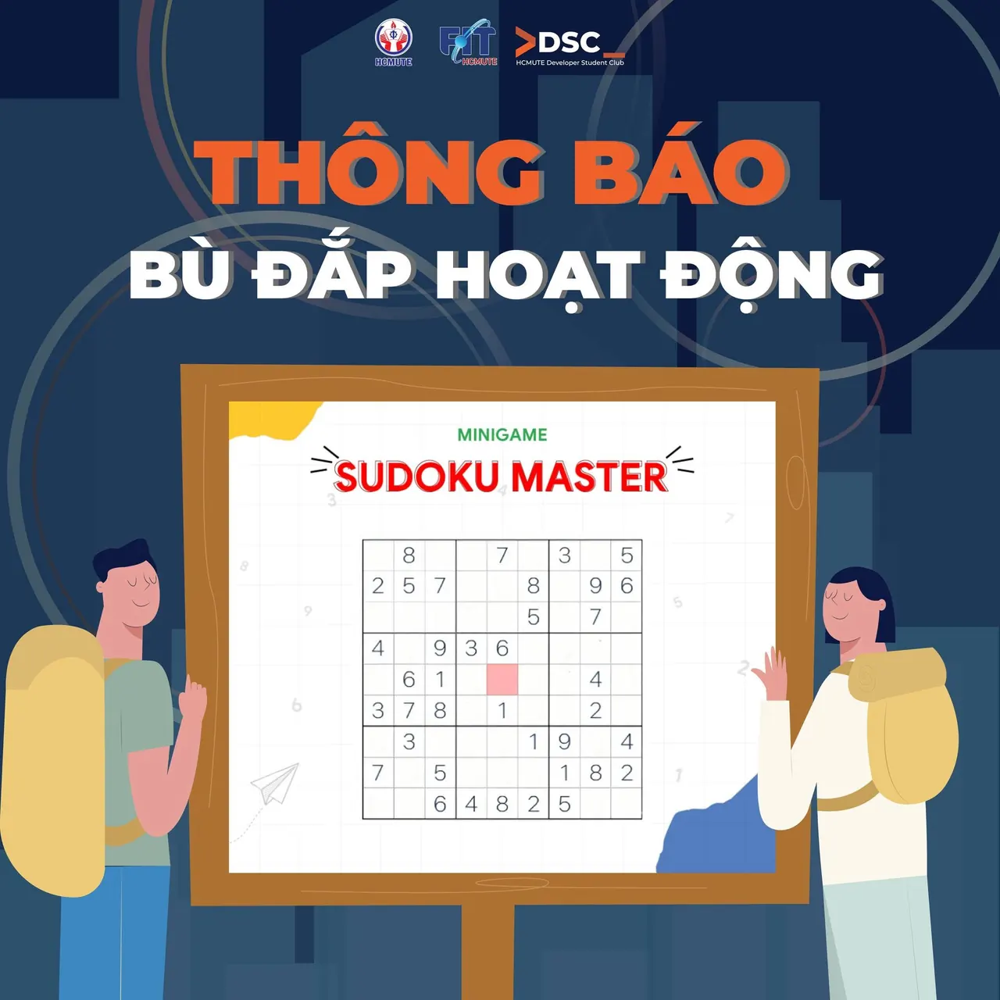

\[Thông báo về việc hỗ trợ các bạn tham gia hoạt động SUDOKU MASTER của HCMUTE DSC\]  
\_\_\_\_\_\_\_\_\_\_\_\_\_\_\_\_\_\_\_\_\_\_\_\_\_\_\_\_\_\_\_\_\_\_\_\_\_\_

<!--truncate-->

Các bạn thân mến,
  
Trước hết, Ban chủ nhiệm CLB chân thành xin lỗi các bạn vì sự cố đáng tiếc liên quan đến việc cộng điểm rèn luyện cho hoạt động SUDOKU MASTER của HCMUTE DSC. Do một số vấn đề về giấy tờ, chúng mình rất tiếc không thể cộng điểm rèn luyện cho các bạn theo kế hoạch ban đầu.
  
Chúng mình hiểu rằng điều này có thể gây thất vọng cho các bạn, và chúng mình vô cùng xin lỗi vì sự bất tiện này. Để bù đắp cho những nỗ lực và đóng góp của các bạn, CLB xin gửi tặng 100 suất review CV & Portfolio cho 100 bạn đăng ký sớm nhất.
  
Thời gian đăng ký: Từ hôm nay đến hết ngày 28/02/2025.  
Cách thức đăng ký: Vui lòng inbox fanpage của CLB.  
Nội dung: CV và Portfolio của các bạn sẽ được các anh chị thành viên có kinh nghiệm hỗ trợ góp ý và chỉnh sửa.  
Chúng mình hy vọng rằng chương trình này sẽ giúp các bạn có một CV & Portfolio ấn tượng, từ đó tăng cơ hội thành công trong quá trình tìm kiếm việc làm.
  
Một lần nữa, xin chân thành cảm ơn sự tham gia và ủng hộ của các bạn.
  
Trân trọng,
  
Ban chủ nhiệm CLB  
\_\_\_\_\_\_\_\_\_\_\_\_\_\_\_\_\_\_\_\_\_\_\_\_\_\_\_\_\_\_\_\_\_\_\_\_\_\_  
Mọi ý kiến đóng góp, các bạn đừng ngần ngại liên hệ trực tiếp với tụi mình thông qua  
fanpage HCMUTE Developer Student Club [https://www.facebook.com/hcmute.dsc/](https://www.facebook.com/hcmute.dsc/)  
hoặc email: dsc.hcmute@gmail.com  
\#HCMUTE\_DSC #DeveloperStudentClub

---

_Bài viết được lưu trữ từ [fanpage HCMUTE Developer Student Club](https://www.facebook.com/hcmute.dsc)._
