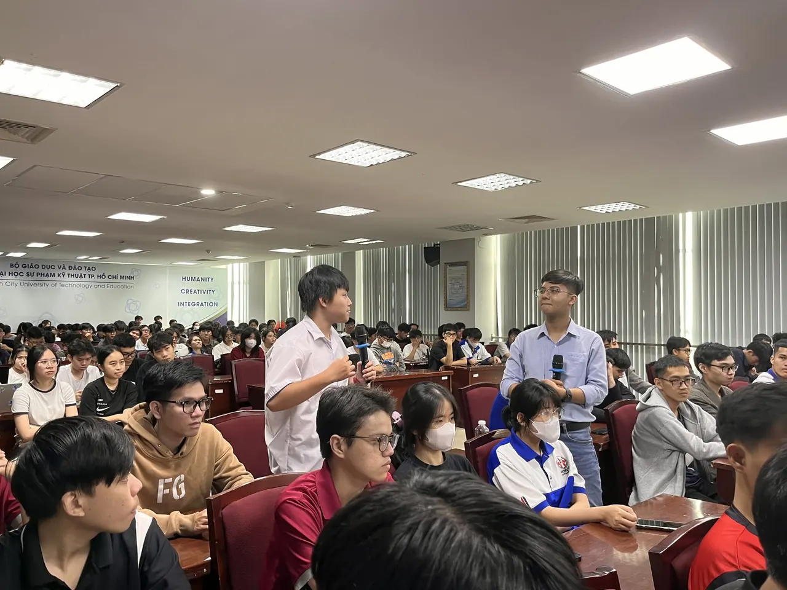
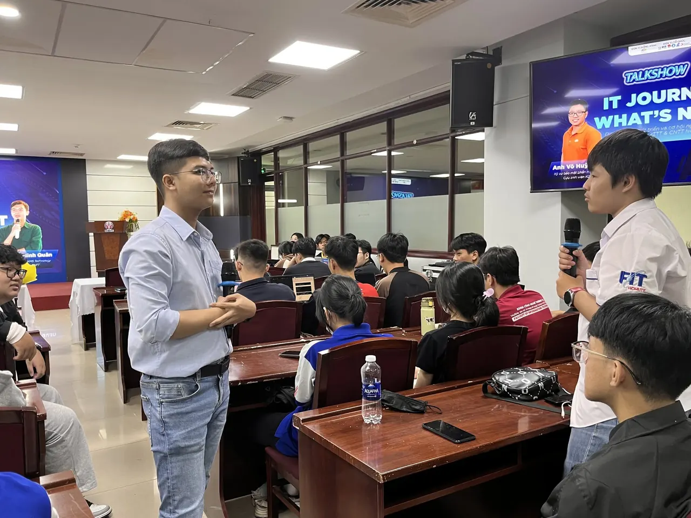
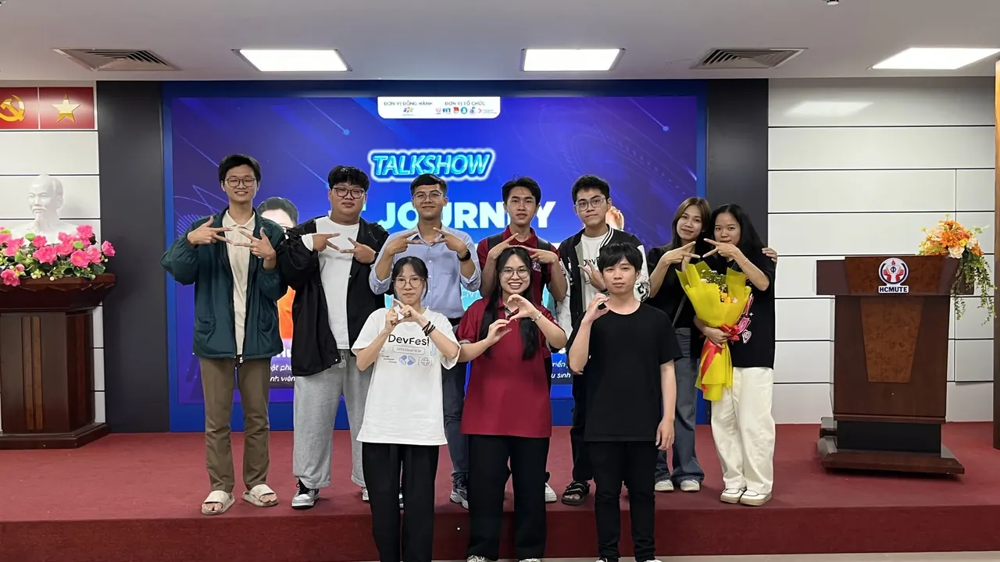
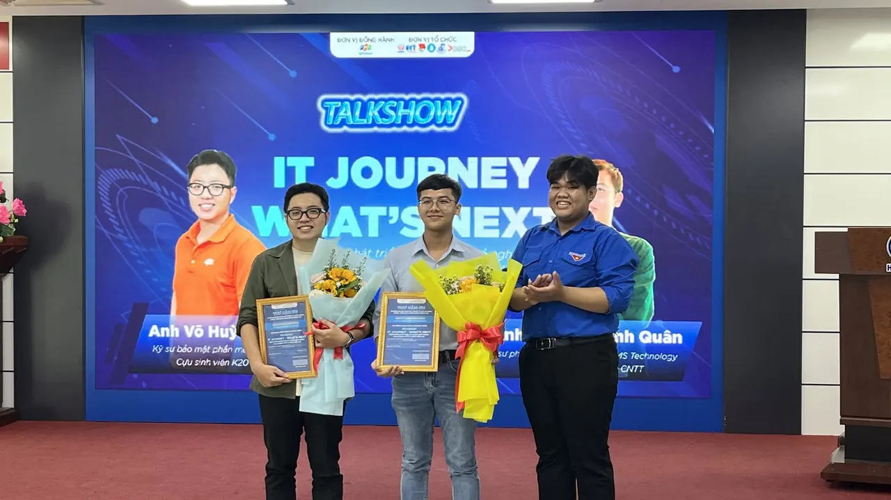
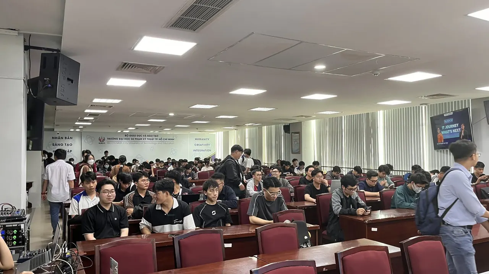
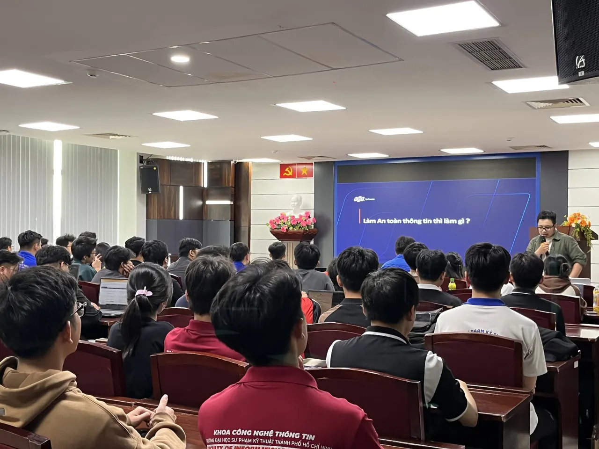

\[🚀🔥 RECAP IT JOURNEY - WHAT'S NEXT 2025 🚀🔥\]  
\_\_\_\_\_\_\_\_\_\_\_\_\_\_\_\_\_\_\_\_\_\_\_\_\_\_\_\_\_\_\_\_\_\_\_\_\_\_

<!--truncate-->

✨ “IT JOURNEY, WHAT’S NEXT?” 2025 đã diễn ra thành công rực rỡ với sự tham gia đông đảo của các bạn sinh viên khoa CNTT 🎓 – một buổi talkshow không chỉ truyền cảm hứng 🌟 mà còn mang đến nhiều thông tin thực tế 💡 và giá trị về định hướng nghề nghiệp trong lĩnh vực Công nghệ Thông tin 💻.
  
🎤 Chương trình vinh dự được chào đón hai diễn giả đặc biệt – những cựu sinh viên ưu tú của HCMUTE:  
👨‍💼 Anh Võ Huỳnh Anh Nhật – Cựu sinh viên khóa K20, hiện đang công tác tại FPT Software 🏢  
👨‍💼 Anh Võ Trần Minh Quân – Cựu sinh viên khóa K18, hiện đang làm việc tại KMS Technology 🚀
  
📚 Với những chia sẻ chân thành 🤝 và kinh nghiệm thực tiễn tích lũy được từ quá trình học tập tại trường 🏫 cũng như hành trình làm việc tại các công ty công nghệ lớn 🌐, hai anh đã mang đến cái nhìn sâu sắc về thực trạng và xu hướng phát triển của ngành CNTT, các vị trí nghề nghiệp phổ biến, lộ trình phát triển trong ngành cũng như các năng cần thiết và những lời khuyên thực tế cho sinh viên trong việc chuẩn bị hành trang bước vào thị trường lao động 📊
  
🤗 Talkshow không chỉ là nơi để học hỏi, mà còn là dịp để các bạn sinh viên kết nối, đặt câu hỏi và được giải đáp trực tiếp từ những người đi trước – những người từng là sinh viên HCMUTE, từng có cùng xuất phát điểm như các bạn 👣.
  
💙 CLB HCMUTE DSC xin gửi lời cảm ơn sâu sắc đến hai diễn giả khách mời, đơn vị đồng hành và toàn thể các bạn sinh viên đã góp phần tạo nên một buổi talkshow ý nghĩa và trọn vẹn 🎉.  
📅 Hẹn gặp lại các bạn trong những hoạt động tiếp theo cùng HCMUTE DSC, HCMUTE ISC và Đoàn - Hội khoa CNTT nhé! 🥳  
\_\_\_\_\_\_\_\_\_\_\_\_\_\_\_\_\_\_\_\_\_\_\_\_\_\_\_\_\_\_\_\_\_\_\_\_\_\_  
Mọi ý kiến đóng góp, các bạn đừng ngần ngại liên hệ trực tiếp với tụi mình thông qua fanpage HCMUTE Developer Student Club [https://www.facebook.com/hcmute.dsc/](https://www.facebook.com/hcmute.dsc/)  
hoặc email: dsc.hcmute@gmail.com  
\#HCMUTE #FITUTE #ITUTE\_TALKSHOW #HCMUTE\_ISC #HCMUTE\_DSC

---

_Bài viết được lưu trữ từ [fanpage HCMUTE Developer Student Club](https://www.facebook.com/hcmute.dsc)._
