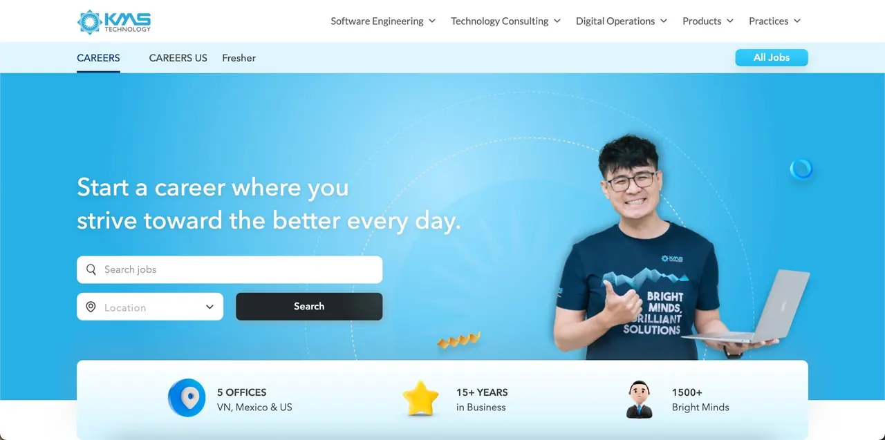

\[DSC Career Connect\]  
💼 Trong khuôn khổ các hoạt động Kết nối Doanh nghiệp, HCM UTE Developer Student Club xin gửi đến các bạn thông tin tuyển dụng Fresher tại KMS Technology Vietnam – một trong những công ty phần mềm hàng đầu với hơn 15 năm kinh nghiệm, 1500+ nhân sự, và nhiều dự án toàn cầu 🌎.

<!--truncate-->

👉 Các vị trí Fresher đang mở đơn: 1. Fresher Java Software Engineer [https://careers.kms-technology.com/job/fresher-java-software-engineer-744000071716545/](https://careers.kms-technology.com/job/fresher-java-software-engineer-744000071716545/) 2. Fresher Software Developer (Low code platform) [https://careers.kms-technology.com/job/fresher-software-developer-low-code-platform-744000072954665/](https://careers.kms-technology.com/job/fresher-software-developer-low-code-platform-744000072954665/) 3. Fresher Full-stack Test Engineer (QA/QC/Tester) [https://careers.kms-technology.com/job/fresher-full-stack-test-engineer-qa-qc-tester-744000077358936](https://careers.kms-technology.com/job/fresher-full-stack-test-engineer-qa-qc-tester-744000077358936) 📌 Đây là cơ hội tuyệt vời để: \* Trải nghiệm môi trường doanh nghiệp chuyên nghiệp \* Học hỏi từ các dự án quốc tế \* Tạo bàn đạp cho sự nghiệp IT ngay từ khi còn là sinh viên
  
\#DSCCareerConnect #KMSFresher #SinhVienCNTT #ITCareers #KMSCareers #KetNoiDoanhNghiep

---

_Bài viết được lưu trữ từ [fanpage HCMUTE Developer Student Club](https://www.facebook.com/hcmute.dsc)._
