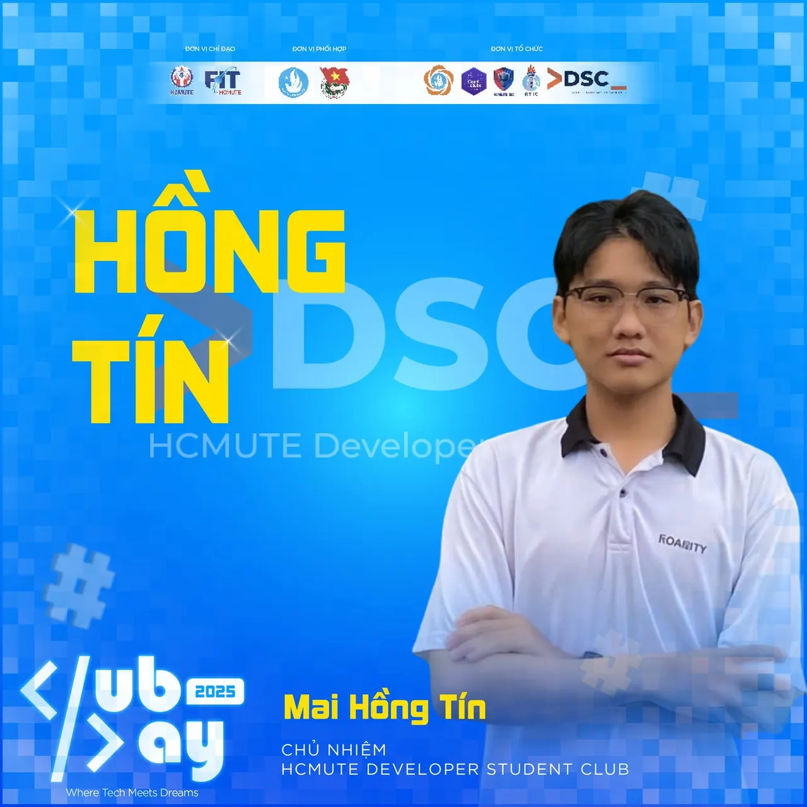
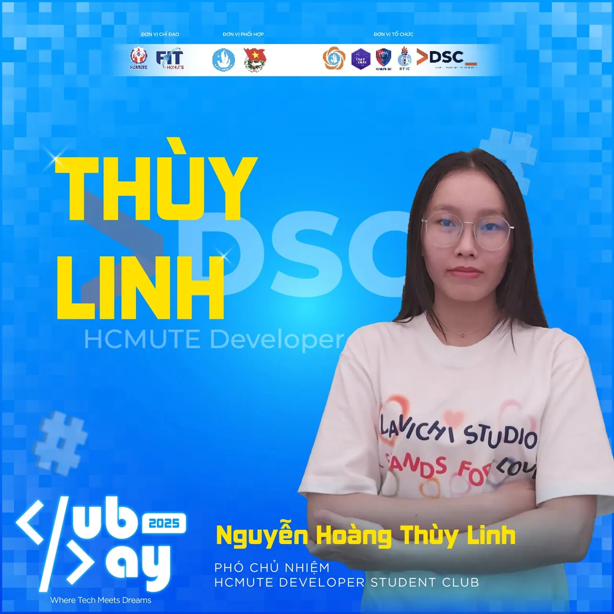

📢📢 \[GIỚI THIỆU BAN CHỦ NHIỆM HCMUTE DSC GEN 6 | 2025 – 2026\] Các bạn đã sẵn sàng chưa  
😎 DSC đã chuẩn bị hạ cánh an toàn tại hành tinh FIT CLUB’S DAY 2025!

<!--truncate-->

🚀✨ Hãy cùng gặp gỡ Ban Chủ Nhiệm Gen 6 – đội ngũ trẻ trung, năng động và đầy nhiệt huyết, sẵn sàng dẫn dắt DSC trong hành trình năm học mới!”  
🔥🔥 HCMUTE DSC xin tự hào ra mắt Ban Chủ Nhiệm nhiệm kỳ 2025 - 2026:  
💁‍♂️ Chủ nhiệm - Mai Hồng Tín Sinh viên khóa 2023, khoa Công nghệ thông tin, chuyên ngành Công nghệ phần mềm 💁‍♀️ Phó chủ nhiệm - Nguyễn Hoàng Thùy Linh Sinh viên khóa 2022, khoa Công nghệ thông tin, chuyên ngành Công nghệ phần mềm 🍀🍀 Hãy cùng gửi lời chúc tới Ban Chủ Nhiệm HCMUTE DSC Gen 6 – chúc các bạn một nhiệm kỳ năng động, tràn đầy nhiệt huyết, dẫn dắt CLB phát triển và mang đến nhiều hoạt động thú vị, bổ ích cho tất cả các bạn sinh viên. Cùng đồng hành và trải nghiệm cùng họ để mỗi khoảnh khắc tại DSC đều trở thành kỷ niệm đáng nhớ!  
🌟 🎯🎯 Và đừng quên ghé gian hàng DSC tại Fit Club’s Day, tham gia, trải nghiệm và kết nối cùng chúng mình nhé!  
💫  
---------------------------------------------------------------------------  
Mọi ý kiến đóng góp, các bạn đừng ngần ngại liên hệ trực tiếp với tụi mình thông qua fanpage Google Developer Student Clubs - HCMUTE: [https://www.facebook.com/hcmute.dsc](https://www.facebook.com/hcmute.dsc)
  
\#DSC #HCMUTE\_DSC #New\_coreteam\_HCMUTE\_DSC

---

_Bài viết được lưu trữ từ [fanpage HCMUTE Developer Student Club](https://www.facebook.com/hcmute.dsc)._
