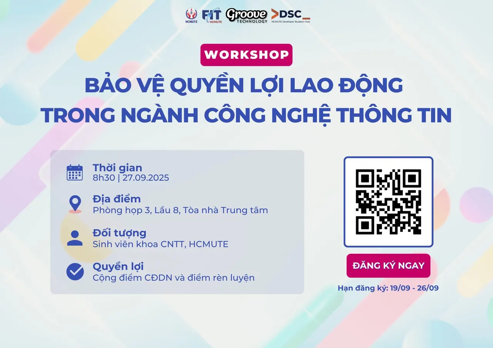

\[⚖️ WORKSHOP - BẢO VỆ QUYỀN LỢI LAO ĐỘNG TRONG NGÀNH CÔNG NGHỆ THÔNG TIN ⚖️\]  
😯 Bạn đã sẵn sàng bước vào thị trường việc làm với đầy rẫy tình huống bất ngờ Ngành Công nghệ Thông tin đang phát triển nhanh chóng, mang đến nhiều cơ hội nghề nghiệp và sự đổi mới không ngừng. Bên cạnh đó là những rủi ro tiềm ẩn mà bất kỳ ai cũng có thể gặp phải. Trong bối cảnh ấy, kiến thức về pháp luật lao động chính là “tấm khiên” giúp bạn bảo vệ quyền lợi và định hướng sự nghiệp vững chắc. Với mong muốn trang bị cho sinh viên hành trang bảo vệ quyền lợi của mình, DSC hợp tác cùng Groove Technology tổ chức Workshop “Bảo vệ quyền lợi lao động trong ngành Công nghệ Thông tin”, hướng tới mục tiêu:

<!--truncate-->

🔹 Cung cấp kiến thức nền tảng về pháp luật lao động, đặc biệt trong bối cảnh công nghệ thay đổi môi trường làm việc.  
🔹 Trang bị hành trang để sinh viên chủ động, tự tin khi bước vào môi trường làm việc thực tế.  
🔹 Giúp nhận biết và bảo vệ quyền lợi ngay từ giai đoạn tìm kiếm việc làm.  
👉 Nhanh tay đăng ký ngay hôm nay để giữ chỗ cùng DSC tham gia Workshop nhé!  
-------------------------------------------------------------  
✅✅ Thông tin chương trình ⏰ Thời gian: 8h30, ngày 27/09/2025 📍 Địa điểm: Phòng họp 3, Lầu 8, Tòa nhà trung tâm, HCMUTE 🎤 Diễn giả:  
🔸 Chị Dương Thị Ngọc Mai - HR Manager tại Groove Technology 🔸 Chị Tống Quỳnh Ngân - Senior HR Executive tại Groove Technology 💁‍♂️ Đối tượng: Sinh viên khoa Công nghệ thông tin HCMUTE  
-------------------------------------------------------------  
✅ Đăng ký tham gia 🔹 Link đăng ký: [https://forms.gle/7FzHzEC7BBuSrH5N9](https://forms.gle/7FzHzEC7BBuSrH5N9) 🔹 Thời hạn đăng ký: 23h59 ngày 26/09/2025 (Biểu mẫu có thể đóng sớm hơn nếu số lượng sinh viên đăng ký đạt giới hạn)  
-------------------------------------------------------------  
✅ Quyền lợi khi tham gia 🔹 Được cộng điểm chuyên đề doanh nghiệp và điểm rèn luyện theo quy định của nhà trường 🔹 Hiểu rõ và áp dụng quy định pháp luật vào thực tiễn làm việc.  
🔹 Được giải đáp trực tiếp thắc mắc với chuyên gia.  
-------------------------------------------------------------
  
\#DSC #GrooveTechnology #Workshop #QuyenLoiLaoDong #ITCareer #PhapLuat #ITLaw

---

_Bài viết được lưu trữ từ [fanpage HCMUTE Developer Student Club](https://www.facebook.com/hcmute.dsc)._
