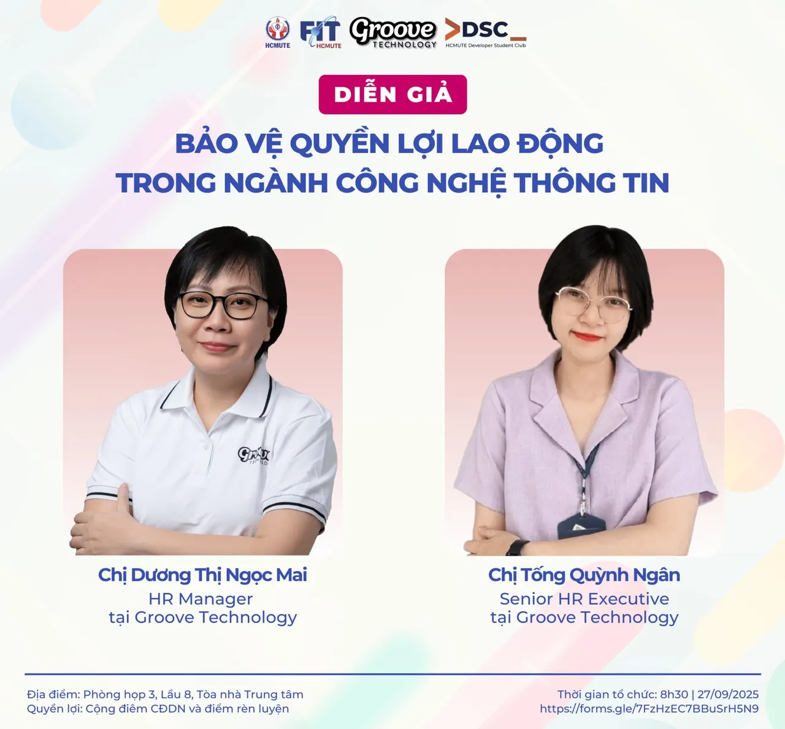

\[🎤 GẶP GỠ DIỄN GIẢ WORKSHOP - BẢO VỆ QUYỀN LỢI LAO ĐỘNG TRONG NGÀNH CÔNG NGHỆ THÔNG TIN 🎤\] Trong môi trường Công nghệ Thông tin đầy biến động, việc hiểu rõ quyền lợi lao động không chỉ giúp bạn tự tin hơn mà còn bảo vệ chính mình trước những rủi ro nghề nghiệp. Đồng hành cùng workshop lần này là hai chuyên gia dày dạn kinh nghiệm, sẵn sàng mang đến những góc nhìn thực tế và những lời khuyên hữu ích để bạn vững vàng hơn trên con đường sự nghiệp:  
👩‍💼 Chị Dương Thị Ngọc Mai – HR Manager tại Groove Technology.

<!--truncate-->

🔹 Với hơn 20 năm kinh nghiệm quản lý nhân sự trong lĩnh vực CNTT.  
🔹 Đã và đang làm việc tại các tập đoàn và công ty đa quốc gia như: Global Cybersoft JSC (Hiện tại tập đoàn toàn cầu Hitachi Vantara Việt Nam, Tập đoàn Aricent Vietnam, Groove Technology Vietnam.  
👩‍💼 Chị Tống Quỳnh Ngân – Senior HR Executive tại Groove Technology.  
🔹 Với hơn 10 năm kinh nghiệm trong lĩnh vực HR Auditor, Compensation  Benefit.  
🔹 Đã và đang làm việc tại nhiều tập đoàn lớn và công ty đa quốc gia trong lĩnh vực công nghệ, ngân hàng như: Samsung Vietnam, UOB (Citibank), NovaGroup, Groove Technology Vietnam. Cùng tham gia để lắng nghe, trò chuyện và bỏ túi những bí kíp giúp bạn bảo vệ quyền lợi của mình nhé!  
😉  
-------------------------------------------------------------  
✅✅ Thông tin chương trình ⏰ Thời gian: 8h30, ngày 27/09/2025 📍 Địa điểm: Phòng họp 3, Lầu 8, Tòa nhà trung tâm, HCMUTE 🎤 Diễn giả:  
🔸 Chị Dương Thị Ngọc Mai - HR Manager tại Groove Technology 🔸 Chị Tống Quỳnh Ngân - Senior HR Executive tại Groove Technology 💁‍♂️ Đối tượng: Sinh viên khoa Công nghệ thông tin HCMUTE  
-------------------------------------------------------------  
✅ Đăng ký tham gia 🔹 Link đăng ký: [https://forms.gle/7FzHzEC7BBuSrH5N9](https://forms.gle/7FzHzEC7BBuSrH5N9) 🔹 Thời hạn đăng ký: 23h59 ngày 26/09/2025 (Biểu mẫu có thể đóng sớm hơn nếu số lượng sinh viên đăng ký đạt giới hạn)  
-------------------------------------------------------------  
✅ Quyền lợi khi tham gia 🔹 Được cộng điểm chuyên đề doanh nghiệp đối với sinh viên khoa Công nghệ thông tin và điểm rèn luyện theo quy định của nhà trường 🔹 Hiểu rõ và áp dụng quy định pháp luật vào thực tiễn làm việc.  
🔹 Được giải đáp trực tiếp thắc mắc với chuyên gia.  
-------------------------------------------------------------
  
\#DSC #GrooveTechnology #Workshop #QuyenLoiLaoDong #ITCareer #PhapLuat #ITLaw

---

_Bài viết được lưu trữ từ [fanpage HCMUTE Developer Student Club](https://www.facebook.com/hcmute.dsc)._
