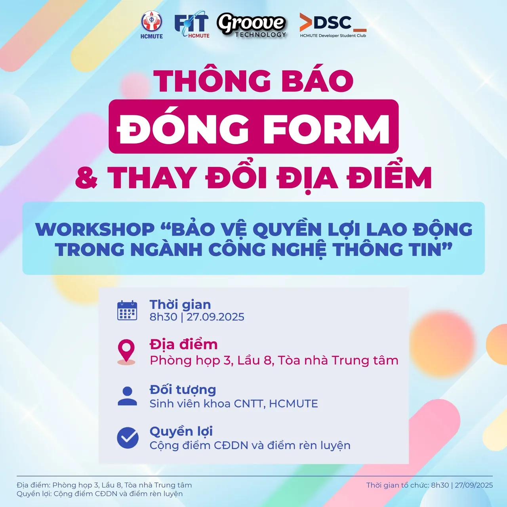

\[📢 THÔNG BÁO ĐÓNG FORM & THAY ĐỔI ĐỊA ĐIỂM WORKSHOP BẢO VỆ QUYỀN LỢI LAO ĐỘNG TRONG NGÀNH CÔNG NGHỆ THÔNG TIN\]
  
🎯 Workshop “Bảo vệ quyền lợi lao động trong ngành Công nghệ Thông tin” đã chính thức đủ số lượng đăng ký và đóng form!

<!--truncate-->

 DSC xin cảm ơn sự quan tâm và đăng ký nhanh chóng của các bạn sinh viên ❤️
  
📌 Cập nhật quan trọng:  
 Để buổi workshop diễn ra thuận lợi hơn, địa điểm tổ chức sẽ được thay đổi như sau:  
 📍 Địa điểm mới: Phòng họp 3, Lầu 8, Tòa nhà trung tâm, HCMUTE  
 ⏰ Thời gian: 8h30, ngày 27/09/2025 (giữ nguyên)  
-------------------------------------------------------------  
 \#DSC #GrooveTechnology #Workshop #QuyenLoiLaoDong #ITCareer #PhapLuat #ITLaw

---

_Bài viết được lưu trữ từ [fanpage HCMUTE Developer Student Club](https://www.facebook.com/hcmute.dsc)._
