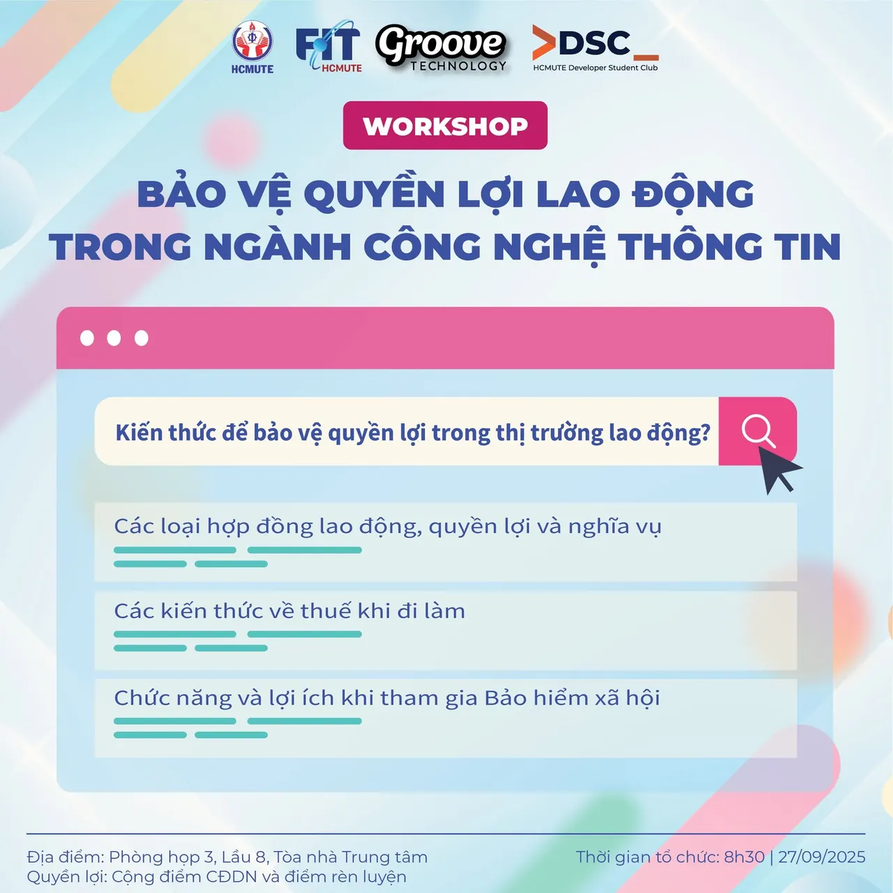

\[💡 NỘI DUNG NỔI BẬT TẠI WORKSHOP - BẢO VỆ QUYỀN LỢI LAO ĐỘNG TRONG NGÀNH CÔNG NGHỆ THÔNG TIN 💡\]  
💭 Bạn sắp bước vào môi trường làm việc

<!--truncate-->

💭 Bạn muốn nắm vững những điều quan trọng để tự bảo vệ quyền lợi và đưa ra quyết định thông minh Vậy thì hãy tham dự “Workshop - Bảo vệ quyền lợi lao động trong ngành Công nghệ Thông tin” nhé 😉 💡 Đến với workshop, bạn sẽ được:  
📌 Hiểu rõ về hợp đồng lao động – từ định nghĩa, các loại hợp đồng (hợp đồng lao động xác định thời hạn và hợp đồng lao động không xác định thời hạn), quyền lợi và nghĩa vụ, đến các lưu ý thực tế trong ngành Công nghệ thông tin. Bạn cũng sẽ được giải thích về thỏa thuận bảo mật thông tin và những chính sách bảo mật trong môi trường làm việc Hybrid Working.  
📌 Nắm vững kiến thức liên quan đến thuế – cách tính thuế khi đi làm, thu nhập chịu thuế.  
📌 Hiểu về bảo hiểm xã hội – chức năng, lợi ích khi tham gia. Nhớ note lại lịch để không bỏ lỡ cơ hội học hỏi, giải đáp thắc mắc và trang bị hành trang bảo vệ quyền lợi của chính bạn!  
😎  
-------------------------------------------------------------  
✅✅ Thông tin chương trình ⏰ Thời gian: 8h30, ngày 27/09/2025 📍 Địa điểm: Phòng họp 3, Lầu 8, Tòa nhà trung tâm, HCMUTE 🎤 Diễn giả:  
🔸 Chị Dương Thị Ngọc Mai - HR Manager tại Groove Technology 🔸 Chị Tống Quỳnh Ngân - Senior HR Executive tại Groove Technology 💁‍♂️ Đối tượng: Sinh viên khoa Công nghệ thông tin HCMUTE  
-------------------------------------------------------------  
✅ Quyền lợi khi tham gia 🔹 Được cộng điểm chuyên đề doanh nghiệp và điểm rèn luyện theo quy định của nhà trường đối với các bạn đã đăng ký.  
🔹 Hiểu rõ và áp dụng quy định pháp luật vào thực tiễn làm việc.  
🔹 Được giải đáp trực tiếp thắc mắc với chuyên gia.  
-------------------------------------------------------------
  
\#DSC #GrooveTechnology #Workshop #QuyenLoiLaoDong #ITCareer #PhapLuat #ITLaw

---

_Bài viết được lưu trữ từ [fanpage HCMUTE Developer Student Club](https://www.facebook.com/hcmute.dsc)._
