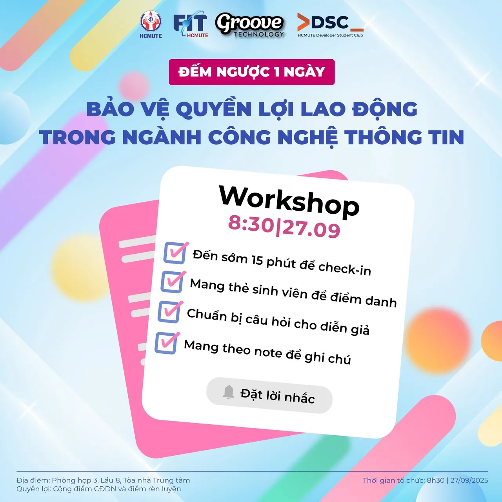

\[⏳ COUNTDOWN WORKSHOP - BẢO VỆ QUYỀN LỢI LAO ĐỘNG TRONG CNTT\]  
🚨 Chỉ còn 1 ngày nữa, Workshop “Bảo vệ quyền lợi lao động trong ngành Công nghệ Thông tin” do Groove Technology phối hợp cùng HCMUTE - DSC sẽ chính thức diễn ra! Đừng bỏ lỡ cơ hội để:

<!--truncate-->

✔️ Nắm vững kiến thức thực tế về hợp đồng lao động, thuế, BHXH …  
✔️ Giao lưu trực tiếp cùng chuyên gia nhân sự từ Groove Technology 📝 Checklist để sẵn sàng cho ngày mai, đừng quên note lại để tận hưởng Workshop trọn vẹn nhé!  
☑️ Có mặt trước 15 phút để check-in ☑️ Mang theo thẻ SV để điểm danh ☑️ Chuẩn bị câu hỏi muốn trao đổi cùng diễn giả ☑️ Mang sổ/điện thoại để ghi chú  
-------------------------------------------------------------  
✅✅ Thông tin chương trình ⏰ Thời gian: 8h30, ngày 27/09/2025 📍 Địa điểm: Phòng họp 3, Lầu 8, Tòa nhà trung tâm, HCMUTE 🎤 Diễn giả: Chị Dương Thị Ngọc Mai - HR Manager tại Groove Technology Chị Tống Quỳnh Ngân - Senior HR Executive tại Groove Technology 💁‍♂️ Đối tượng: Sinh viên khoa Công nghệ thông tin HCMUTE  
-------------------------------------------------------------  
✅ Quyền lợi khi tham gia Được cộng điểm chuyên đề doanh nghiệp và điểm rèn luyện theo quy định của nhà trường đối với các bạn đã đăng ký. Hiểu rõ và áp dụng quy định pháp luật vào thực tiễn làm việc. Được giải đáp trực tiếp thắc mắc với chuyên gia.  
-------------------------------------------------------------
  
\#DSC #GrooveTechnology #Workshop #QuyenLoiLaoDong #ITCareer #PhapLuat #ITLaw

---

_Bài viết được lưu trữ từ [fanpage HCMUTE Developer Student Club](https://www.facebook.com/hcmute.dsc)._
