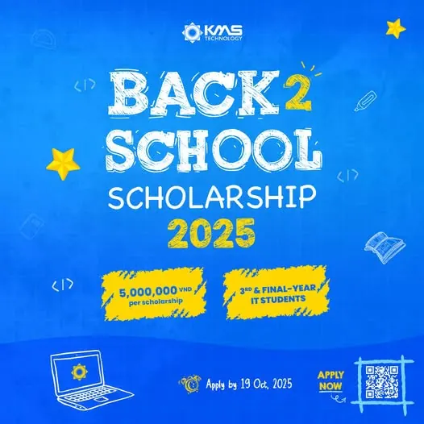

\[DSC Career Connect\] Fueling Future Vietnamese Tech Talents with KMS Back2School Scholarship 2025 ✨ Bạn là sinh viên CNTT tài năng, đam mê chinh phục những đỉnh cao mới Đây chính là cơ hội để bạn bứt phá và ghi thêm cột mốc đáng tự hào với Học bổng KMS Back2School 2025!  
💰 5.000.000 VND tiền mặt cho mỗi suất học bổng 🤝 Kết nối và nâng cao kỹ năng chuyên môn cùng các chuyên gia cấp cao 🎯 Định hướng nghề nghiệp với đội ngũ tuyển dụng dày dặn kinh nghiệm 🏢 Khám phá môi trường "Great Place to Work" tại công ty công nghệ đa quốc gia ĐỐI TƯỢNG THAM GIA:

<!--truncate-->

✅ Sinh viên năm 3, 4 (hoặc năm cuối) các nhóm ngành IT trên toàn quốc ✅ Điểm trung bình tích lũy từ 8.0 trở lên (thang điểm 10) NỘP HỒ SƠ TẠI:  
👉 [https://careers.kms-technology.com/.../kms-back2school.../](https://careers.kms-technology.com/.../kms-back2school.../) ⏰ Hạn đăng ký: 23h00, ngày 19/10/2025 📧 Liên hệ: KMS-Gives-VN@kms-technology.com
  
\#DSCCareerConnect #KMSFresher #SinhVienCNTT #ITCareers #KMSCareers #KetNoiDoanhNghiep

---

_Bài viết được lưu trữ từ [fanpage HCMUTE Developer Student Club](https://www.facebook.com/hcmute.dsc)._
