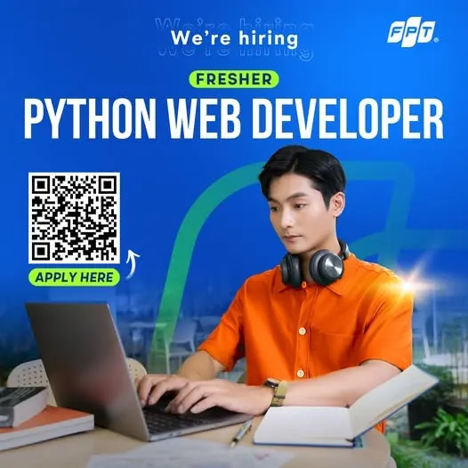

\[DSC Career Connect\]  
🚀\[FPT Software HCM\] Tuyển dụng Fresher Python Web Developer Bạn có bao giờ tự hỏi vì sao Python lại trở thành ngôn ngữ của thời đại Bạn có tò mò cách mà một dòng code nhỏ có thể tạo ra sản phẩm được hàng triệu người sử dụng Và quan trọng nhất, bạn đã sẵn sàng để bắt đầu hành trình đó – từ hôm nay chưa

<!--truncate-->

🎯Yêu cầu:  
🔹Sinh viên năm cuối hoặc mới tốt nghiệp các ngành CNTT, Kỹ thuật phần mềm hoặc liên quan.  
🔹Có kiến thức cơ bản về Python và lập trình hướng đối tượng.  
🔹Biết sử dụng Git, hiểu cơ bản về web development là lợi thế.  
🔹Có khả năng đọc hiểu tài liệu tiếng Anh; TOEIC 700+ hoặc tương đương 🔹 Có GPA từ 3.2/4.0 trở lên 🔹Làm việc Offline Fulltime từ Thứ 2 đến Thứ 6 ✊ Bạn sẽ được:  
🔹Sự nghiệp toàn cầu: cơ hội Onsite Mỹ, Nhật Bản, Hàn Quốc,...  
🔹Đào tạo chuyên sâu về công nghệ 🔹Tham gia dự án thực tế cùng các kỹ sư công nghệ giàu kinh nghiệm tại FPT 🔹Mentorship 1-1 từ các Senior Developer và Solution Architect 🔹Các chương trình phát triển chuyên môn, hỗ trợ thi chứng chỉ quốc tế, phát triển kỹ năng mềm 🔹Tham gia các hoạt động nội bộ đậm chấm FPT, phát triển chuyên môn  kỹ năng mềm 📩 CÁCH THỨC ỨNG TUYỂN: [https://forms.gle/vC7LkvsgFn6R1wEB6](https://forms.gle/vC7LkvsgFn6R1wEB6) 👉 Ứng tuyển ngay hôm nay để trở thành một phần của đội ngũ chuyên gia tại FPT!

---

_Bài viết được lưu trữ từ [fanpage HCMUTE Developer Student Club](https://www.facebook.com/hcmute.dsc)._
