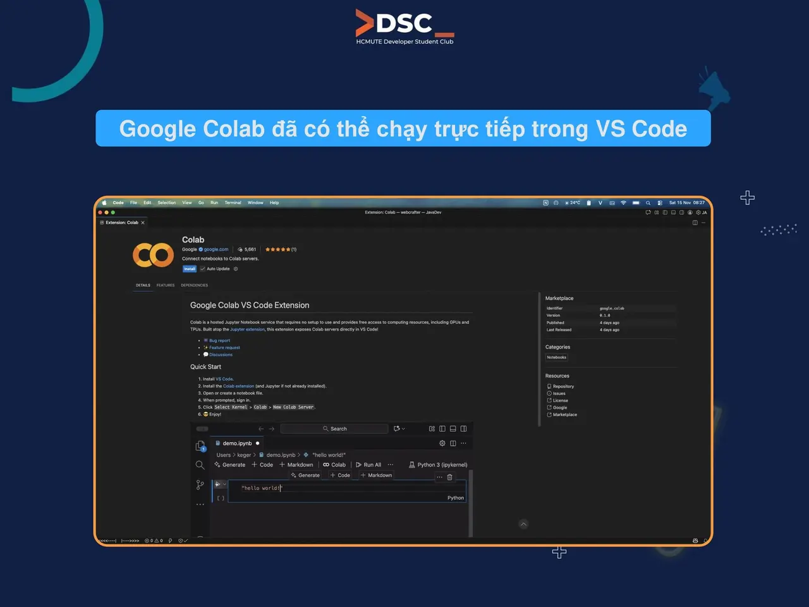

🎉 CẬP NHẬT: GOOGLE COLAB ĐÃ HẠ CÁNH TRỰC TIẾP TRÊN VS CODE! 🚀  
Tin vui cho cộng đồng đam mê Lập trình, Data Science và AI/ML! Cuối cùng, "bá chủ" notebook Google Colab đã có thể tích hợp thẳng vào "ngôi nhà chung" VS Code.

<!--truncate-->

Giờ đây, chúng ta có thể:  
☁️ Train model thuận tiện: Chạy các tác vụ ML/Training nặng đô trên GPU/TPU của Google Cloud ngay trong VS Code. Không cần phải chuyển qua lại trình duyệt!  
🤖 Sự kết hợp tuyệt vời: Thoải mái sử dụng các trợ lý AI yêu thích (như GitHub Copilot, Cursor, Cline,...) ngay trên file notebook Colab của mình.  
🏠 Giữ trọn môi trường quen thuộc: Vẫn là VS Code, vẫn là phím tắt quen thuộc, theme thuận mắt, nhưng nay có thêm sức mạnh phần cứng từ Colab.  
➡️ Đây chính là cập nhật cho phép chúng ta code thuận tiện hơn, train model nhanh hơn mà không cần thay đổi thói quen!  
👉 Còn chờ gì nữa, cài ngay extension "Google Colab" MỚI TOANH từ Google và trải nghiệm thôi!  
\#HCMUTE\_DSC #Developer\_Student\_Club #DSCNews

---

_Bài viết được lưu trữ từ [fanpage HCMUTE Developer Student Club](https://www.facebook.com/hcmute.dsc)._
