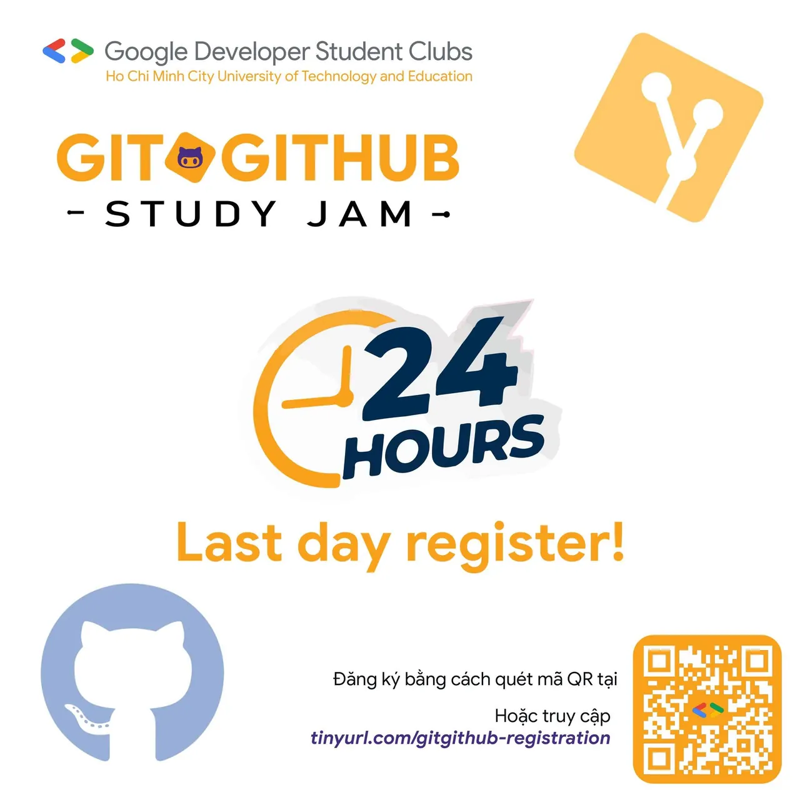
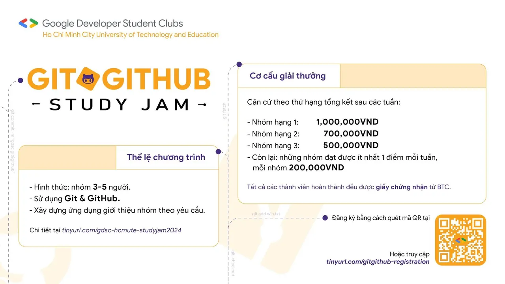

\[**ĐĂNG KÝ THAM GIA CHƯƠNG TRÌNH: “GIT & GITHUB STUDY JAM 2025”**\]  
💥HCMUTE-DSC chính thức mở form đăng ký cho chương trình “Git & GitHub Study Jam!💥 Chương trình \*“Git & GitHub Study Jam”\* đã chính thức khởi động dành cho những bạn muốn khám phá cách làm việc nhóm hiệu quả hơn thông qua Git và GitHub. Nếu bạn đang tìm một hoạt động vừa học vừa thực hành, có thử thách nhẹ nhàng và có bạn bè đồng hành thì đây là dịp rất hợp để bắt đầu.

<!--truncate-->

🌟 🔥 Nhanh tay đăng ký để giữ slot cho nhóm mình nhé!  
\_\_\_\_\_\_\_\_\_\_\_\_\_\_\_\_\_\_\_\_\_\_\_\_\_\_\_\_\_\_\_\_\_\_\_\_  
📌 Cách thức tham gia 🔗 Link đăng ký: [https://tinyurl.com/form-hcmute-dsc-studyjam2025](https://tinyurl.com/form-hcmute-dsc-studyjam2025) ⏳ Thời hạn đăng ký: **18/11/2025 – 21/11/2025** 🎓 Đối tượng: Thành viên HCMUTE-DSC 👥 Hình thức: Tham gia theo nhóm **2-3 người**, tối đa **10 nhóm **(Nếu chưa có nhóm, BTC sẽ hỗ trợ ghép nhóm)  
📌 **Nhiệm vụ chương trình:** – Sử dụng Git và GitHub – Xây dựng một ứng dụng đơn giản (web/desktop/mobile) để giới thiệu nhóm theo yêu cầu BTC 📄 Thể lệ chi tiết: [https://tinyurl.com/hcmute-dsc-studyjam2025](https://tinyurl.com/hcmute-dsc-studyjam2025)  
\_\_\_\_\_\_\_\_\_\_\_\_\_\_\_\_\_\_\_\_\_\_\_\_\_\_\_\_\_\_\_\_\_\_\_\_  
**👉 Quyền lợi** ✅ Thực hành Git & GitHub một cách bài bản nhưng dễ tiếp cận ✅ Làm quen với quy trình phối hợp nhóm và quản lý công việc ✅ Tăng kỹ năng quản lý thời gian, phân chia nhiệm vụ ✅ Nhận giấy chứng nhận khi hoàn thành chương trình  
\_\_\_\_\_\_\_\_\_\_\_\_\_\_\_\_\_\_\_\_\_\_\_\_\_\_\_\_\_\_\_\_\_\_\_\_  
🎁 Cơ cấu giải thưởng Tất cả thành viên hoàn thành chương trình đều nhận chứng nhận từ BTC. Xếp hạng theo kết quả các tuần nhiệm vụ:  
🥇 1 giải nhất: **500.000 VND** 🥈 1 giải nhì: **300.000 VND** 🥉 1 giải ba: **200.000 VND** 🏅 3 giải khuyến khích: mỗi thành viên trong nhóm sẽ nhận được** một món quà** từ ban tổ chức.  
👉Lưu ý: kết quả chỉ được chấp nhận với điều kiện các nhóm đạt được ít nhất 1 điểm mỗi tuần.

---

_Bài viết được lưu trữ từ [fanpage HCMUTE Developer Student Club](https://www.facebook.com/hcmute.dsc)._
