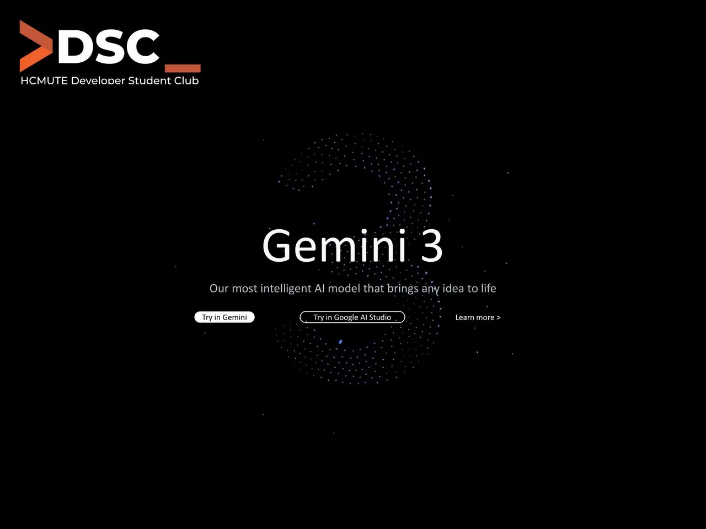

🎉 CẬP NHẬT: GEMINI 3 ĐÃ RA MẮT - Người dùng Việt Nam đã có thể trải nghiệm Gemini 3 trên Google AI Studio Google DeepMind vừa chính thức giới thiệu thế hệ trí tuệ nhân tạo mới nhất của mình, Gemini 3, và nó được định vị là mô hình thông minh nhất của Google, đánh dấu một bước nhảy vọt quan trọng trên con đường hướng tới Trí tuệ Nhân tạo Tổng quát (AGI). Gemini 3 Pro hiện đã ra mắt và đạt được các thành tích ấn tượng: • Khả năng Suy luận Đỉnh cao: Gemini 3 Pro dẫn đầu bảng xếp hạng uy tín LMArena với điểm số đột phá 1501 Elo. Nó cũng thể hiện khả năng suy luận cấp độ Tiến sĩ (PhD-level reasoning) với 37.5% điểm số tại bài kiểm tra "Humanity’s Last Exam" (mà không dùng công cụ) và 91.9% trên GPQA Diamond. • Hiểu Đa Phương thức Vô song: Đây là mô hình tốt nhất thế giới về khả năng hiểu đa phương thức (multimodal understanding), xử lý liền mạch thông tin qua nhiều dạng thức bao gồm văn bản, hình ảnh, video, âm thanh và mã (code). Khả năng này được chứng minh bằng điểm số cao trong các bài kiểm tra MMMU-Pro và Video-MMMU. • Xử lý Ngữ cảnh Lớn: Gemini 3 Pro có cửa sổ ngữ cảnh lên tới 1 triệu token, cho phép mô hình hiểu và suy luận trên các bộ dữ liệu khổng lồ như toàn bộ kho mã nguồn hoặc các tài liệu dài.  
--------------------------------------------------------------------------

<!--truncate-->

Cơ Hội cho Sinh Viên  Lập Trình Viên Gemini 3 được thiết kế để giúp bạn Học tập (Learn), Xây dựng (Build) và Lập kế hoạch (Plan) mọi thứ. 1. Học Tập Thông Minh:  
◦ Bạn có thể cung cấp cho Gemini 3 các tài liệu học thuật, video bài giảng dài, và nó sẽ tạo mã để tạo ra các công cụ tương tác như flashcards hoặc trực quan hóa dữ liệu phức tạp.  
◦ Trong thể thao, bạn có thể tải video trận đấu (ví dụ: Pickleball), và AI sẽ phân tích động tác chi tiết để đề xuất kế hoạch tập luyện cải thiện tổng thể. 2. Lập Trình Đột Phá (Agentic  Vibe Coding):  
◦ Gemini 3 Pro là mô hình "vibe coding" và agentic coding mạnh mẽ nhất từng được Google xây dựng, cho phép bạn dịch ý tưởng cấp cao thành một ứng dụng tương tác đầy đủ chỉ bằng một câu lệnh tự nhiên.  
◦ Mô hình này dẫn đầu bảng xếp hạng lập trình web WebDev Arena với 1487 Elo.  
◦ Google cũng giới thiệu nền tảng phát triển tác nhân mới Google Antigravity, nơi các tác nhân AI (AI agents) có thể tự động lập kế hoạch, viết mã và kiểm tra lỗi trên trình chỉnh sửa, terminal và trình duyệt. 3. Lập Kế Hoạch và Tác vụ Dài hạn:  
◦ Gemini 3 cải thiện khả năng lập kế hoạch dài hạn và sử dụng công cụ nhất quán, giúp thực hiện các quy trình làm việc phức tạp, nhiều bước, chẳng hạn như tổ chức hộp thư đến Gmail hoặc sắp xếp lịch trình. Thử nghiệm ngay: Cộng đồng người dùng Việt Nam hiện đã có thể trải nghiệm Gemini 3 Pro trong Google AI Studio.
  
\#Gemini3 #GoogleAI #AGI #VibeCoding #AIStudio #HCMUTE\_DSC #Developer\_Student\_Club #DSCNews

---

_Bài viết được lưu trữ từ [fanpage HCMUTE Developer Student Club](https://www.facebook.com/hcmute.dsc)._
