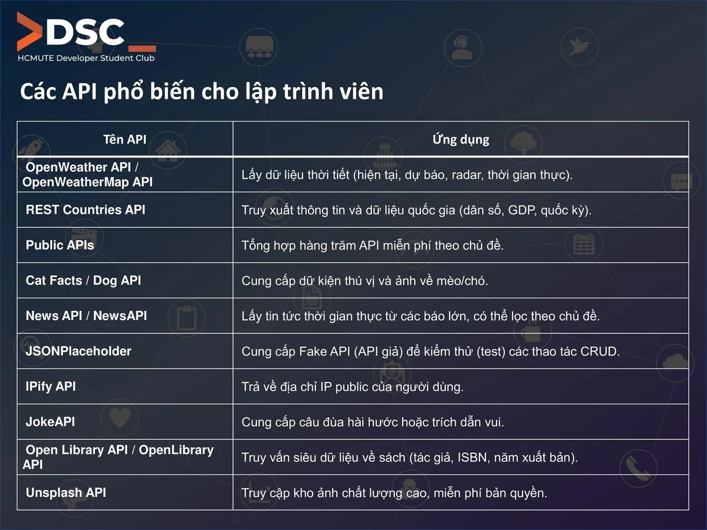
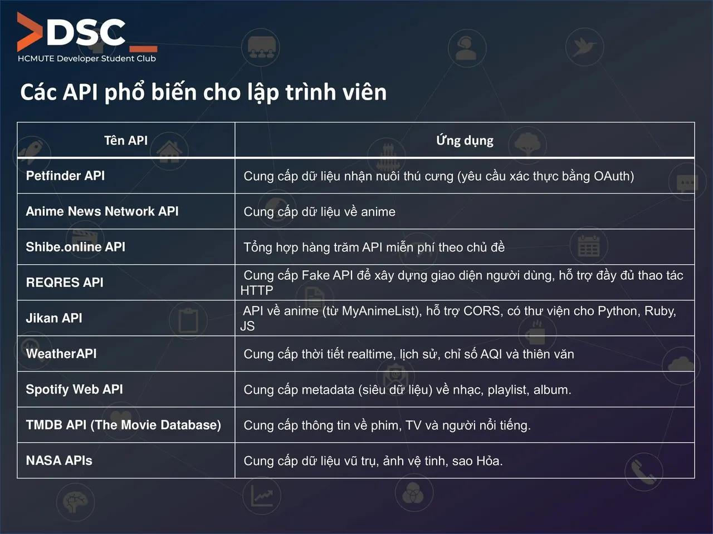

\[CHIA SẺ: KHÁM PHÁ THẾ GIỚI API - CÁNH CỬA MỞ RA KHÔNG GIỚI HẠN SÁNG TẠO!\] Chào các bạn đam mê công nghệ!  
🧐 Bạn có bao giờ tự hỏi làm thế nào các ứng dụng yêu thích của chúng ta lại có thể "nói chuyện" với nhau và lấy dữ liệu từ khắp mọi nơi không Câu trả lời chính là API (Application Programming Interface) – những "cây cầu" kết nối và mở ra kho tàng dữ liệu khổng lồ cho các nhà phát triển!

<!--truncate-->

😎 Hôm nay, HCM UTE Developer Student Club sẽ cùng các bạn khám phá một số API thú vị và cực kỳ hữu ích mà mọi lập trình viên (hoặc bất kỳ ai muốn tìm hiểu về phát triển ứng dụng) đều nên biết!  
💁‍♂️ Dưới đây là một vài cái tên nổi bật và ứng dụng của chúng:  
👉OpenWeather API / OpenWeatherMap API  WeatherAPI: Cung cấp thông tin để biết ngay thời tiết hiện tại, dự báo hay thậm chí cả chỉ số chất lượng không khí (AQI)! Tích hợp vào app của bạn để tạo ra tính năng dự báo thời tiết siêu tiện lợi. REST Countries API: Cần thông tin về một quốc gia nào đó Từ dân số, GDP đến quốc kỳ, API này sẽ cung cấp những thông tin cần thiết!  
👉 News API / NewsAPI: Luôn cập nhật tin tức nóng hổi từ các báo lớn, lọc theo chủ đề bạn quan tâm. Xây dựng một ứng dụng đọc báo cá nhân chưa bao giờ dễ đến thế!  
👉 Cat Facts / Dog API: Thư giãn với những "fact" hài hước và hình ảnh đáng yêu của mèo/chó. Thích hợp để tạo các tính năng giải trí vui nhộn!  
👉 Open Library API / OpenLibrary API: Kho tàng thông tin về sách, tác giả, ISBN. Tuyệt vời cho các dự án quản lý thư viện hoặc ứng dụng gợi ý sách.  
👉 Unsplash API: Truy cập kho ảnh chất lượng cao, miễn phí bản quyền để làm đẹp cho mọi dự án của bạn.  
👉 Spotify Web API: Lấy siêu dữ liệu nhạc, playlist, album để tạo ra các ứng dụng nghe nhạc, phân tích âm nhạc độc đáo.  
👉 TMDB API (The Movie Database): Nguồn thông tin khổng lồ về phim, TV show và người nổi tiếng. Xây dựng ứng dụng quản lý phim yêu thích của bạn!  
👉 NASA APIs: Khám phá vũ trụ với dữ liệu ảnh vệ tinh, thông tin về hành tinh của NASA. Mang cả dải ngân hà vào ứng dụng của bạn! Và còn rất nhiều API khác như Public APIs, Shibe.online API (tổng hợp hàng trăm API miễn phí theo chủ đề), JSONPlaceholder  REQRES API (Fake API để test và xây dựng giao diện người dùng), IPify API (lấy địa chỉ IP), JokeAPI (câu đùa), Petfinder API (nhận nuôi thú cưng), hay Anime News Network API  Jikan API (dữ liệu về anime)!  
🤩 Bạn đã sẵn sàng để thử nghiệm và tạo ra những dự án công nghệ của riêng mình chưa Hãy comment phía dưới API nào khiến bạn hứng thú nhất nhé!
  
\#HCMUTE\_DSC #Developer\_Student\_Club #DSCShare

---

_Bài viết được lưu trữ từ [fanpage HCMUTE Developer Student Club](https://www.facebook.com/hcmute.dsc)._
