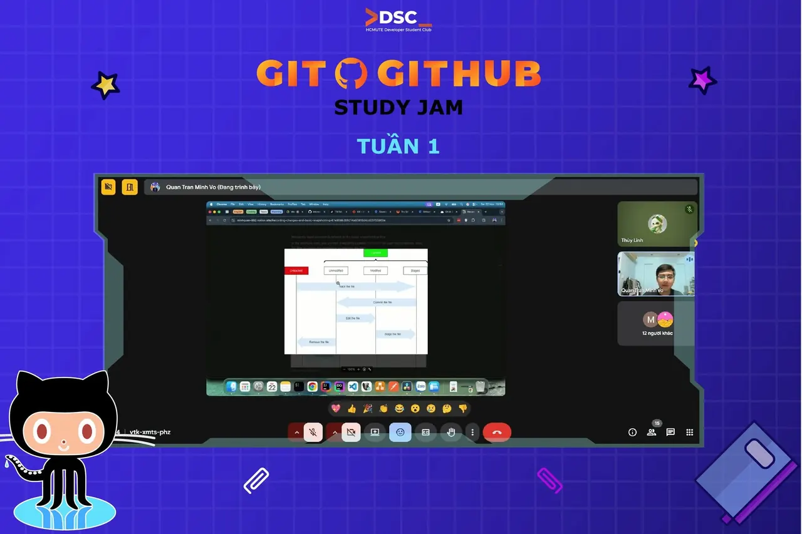

\[RECAP TUẦN 1 | GIT  GITHUB STUDY JAM 2025 – HCMUTE DSC\] HCMUTE-DSC đã có buổi sinh hoạt mở màn cho Git  GitHub Study Jam 2025 dành riêng cho thành viên câu lạc bộ. Đây là dịp để mọi người gặp gỡ, làm quen và khởi động một mùa Study Jam mới đầy năng lượng.  
💙 Mặc dù chương trình được tổ chức nội bộ, DSC vẫn muốn chia sẻ lại tài liệu của buổi đầu để những bạn quan tâm bên ngoài có thể tự học và tiếp cận Git/GitHub một cách dễ dàng hơn.

<!--truncate-->

👉 Tài liệu buổi sinh hoạt đầu: [https://minhquan-992.notion.site/Git-GitHub-Series-e6e1f187a5ab4f9797a2c4b10678c235](https://minhquan-992.notion.site/Git-GitHub-Series-e6e1f187a5ab4f9797a2c4b10678c235) 🎉 Tài liệu được biên soạn bởi anh Võ Trần Minh Quân. DSC xin gửi lời cảm ơn đến anh Quân vì sự hỗ trợ và chuẩn bị nội dung vô cùng tâm huyết, giúp buổi sinh hoạt diễn ra trọn vẹn và hiệu quả hơn. Hy vọng tài liệu sẽ mang lại giá trị cho những bạn đang muốn bắt đầu với Git  GitHub. Cảm ơn mọi người đã luôn theo dõi và đồng hành cùng các hoạt động của DSC!  
🌟  
\_\_\_\_\_\_\_\_\_\_\_\_\_\_\_\_\_\_\_\_\_\_\_\_\_\_\_\_\_\_\_\_\_\_\_
  
\#DSC #HCMUTEDeveloperStudentClubs #HCMUTE\_DSC #STUDY\_JAM #GIT\_GITHUB

---

_Bài viết được lưu trữ từ [fanpage HCMUTE Developer Student Club](https://www.facebook.com/hcmute.dsc)._
