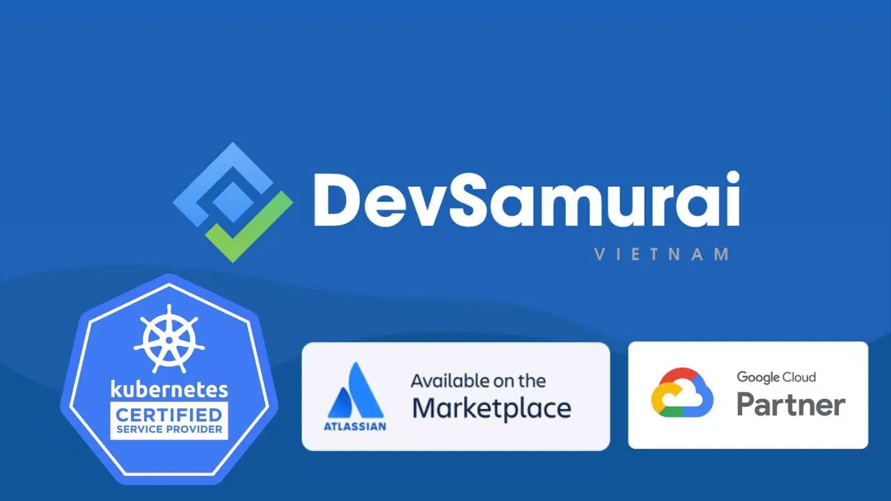

\[DSC CAREER CONNECT\]
  
DEVSAMURAI VIETNAM | WE’RE HIRING – WEB APP DEVELOPER INTERN

<!--truncate-->

📍📍📍DevSamurai Vietnam is seeking 4 Web App Interns to join our dynamic team in Tan Binh, HCMC.
  
📝📝 Requirements:
  
🔷 4th-year students majoring in Computer Science, IT, or related fields
  
🔷 Knowledge of ReactJS, NodeJS, CSS
  
🔷 Ability to research and learn independently
  
🔷 Good English communication skills
  
👉👉 Benefits:
  
✅ Monthly allowance: 3–5 million VND
  
✅ MacBook provided for work
  
✅ Working hours: Monday to Friday, 9 AM – 6 PM
  
✅ Minimum 3-month internship
  
✅ Opportunity to become a full-time employee
  
 📩📩 Apply now!
  
📧 Email: tham.tran@devsamurai.com
  
📞 Phone/Zalo
  
\#hcmute\_dsc #developer\_student\_club #dsc\_career\_connect

---

_Bài viết được lưu trữ từ [fanpage HCMUTE Developer Student Club](https://www.facebook.com/hcmute.dsc)._
