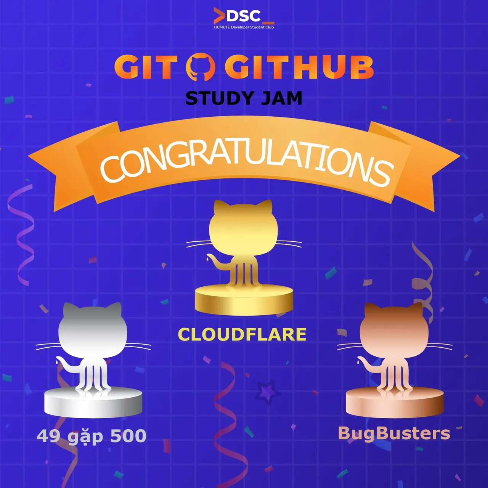

\[TỔNG KẾT | GIT  GITHUB STUDY JAM 2025 – HCMUTE DSC\] Sau hành trình học tập, thực hành và làm việc nhóm đầy năng lượng, Git  GitHub Study Jam 2025 đã chính thức khép lại. HCMUTE-DSC xin chúc mừng các đội đã đạt thành tích xuất sắc trong chương trình!  
🔥✨ 🎖🎖 Danh sách các đội đạt giải:

<!--truncate-->

🥇 Giải Nhất: CLOUDFLARE 👥 Thành viên: – Phan Nhật Đăng Khoa – Huỳnh Cao Trung Đức 🥈 Giải Nhì: 49 gặp 500 👥 Thành viên: – Trần Anh Hào – Võ Hoàng Tú – Huỳnh Thị Thùy Trang 🥉 Giải Ba: BugBusters 👥 Thành viên: – Nguyễn Chiến – Huỳnh Nguyễn Tấn Đạt Mỗi đội đều đã thể hiện tinh thần học hỏi nghiêm túc, teamwork hiệu quả và sự tiến bộ rõ rệt qua từng tuần nhiệm vụ. Xin chúc mừng tất cả các bạn!  
💙👏 ✨ HCMUTE-DSC xin gửi lời cảm ơn chân thành đến anh Võ Trần Minh Quân – diễn giả đồng hành và cũng là nhà tài trợ chính của chương trình. Cảm ơn anh vì những chia sẻ thực tế, sự hỗ trợ quý giá và nguồn động lực tích cực dành cho các bạn sinh viên.  
🙌🌟 Một lần nữa, chúc mừng các đội đạt giải và cảm ơn tất cả các bạn đã tham gia, đồng hành cùng DSC. Hẹn gặp lại mọi người trong những hoạt động tiếp theo nhé!  
🚀💙  
\_\_\_\_\_\_\_\_\_\_\_\_\_\_\_\_\_\_\_\_\_\_\_\_\_\_\_\_\_\_\_\_\_\_\_
  
\#DSC #HCMUTEDeveloperStudentClubs #HCMUTE\_DSC #STUDY\_JAM #GIT\_GITHUB

---

_Bài viết được lưu trữ từ [fanpage HCMUTE Developer Student Club](https://www.facebook.com/hcmute.dsc)._
