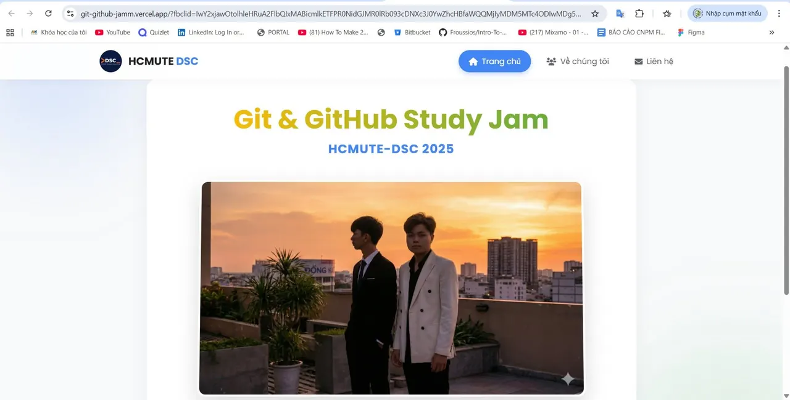

\[FLEX THÀNH PHẨM | GIT  GITHUB STUDY JAM 2025 – HCMUTE DSC\] Mở đầu chuỗi chia sẻ thành phẩm từ Git  GitHub Study Jam 2025 là đội đạt 🥇 Giải Nhất – CLOUDFLARE. Đây là đội để lại ấn tượng tốt nhờ cách triển khai bài bản, hoàn thành sản phẩm đúng yêu cầu và đặc biệt là tiến độ thực hiện rất tốt ngay từ những tuần đầu.  
🔥 💻 Sản phẩm: [https://git-github-jamm.vercel.app/](https://git-github-jamm.vercel.app/) Thành phẩm của đội mang cảm giác chỉn chu, rõ ràng và hoàn thiện. Việc làm đúng, làm nhanh và liên tục cải thiện qua từng giai đoạn là yếu tố giúp đội giữ phong độ ổn định và đạt vị trí cao nhất.

<!--truncate-->

👏✨ 👥 Thành viên đội: – Phan Nhật Đăng Khoa – Huỳnh Cao Trung Đức  
\_\_\_\_\_\_\_\_\_\_\_\_\_\_\_\_\_\_\_\_\_\_\_\_\_\_\_\_\_\_\_\_\_\_\_
  
\#DSC #HCMUTEDeveloperStudentClubs #HCMUTE\_DSC #STUDY\_JAM #GIT\_GITHUB

---

_Bài viết được lưu trữ từ [fanpage HCMUTE Developer Student Club](https://www.facebook.com/hcmute.dsc)._
