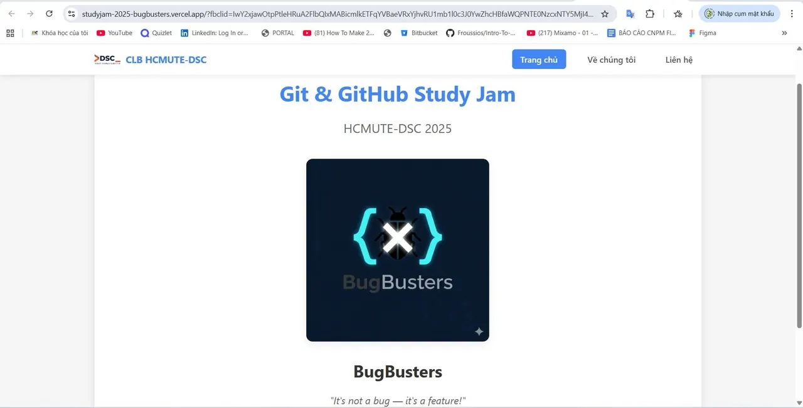
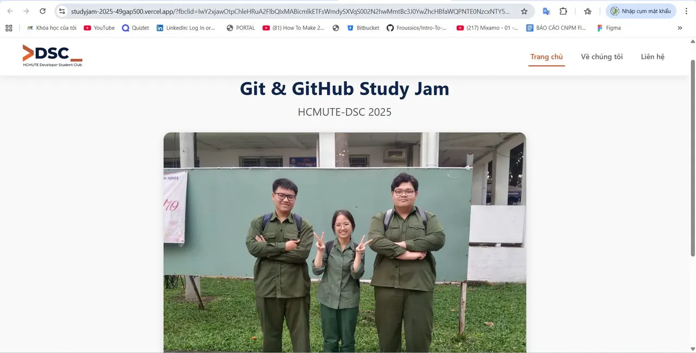

\[FLEX THÀNH PHẨM | GIT  GITHUB STUDY JAM 2025 – HCMUTE DSC\] Khép lại chuỗi flex là 🥉 Giải Ba – BugBusters, đội đã hoàn thành sản phẩm đúng định hướng và thể hiện tinh thần học tập nghiêm túc trong suốt quá trình tham gia.  
🌟 💻 Sản phẩm: [https://studyjam-2025-bugbusters.vercel.app/](https://studyjam-2025-bugbusters.vercel.app/) Thành phẩm của đội đáp ứng tốt yêu cầu chương trình, bố cục rõ ràng và dễ theo dõi. Đội cho thấy sự cố gắng và tiến bộ qua từng giai đoạn, từ khâu triển khai ban đầu đến khi hoàn thiện sản phẩm cuối cùng. Đây là một kết quả xứng đáng, ghi nhận nỗ lực của đội trong hành trình trải nghiệm và học tập cùng Study Jam 2025.

<!--truncate-->

👏✨ 👥 Thành viên: – Nguyễn Chiến – Huỳnh Nguyễn Tấn Đạt  
\_\_\_\_\_\_\_\_\_\_\_\_\_\_\_\_\_\_\_\_\_\_\_\_\_\_\_\_\_\_\_\_\_\_\_
  
\#DSC #HCMUTEDeveloperStudentClubs #HCMUTE\_DSC #STUDY\_JAM #GIT\_GITHUB

---

_Bài viết được lưu trữ từ [fanpage HCMUTE Developer Student Club](https://www.facebook.com/hcmute.dsc)._
